# Plan de securización de Cervecera El Bastión, S.L.

**Bastionado de redes y sistemas (5022) · UD1 · Proyecto final** · Entregables 2 a 5 · Variante: bar de degustación (taproom) en la nave

**Equipo:** BST-G2 (Equipo 2) · **Miembros:** Luis Fernando Arrosquipa Mamani · Marcos Olmo García · **Fecha:** 20/11/2026

## Índice

1. [Punto de partida y análisis de riesgos (R8)](#1-punto-de-partida-el-bastión-el-bar-y-el-análisis-de-riesgos)
2. [Entregable 2 · Evaluación de las medidas actuales](#2-entregable-2--evaluación-de-las-medidas-actuales-ce-b)
3. [Entregable 3 · Plan de medidas priorizado](#3-entregable-3--plan-de-medidas-priorizado-ce-d-y-e)
4. [Entregable 4 · Marco de referencia](#4-entregable-4--marco-de-referencia-ce-f)
5. [Entregable 5 · Protocolo de incidencias](#5-entregable-5--protocolo-de-incidencias-con-matriz-de-escalado-ce-f)
6. Anexos: A · Capturas · B · Test del recién llegado · C · Indicadores y fichas · D · Declaración de autoría

---

## 1. Punto de partida: El Bastión, el bar y el análisis de riesgos

### 1.1 La novedad de nuestro equipo: el bar de degustación

El Bastión abre un bar de degustación en la propia nave, de jueves a domingo hasta las 23:00. Para ello instala un **TPV con datáfono** conectado a la red de la empresa, una **wifi gratuita para clientes** y **dos pantallas** con la carta. Atienden camareros de fin de semana que comparten un único usuario del TPV.

Esto cambia el análisis por dos motivos. Primero, aparecen datos de tarjetas de pago, que obligan a cumplir PCI DSS v4.0.1. Segundo, por primera vez entra en la red gente que no trabaja en la empresa, y en horario en el que no hay nadie de informática.

### 1.2 Análisis de riesgos (entregable 1, resumido)

El plan parte de este análisis. La probabilidad y el impacto van de 1 a 5, y el riesgo es P × I (crítico 15-25, alto 10-14, medio 5-9, bajo 1-4), como en la diapositiva 17. Los riesgos R1 a R7 son los de la diapositiva 18. El R8 es el riesgo nuevo que trae el bar, valorado con el mismo método MAGERIT que usamos en la primera parte.

| ID | Activo | Escenario de amenaza (código MAGERIT) | Vulnerabilidad | P | I | Riesgo |
|---|---|---|---|---|---|---|
| R1 | NAS de copias | Un ransomware cifra también las copias [A.8] | NAS en la red plana, sin copia externa | 4 | 5 | 20 · Crítico |
| R2 | SRV-WIN | Acceso con credenciales robadas [A.5] [A.11] | Administrador compartido, sin MFA | 4 | 5 | 20 · Crítico |
| R3 | Sensores IoT | Toma de control y salto a la red interna [A.11] | Contraseña de fábrica, sin segmentar | 3 | 4 | 12 · Alto |
| R4 | Tienda online | Explotación de una vulnerabilidad conocida [E.20] [A.11] | No hay política de parches | 3 | 5 | 15 · Crítico |
| R5 | Recetas | Fuga de información por un empleado [A.19] [A.6] | Carpeta con «Todos: control total» | 2 | 5 | 10 · Alto |
| R6 | Armario de servidores | Corte eléctrico [I.6] | Sin SAI | 2 | 3 | 6 · Medio |
| R7 | Tienda online | Denegación de servicio [A.24] | Alojada en una sola línea | 2 | 4 | 8 · Medio |
| R8 | TPV y datáfono del bar, wifi de clientes | Robo de datos de tarjetas o acceso a la red interna [A.11] [A.19] | TPV conectado a la red de la empresa; los camareros comparten un usuario del TPV | 4 | 5 | 20 · Crítico |

**Ajustes a R1-R7:** mantenemos las valoraciones de la diapositiva 18. El bar no cambia la probabilidad ni el impacto de esos riesgos por separado, pero sí abre un camino nuevo hacia R1 y R2 (de la wifi o el TPV a la red interna). Por eso las medidas del R8 también protegen a R1 y R2.

### 1.3 El R8 paso a paso con MAGERIT

| Paso | Resultado para el R8 | Justificación |
|---|---|---|
| Activos | [HW] TPV del bar · [HW] [peripheral] datáfono · [COM] [wifi] wifi de clientes · [HW] pantallas de la carta · [D] [per] datos de las tarjetas de los clientes | Tipos del Libro II, apartado 2. El activo esencial es el dato de tarjeta: los equipos le dan soporte y heredan su valor. |
| Valoración (D, I, C, A, T) | D: M · I: A · C: MA · A: A · T: A | Si el TPV cae, se puede cobrar en efectivo (D medio). Una fuga de tarjetas es lo peor que le puede pasar al bar (C muy alto). Con un usuario compartido no se sabe quién cobró qué (A y T altos). |
| Amenazas (Libro II) | [A.11] Acceso no autorizado · [A.19] Revelación de información | Alguien entra al TPV o a la red desde la wifi (A.11) y se lleva datos de tarjetas (A.19). |
| Dimensiones afectadas | C, I y A | Confidencialidad de las tarjetas, integridad del TPV (programa malicioso) y autenticidad de quién lo usa. |
| Degradación | C: 100 % · I: 10 % · A: 100 % | Una vez copiados los datos de tarjeta, la pérdida de confidencialidad es total. |
| Probabilidad | A (mensual) → 4 | Wifi abierta a cualquier cliente cuatro días por semana, TPV en la red plana y sin nadie de informática por la noche. |
| Impacto | MA → 5 | Valor MA × degradación 100 % = impacto MA (tabla del paso 4 de la primera parte). Implica banco, AEPD, PCI DSS y reputación. |
| Riesgo | 4 × 5 = 20 · Crítico | Empata con R1 y R2 en lo más alto de la matriz. |

#### Matriz de riesgos de El Bastión (con el R8)

|  | I = 1 | I = 2 | I = 3 | I = 4 | I = 5 |
|---|---|---|---|---|---|
| P = 5 |  |  |  |  |  |
| P = 4 |  |  |  |  | R1 R2 R8 |
| P = 3 |  |  |  | R3 | R4 |
| P = 2 |  |  | R6 | R7 | R5 |
| P = 1 |  |  |  |  |  |

### 1.4 Salvaguardas que existen hoy

En la primera parte solo indicamos la madurez. Aquí decimos también qué hay de verdad, según la diapositiva 18 y lo que medimos en el laboratorio (apartado 2).

| Riesgo | Qué existe hoy | Madurez |
|---|---|---|
| R1 | Copias en el NAS, montado en la misma red. No hay copia fuera de la red ni prueba de restauración. | L1 |
| R2 | Contraseña de administrador, compartida entre varias personas. Sin MFA. Bloqueo de cuenta a los 6 intentos durante 25 minutos, pero contraseñas de solo 7 caracteres (E-09). | L1 |
| R3 | Los sensores funcionan con la contraseña de fábrica y comparten red con todo lo demás. | L0 |
| R4 | Actualizaciones automáticas activadas, pero con 121 paquetes pendientes y sin revisión (E-05). | L1 |
| R5 | Carpeta de recetas con «Todos: control total». No hay registro de quién la abre. | L0 |
| R6 | Ninguna: no hay SAI en el armario. | L0 |
| R7 | Una sola línea de Internet. No hay protección contratada frente a denegación de servicio. | L0 |
| R8 | Datáfono proporcionado por el banco; con M05 se exigirá que esté certificado PCI PTS. El TPV y la wifi están en la red de la empresa y el usuario del TPV es compartido. | L1 |

Madurez: L0 inexistente · L1 inicial · L2 repetible · L3 definido · L4 gestionado · L5 optimizado.

## 2. Entregable 2 · Evaluación de las medidas actuales (CE b)

Aquí solo describimos cómo están hoy los servidores. Las mejoras van en el entregable 3. Evaluamos los dos servidores del laboratorio con siete controles en cada uno: SRV-UBU (Ubuntu Server 26, nombre de equipo fernandosrvubu) y SRV-WIN (Windows Server 2025, nombre de equipo SRV-DC01). SRV-WIN es además el controlador de dominio de Active Directory, lo que sube el valor de todo lo que le afecte.

### 2.1 Método

1. **Leer lo documentado:** diapositivas 8 y 18 y nuestro enunciado.
2. **Preparar el laboratorio:** instantánea «base limpia» y marcas del equipo (usuario auditor-g2, banner con BST-G2-M3RA y aviso legal en SRV-WIN). Captura de las marcas: E-00 en el Anexo A.
3. **Medir con herramientas:** comandos de auditoría, Lynis en SRV-UBU y OSConfig en SRV-WIN.
4. **Comparar con una referencia:** CIS Benchmark nivel 1 de cada sistema y CIS Controls v8.1.
5. **Interpretar y puntuar:** qué significa cada resultado para El Bastión, madurez L0-L5 y riesgo relacionado.
Dos ajustes del laboratorio que conviene saber al leer las capturas: para que SRV-UBU estuviera en la misma red que SRV-WIN y el equipo de administración, le añadimos una segunda tarjeta en la red interna (10.10.10.10), después de E-01; y la carpeta Recetas de E-13 la creamos para reproducir el escenario del R5 de la diapositiva 18.

> **Formato de cada captura**
>
> En la misma pantalla: el comando, su resultado y la línea de identificación.
>
> SRV-UBU: hostname; date; whoami; echo BST-G2-M3RA
>
> SRV-WIN: hostname; Get-Date; whoami; echo BST-G2-M3RA
>
> Todas las capturas están en el Anexo A, numeradas igual que en la tabla.

### 2.2 Tabla de evidencias e interpretación

En la tabla se resume la herramienta usada; el comando completo, con la línea de identificación, está junto a cada captura en el Anexo A.

| Ev. | Control y referencia | Sistema · comando | Resultado | Interpretación propia | Mad. | Riesgo |
|---|---|---|---|---|---|---|
| E-01 | Mínima exposición de servicios · CIS Control 4.8 | SRV-UBU · ss -tulpn | 22/tcp (sshd) en 0.0.0.0 y [::] · 80 y 443/tcp (apache2) en todas las interfaces · 53 (systemd-resolved) y 323/udp (chronyd) solo en localhost · 68/udp (DHCP) en 192.168.210.38 | SSH escucha en todas las interfaces, así que cualquier equipo de la red plana puede intentar entrar, incluida hoy la wifi del bar. Apache publica la web por 80 y 443 (la de la tienda online). El DNS local y la sincronización horaria solo atienden en localhost, y no hay ninguna base de datos expuesta. El problema no es un servicio de más, sino desde dónde se ve SSH: debe limitarse a la red de administración (IT-BST-01). | L1 | R2 R4 R8 |
| E-02 | Cortafuegos de host · CIS Ubuntu (ufw) | SRV-UBU · ufw status verbose | Antes: Status: inactive<br>Después (E-02b, E-02c): activo; SSH solo desde 10.10.10.100; desde Fermentador (10.10.10.30) el 22 falla y el 443 responde | El cortafuegos del servidor estaba desactivado. SRV-UBU acepta conexiones a SSH, 80 y 443 (E-01) desde cualquier equipo de la red, incluida hoy la wifi del bar. Se corrige con la instrucción IT-BST-01 (apartado 4.6). | L0 | R4 R8 |
| E-03 | Acceso SSH · CIS Ubuntu (SSH) | SRV-UBU · sshd -T | Antes: maxauthtries 6 · permitrootlogin prohibit-password · passwordauthentication yes<br>Después (E-03b): maxauthtries 4 · permitrootlogin no | Root no puede entrar con contraseña, pero sí con clave. El resto de usuarios entra con contraseña y tiene 6 intentos por conexión. Como SSH escucha en toda la red (E-01), queda expuesto a fuerza bruta. Objetivo: MaxAuthTries 4 y PermitRootLogin no. | L1 | R2 R4 |
| E-04 | Calidad de contraseñas · CIS Ubuntu (pwquality) | SRV-UBU · pwquality.conf y dpkg | Antes: libpam-pwquality 1.4.5 instalado, sin línea minlen activa<br>Después (E-04b): minlen = 16 | El módulo está instalado pero sin configurar, así que se aplica su mínimo por defecto de 8 caracteres, la mitad de los 16 que fija el enunciado. Es una mejora rápida: solo hay que editar un fichero. | L1 | R2 |
| E-05 | Gestión de parches · CIS Control 7 | SRV-UBU · apt list --upgradable | 121 paquetes pendientes · unattended-upgrades: enabled | Las actualizaciones automáticas están activadas, pero hay 121 paquetes pendientes. O solo instalan los de seguridad (configuración por defecto) o no se están ejecutando, y nadie lo revisa. Confirma el R4: no hay ciclo de parches. | L1 | R4 |
| E-06 | Cuentas con privilegios · CIS Control 5.4 | SRV-UBU · grupo sudo y UID 0 | Grupo sudo: ciberseguridad · UID 0: solo root | Hay una sola cuenta con sudo y ninguna cuenta extra con UID 0, lo cual está bien. Pero esa cuenta tiene un nombre genérico: si la usan varias personas, no se sabe quién hizo cada cambio, el mismo problema que el R2. | L2 | R2 |
| E-07 | Bastionado global · Lynis 3.1.6 | SRV-UBU · lynis audit system | Antes: 59 · Después (E-07b): 63 | 59 sobre 100 es un servidor sin bastionar: Lynis resume en una cifra lo que muestran E-02 a E-06. Las victorias rápidas (ufw, SSH y contraseñas) lo suben 4 puntos; el informe «después» terminó a las 10:44:50 UTC, con ufw ya activo. Es menos de los 10 puntos que nos habíamos marcado. Lo que más pesa en lo que queda son los 121 paquetes pendientes (E-05) y el resto del bastionado CIS, que van en la medida M04 (60 días). | L1 → L2 | Todos |
| E-08 | Perfiles del cortafuegos · CIS Windows (Firewall) | SRV-WIN · Get-NetFirewallProfile | Domain: True · Allow<br>Private: True · NotConfigured<br>Public: True · NotConfigured | Los tres perfiles están activos, pero el de dominio, que es el que usa un controlador de dominio en la red de la empresa, deja entrar todo por defecto. En la práctica el cortafuegos está encendido pero no filtra nada: desde el TPV o la wifi del bar se llega a cualquier servicio de SRV-WIN. Private y Public sí bloquean por defecto, pero aquí no se usan. | L1 | R2 R8 |
| E-09 | Contraseñas y bloqueo · CIS Windows (Account Policies) | SRV-WIN · net accounts | Antes: longitud mínima 7 · vigencia 42 días · historial 24 · bloqueo 6 intentos, 25 min<br>Tras la línea base: bloqueo 3 intentos, 15 min (E-09b-1)<br>Después (E-09b): bloqueo 6 intentos, 25 min · longitud mínima 7 | En la primera medición el bloqueo ya tenía los valores del enunciado. Al aplicar la línea base de OSConfig, esta impuso los suyos (3 intentos y 15 minutos), y volvimos a fijar los del enunciado. Lo que no cambia es la longitud mínima: en un controlador de dominio la marca la directiva del dominio y OSConfig no la toca. Siete caracteres es la mitad de lo recomendado; se corrige con la medida M03. | L2 | R2 |
| E-10 | Cuentas de administración · CIS Control 5 | SRV-WIN · Get-LocalUser y Get-ADGroupMember | Cuentas activas: Administrador, ciso, auditor-g2 · Invitado y krbtgt desactivadas<br>Administradores: Admins. del dominio, Administradores de empresas, Administrador · Admins. del dominio: solo Administrador | La única persona con privilegios de administración es la cuenta integrada «Administrador», y es con la que se trabaja a diario (whoami en todas las capturas). No hay cuentas nominales de administración: si la comparten varias personas, no se sabe quién hizo cada cambio y, si alguien roba esa contraseña, controla todo el dominio. Es exactamente el R2. | L1 | R2 |
| E-11 | Auditoría de inicios de sesión · CIS Control 8 | SRV-WIN · auditpol (inicio de sesión) | Inicio de sesión: aciertos y errores | Los inicios de sesión, buenos y fallidos, quedan registrados, que es lo que pide la línea base. Lo que falta es que alguien lo revise: los eventos se quedan en el visor del propio servidor y nadie recibe un aviso si alguien prueba contraseñas desde el bar (M09). | L2 | R2 R8 |
| E-12 | Configuración de SMB · línea base Microsoft | SRV-WIN · Get-SmbServerConfiguration | EnableSMB1Protocol: False · RequireSecuritySignature: True · EncryptData: False | Está bien configurado: SMBv1, la vía clásica de propagación de ransomware, está desactivado y la firma es obligatoria, así que no se puede manipular el tráfico de ficheros. El cifrado no se exige, por lo que el contenido viaja en claro por la red plana; con la segmentación (M02) deja de ser un problema. | L3 | R1 |
| E-13 | Permisos de datos sensibles · CIS Control 3.3 | SRV-WIN · Get-SmbShareAccess y Get-Acl | Recurso compartido: Todos · Allow · Full<br>NTFS: Todos · FullControl (además de Administradores, SYSTEM y Usuarios) | Carpeta creada en el laboratorio para reproducir el escenario del R5 de la diapositiva 18. Tanto el recurso compartido como los permisos NTFS dan control total a «Todos»: cualquier usuario del dominio puede leer, copiar, cambiar o borrar las recetas, que son el principal secreto de la cervecera. | L0 | R5 |
| E-14 | Línea base de seguridad · OSConfig (Windows Server 2025, controlador de dominio) | SRV-WIN · Get-OSConfigDesiredConfiguration | Antes: 347 reglas · 31 % de cumplimiento<br>Después (E-14b): 347 reglas · 100 % | Antes de aplicarla, el servidor solo cumplía una de cada tres reglas de la línea base de Microsoft para controladores de dominio. Al aplicarla se procesaron 345 ajustes y el cumplimiento llegó al 100 %. Excepción documentada: no se reinició, porque la línea base activa la seguridad basada en virtualización y VirtualBox no arranca con ella; los ajustes quedan escritos, pero los que dependen del reinicio no se han podido probar en el laboratorio. | L1 | Todos |

Los ajustes aplicados después (MaxAuthTries 4, minlen 16, ufw, OSConfig y bloqueo de 6 intentos y 25 minutos) y sus comandos están al principio del Anexo A, junto a las capturas «después» (letra b).

### 2.3 Resumen de madurez por función (NIST CSF 2.0)

| Función | Hoy | Por qué | Objetivo a 6 meses |
|---|---|---|---|
| Gobernar (GV) | L1 | No hay política de seguridad aprobada ni nadie responsable del bar fuera del horario de oficina. | L3 |
| Identificar (ID) | L1 | El inventario no incluía el TPV, la wifi de clientes ni las pantallas hasta este análisis. | L3 |
| Proteger (PR) | L1 | E-02, E-03, E-04, E-09, E-10 y E-13: sin cortafuegos de host, contraseñas débiles, administrador compartido y permisos abiertos. | L3 |
| Detectar (DE) | L1 | E-11: los inicios de sesión se auditan, pero nadie revisa los registros ni recibe avisos. | L2 |
| Responder (RS) | L1 | No hay protocolo escrito. En el bar nadie sabría a quién llamar un sábado por la noche. | L3 |
| Recuperar (RC) | L1 | Hay copias en el NAS, pero en la misma red y sin pruebas de restauración. | L3 |

## 3. Entregable 3 · Plan de medidas priorizado (CE d y e)

Cada medida sale de un riesgo del apartado 1 y, cuando la hay, de una evidencia del apartado 2. Proponemos 10 medidas (el mínimo para un equipo de dos es 6), y tres de ellas tratan el R8.

### 3.1 Catálogo de medidas

| ID | Medida técnica | Riesgo · evidencia | Tipo | Responsable | Plazo | Coste año 1 |
|---|---|---|---|---|---|---|
| M01 | Copias 3-2-1: copia diaria a un PC retirado que solo se conecta durante la copia, más una copia inmutable en la nube. Prueba de restauración cada mes. | R1 · E-12 | Preventiva y de recuperación | Responsable de informática | 30 d | 1.200 € |
| M02 | Segmentar la red en VLAN (servidores, oficina, sensores, TPV del bar, wifi de clientes y gestión) con un cortafuegos entre ellas. La wifi de clientes solo sale a Internet. | R1 R3 R8 · E-01 E-08 | Preventiva | Proveedor TIC | 60 d | 2.200 € |
| M03 | Cuentas nominales de administración, desactivar el administrador compartido, Windows LAPS, MFA en los accesos de administración y contraseñas de al menos 14 caracteres en la directiva del dominio (el bloqueo de 6 intentos y 25 minutos ya existe). | R2 · E-09 E-10 | Preventiva | Responsable de informática | 30 d | 400 € |
| M04 | Parcheo mensual y bastionado CIS nivel 1 de SRV-UBU y SRV-WIN (ufw, SSH, contraseñas, OSConfig) y cortafuegos de aplicaciones web (ModSecurity con OWASP CRS) delante de la tienda. | R4 R2 · E-02 a E-07, E-14 | Preventiva | Responsable de informática | 30 d · WAF 60 d | 0 € |
| M05 | Bar seguro: datáfono certificado con conexión 4G propia y separado del TPV, un usuario por camarero, wifi de clientes aislada, revisión del datáfono al abrir y 30 minutos de formación a los camareros. | R8 · E-01 E-08 | Preventiva | Encargado del bar e informática | 30 d · datáfono 60 d | 1.100 € |
| M06 | Sensores IoT: cambiar las claves de fábrica, actualizar el firmware y pasarlos a su propia VLAN sin acceso a la red interna. | R3 | Preventiva | Responsable de informática | 30 d · VLAN 60 d | 0 € |
| M07 | Permisos por rol en la carpeta de recetas: quitar «Todos», crear un grupo solo para producción y auditar quién abre los archivos. | R5 · E-13 | Preventiva y detectiva | Informática y maestro cervecero | 30 d | 0 € |
| M08 | SAI en el armario de servidores con apagado ordenado de SRV-UBU, SRV-WIN y el NAS. | R6 | Minimiza el impacto | Mantenimiento | 90 d | 900 € |
| M09 | Registros centralizados y alertas con Wazuh en un segundo PC retirado: inicios de sesión fallidos, cambios en el TPV y accesos a las recetas. | R1 R2 R8 · E-11 | Detectiva | Responsable de informática | 90 d | 0 € |
| M10 | Protección anti-DDoS contratada con el proveedor de la tienda online. | R7 | Transferencia | Gerencia y proveedor | 90 d | 600 € |

**Total año 1: 6.400 €** más horas internas. Presupuesto máximo del enunciado: 8.000 €. Margen para imprevistos: 1.600 €. Los costes son estimaciones a partir de precios de mercado y se sustituirán por presupuestos firmes antes de contratar.

El indicador, las dependencias y el criterio circular de cada medida, y las fichas completas de M05 (R8) y M01 (R1), están en el Anexo C.

### 3.2 Criterio de priorización (escrito antes de aplicarlo)

Usamos una fórmula propia. Parte del riesgo más alto que trata cada medida, porque es lo que la dirección entiende mejor. Suma la obligación legal, porque con el bar entran PCI DSS y el RGPD. Y resta el doble del esfuerzo, porque somos una empresa pequeña con 8.000 € y poca gente de informática.

> **Fórmula**
>
> **Prioridad = Riesgo inherente más alto que trata (1-25) + 2 × Obligación legal o contractual (0-3) + Economía circular (0-2) − 2 × Esfuerzo y coste (1-5)**
>
> Empates: primero la de menor esfuerzo; si siguen empatadas, la de mayor obligación legal.

| Medida | Riesgo | Legal (×2) | Circular | Esfuerzo (×2, −) | Prioridad | Justificación breve |
|---|---|---|---|---|---|---|
| M03 | 20 | 1 | 0 | 1 | 20 | Barata y rápida; cierra la puerta más usada (credenciales) |
| M05 | 20 | 3 | 0 | 3 | 20 | PCI DSS y contrato con el banco; el bar ya está abierto |
| M01 | 20 | 2 | 2 | 3 | 20 | RGPD; sin copias probadas el R1 puede parar la empresa |
| M04 | 20 | 1 | 1 | 2 | 19 | Sin coste; corrige lo medido en E-02 a E-07 y E-14 |
| M02 | 20 | 3 | 0 | 4 | 18 | Base del resto; reduce el alcance de PCI DSS |
| M09 | 20 | 1 | 2 | 3 | 18 | Necesita M02 y M04 antes |
| M06 | 12 | 0 | 1 | 1 | 11 | Victoria rápida |
| M07 | 10 | 1 | 0 | 1 | 10 | Las recetas son secreto empresarial |
| M10 | 8 | 0 | 0 | 1 | 6 | Se transfiere al proveedor |
| M08 | 6 | 0 | 0 | 2 | 2 | Riesgo medio y sin obligación |

#### Medidas con doble premio (seguridad y sostenibilidad)

| Principio circular | Medida | Riesgo que reduce | Recurso que ahorra |
|---|---|---|---|
| Reutilizar (criterio obligatorio) | Un PC de oficina retirado pasa a ser el servidor de copias desconectado (M01) | R1 | Un servidor de copias nuevo |
| Reutilizar | Un segundo PC retirado aloja Wazuh (M09) | R1 R2 R8 | Un equipo nuevo para registros |
| Reparar y alargar | Actualizar el firmware de los sensores en lugar de cambiarlos (M06); mantener los servidores con versiones LTS y bastionados (M04) | R3 R4 | Sustitución anticipada de sensores y servidores |
| Reciclar con seguridad | Los equipos que sobren tras M02 se borran según NIST SP 800-88 y se entregan a un gestor RAEE autorizado | Fuga de datos | Residuos sin control |
| Comprar mejor | El cortafuegos y el switch de M02 se eligen con al menos 5 años de actualizaciones y bajo consumo | Riesgos futuros | Energía y renovaciones |

> **Reutilizar sin crear un riesgo nuevo**
>
> El PC reutilizado para copias guarda datos de toda la empresa: lleva los discos cifrados, el sistema actualizado y solo se conecta en la ventana de copia. Si no se puede mantener con parches, deja de usarse.

### 3.3 Matriz de impacto y esfuerzo

|  | Esfuerzo y coste bajos | Esfuerzo y coste altos |
|---|---|---|
| Reducción de riesgo alta | Victorias rápidas: M03, M04, M06, M07 | Proyectos: M01, M02, M05, M09 |
| Reducción de riesgo baja | Relleno útil: M10 | Al final: M08 · Descartado: renovar los servidores este año |

### 3.4 Hoja de ruta 30-60-90

| Días 0-30 · Cerrar lo urgente | Días 31-60 · Separar la red | Días 61-90 · Ver y medir | Más de 90 días |
|---|---|---|---|
| M03 Cuentas de administración<br>M04 Victorias rápidas en los servidores<br>M05 Usuarios por camarero, wifi aislada y formación<br>M06 Claves de los sensores<br>M07 Permisos de recetas<br>M01 Copias 3-2-1 | M02 Segmentación en VLAN<br>M05 Datáfono por 4G y TPV en su VLAN<br>M06 Sensores en su VLAN<br>M04 WAF de la tienda | M09 Wazuh<br>M08 SAI<br>M10 Anti-DDoS<br>Simulacro del incidente del bar | Prueba de segmentación anual<br>Revisión anual del análisis de riesgos<br>Revisión de PCI DSS con el banco |

El orden no sigue solo la puntuación. M02 tiene 18 puntos pero va en el segundo bloque porque hay que comprar el equipo y cortar la red, y eso se hace de lunes a miércoles, cuando el bar está cerrado. Cada hito termina con una evidencia (captura, informe o acta).

### 3.5 Criterio de aceptación del riesgo

> **Criterio pactado con la dirección**
>
> **Riesgo residual de 1 a 9 (bajo o medio):** se acepta y se vigila con el indicador de su medida.
>
> **Riesgo residual de 10 a 14 (alto):** solo se acepta de forma temporal, con plan, fecha límite y firma de la gerencia.
>
> **Riesgo residual de 15 o más (crítico):** no se acepta. La actividad afectada se para o se rediseña.

### 3.6 Riesgo residual

Para cada riesgo indicamos qué baja: la probabilidad (que ocurra) o el impacto, que baja cuando baja la degradación del activo.

| Riesgo | Inherente | Medidas | Qué baja y por qué | Residual | Decisión |
|---|---|---|---|---|---|
| R1 | 4 × 5 = 20 | M01 M02 M04 M09 | P de 4 a 2: red segmentada, parches y SMBv1 fuera. Degradación de D de 100 % a 10 %: con la copia inmutable probada se pierde como mucho un día, así que I baja de 5 a 3. | 6 · Medio | Aceptar y vigilar |
| R2 | 4 × 5 = 20 | M03 M04 M09 | P de 4 a 1: cuentas nominales, MFA y bloqueo a los 6 intentos. I sigue en 5: quien entre como administrador lo controla todo. | 5 · Medio | Aceptar y vigilar |
| R3 | 3 × 4 = 12 | M02 M06 | P de 3 a 1: claves únicas y firmware al día. I de 4 a 3: aunque tomen un sensor, ya no hay salto a la red interna. | 3 · Bajo | Aceptar |
| R4 | 3 × 5 = 15 | M04 | P de 3 a 2: parches mensuales y WAF. I de 5 a 4: ufw reduce lo que queda expuesto. | 8 · Medio | Aceptar y vigilar |
| R5 | 2 × 5 = 10 | M07 M09 | P de 2 a 1: solo producción accede y queda registrado. I sigue en 5: las recetas valen lo mismo. | 5 · Medio | Aceptar |
| R6 | 2 × 3 = 6 | M08 | I de 3 a 2: el apagado ordenado evita la corrupción de datos. | 4 · Bajo | Aceptar |
| R7 | 2 × 4 = 8 | M10 | I de 4 a 2: el proveedor absorbe el ataque. | 4 · Bajo | Transferir |
| R8 | 4 × 5 = 20 | M05 M02 M09 | P de 4 a 2: wifi aislada, TPV en su VLAN y usuarios individuales. Degradación de C de 100 % a 10 %: con el datáfono separado, el TPV ya no ve datos de tarjeta; I de 5 a 3. | 6 · Medio | Aceptar y vigilar |

**Si M02 se retrasa:** el R8 se quedaría en 4 × 3 = 12 (alto) solo con el datáfono separado. En ese caso se acepta de forma temporal, con la firma de la gerencia, hasta que la segmentación esté terminada.

| Aprobación de la dirección | Nombre | Cargo | Fecha | Firma |
|---|---|---|---|---|
| Aprobado por |  | Gerencia |  |  |

## 4. Entregable 4 · Marco de referencia (CE f)

### 4.1 Estándares elegidos

| Referencia | Para qué la usamos en El Bastión | ¿Aplica? |
|---|---|---|
| PCI DSS v4.0.1 (obligatoria) | Requisitos para cobrar con tarjeta en el bar y cómo reducir el alcance (apartado 4.2) | Sí |
| CIS Benchmarks nivel 1 (Ubuntu y Windows Server 2025) | Referencia de cada control del entregable 2 y del bastionado de M04 | Sí |
| CIS Controls v8.1 | Trazabilidad de las medidas y lenguaje común con el proveedor TIC | Sí |
| ISO/IEC 27002:2022 | Catálogo de controles para las políticas y procedimientos. No buscamos la certificación ISO/IEC 27001 por ahora: es cara para una empresa de este tamaño. | Sí, como guía |
| NIST CSF 2.0 | Resumen de madurez por función para la dirección (apartado 2.4) | Sí |
| MAGERIT v3 | Método del análisis de riesgos (entregable 1 y R8) | Sí |
| RGPD y LOPDGDD | Los datos de clientes y de tarjetas son datos personales: notificación de brechas a la AEPD en 72 horas | Sí, es obligatorio |
| Ley 1/2019 de Secretos Empresariales | Las recetas solo están protegidas como secreto si la empresa toma medidas razonables para guardarlas (M07) | Sí |
| ENS (Esquema Nacional de Seguridad) | Es para el sector público y sus proveedores. El Bastión no presta servicios a administraciones. | No |
| Directiva NIS2 y su transposición | La fabricación de bebidas está en sus sectores, pero solo afecta a empresas medianas o grandes. El Bastión es una pequeña empresa, así que queda fuera; se revisará si crece. | No |
| IEC 62443 | Seguridad industrial. Solo tomamos la idea de separar los sensores en su propia zona (M06); aplicarla entera no es proporcionado. | Parcial |

### 4.2 PCI DSS v4.0.1 en el bar

PCI DSS es la norma de seguridad de las marcas de tarjetas. Se aplica a cualquier comercio que cobre con tarjeta, aunque sea pequeño, y es el banco adquirente quien pide demostrar que se cumple, normalmente con un cuestionario de autoevaluación (SAQ).

#### Qué reduce el alcance

- **Datáfono certificado y separado:** si el datáfono cifra la tarjeta en el propio terminal y sale a Internet por su 4G, el TPV y la red de la empresa no tocan nunca los datos de tarjeta. Así quedan fuera del alcance (M05).
- **Segmentación:** si el datáfono tuviera que ir por la red, hay que aislarlo en su VLAN y comprobar que la segmentación funciona (M02). Una red plana mete a toda la empresa en el alcance, servidores incluidos.
- **No guardar nada:** el TPV no debe guardar el número de tarjeta ni ningún dato de autenticación. Se exigirá por contrato al proveedor del TPV.
Con el datáfono separado, lo normal es que el banco pida un cuestionario reducido (SAQ B-IP, o SAQ P2PE si el datáfono forma parte de una solución P2PE validada). El tipo exacto lo decide el banco adquirente.

#### Requisitos que afectan al bar y lo que tiene que hacer El Bastión

| Requisito PCI DSS | Qué pide | Qué hace El Bastión |
|---|---|---|
| 1 · Controles de seguridad de red | Separar el entorno de tarjetas de las demás redes | VLAN del TPV y wifi de clientes solo a Internet (M02, M05) |
| 2 · Configuraciones seguras | Cambiar las cuentas y contraseñas por defecto | Claves propias en el TPV, el punto de acceso y el cortafuegos (M05, M02) |
| 3 · Proteger los datos almacenados | No guardar datos sensibles de autenticación tras la autorización | El TPV no guarda datos de tarjeta (confirmado con el proveedor) |
| 8 · Identificar y autenticar | Un identificador único por persona (8.2.1); las cuentas compartidas, solo como excepción justificada | Un usuario por camarero en el TPV (M05) |
| 9.5 · Proteger los datáfonos | Inventario de terminales, revisión periódica contra manipulaciones y formación del personal | Revisión del datáfono al abrir y formación de 30 minutos (M05) |
| 11 · Probar la seguridad | Si se usa segmentación para reducir alcance, probarla al menos una vez al año | Prueba de segmentación anual (indicador de M02) |
| 12.10 · Respuesta a incidentes | Plan de respuesta ante una sospecha de compromiso de tarjetas | Protocolo del entregable 5 |

### 4.3 Trazabilidad de las medidas

| Medida | CIS Controls v8.1 | ISO/IEC 27002:2022 | NIST CSF 2.0 |
|---|---|---|---|
| M01 Copias 3-2-1 | 11 Recuperación de datos | 8.13 Copias de seguridad de la información | PR.DS · RC.RP |
| M02 Segmentación | 12 Gestión de la infraestructura de red | 8.20 Seguridad de redes · 8.22 Segregación de redes | PR.IR |
| M03 Cuentas de administración | 5 Gestión de cuentas · 6 Gestión del control de acceso | 8.2 Derechos de acceso privilegiado · 8.5 Autenticación segura | PR.AA |
| M04 Parcheo y bastionado | 4 Configuración segura · 7 Gestión continua de vulnerabilidades | 8.8 Gestión de vulnerabilidades técnicas · 8.9 Gestión de la configuración | PR.PS · ID.RA |
| M05 Bar seguro | 5 Gestión de cuentas · 12 · 14 Concienciación | 8.22 Segregación de redes · 6.3 Concienciación · 7.8 Emplazamiento y protección de equipos | PR.AA · PR.AT · PR.IR |
| M06 Sensores IoT | 4 Configuración segura · 12 | 8.9 Gestión de la configuración · 8.22 | PR.PS · PR.IR |
| M07 Permisos de recetas | 3 Protección de datos · 6 | 5.15 Control de acceso · 8.3 Restricción del acceso a la información | PR.AA · PR.DS |
| M08 SAI | — (no tiene control directo) | 7.11 Servicios de suministro | PR.IR |
| M09 Wazuh | 8 Gestión de registros · 13 Monitorización y defensa de red | 8.15 Registro de eventos · 8.16 Actividades de monitorización | DE.CM · DE.AE |
| M10 Anti-DDoS | 13 Monitorización y defensa de red · 15 Gestión de proveedores | 5.19 Seguridad en las relaciones con proveedores · 8.14 Redundancia | PR.IR · GV.SC |
| Reciclaje seguro | 3 Protección de datos | 7.14 Eliminación o reutilización segura de equipos | PR.DS |

### 4.4 Política · POL-BST-01 Red de invitados y segmentación

|  |  |
|---|---|
| Objeto | Que nadie de fuera de la empresa, ni ningún equipo que no sea de El Bastión, pueda llegar a los sistemas internos ni a los datos de tarjetas. |
| Alcance | Todas las redes de la nave: oficina, servidores, sensores, bar (TPV y datáfono), wifi de clientes y gestión. |
| Principios | 1. La wifi de clientes solo da acceso a Internet. 2. Ningún equipo personal ni de un visitante se conecta a las redes internas. 3. Los equipos que intervienen en el cobro con tarjeta van en una red propia. 4. Los sensores van en una red propia sin acceso a la oficina ni a los servidores. 5. Entre redes, todo está prohibido salvo lo que se autorice por escrito. 6. Cualquier cambio de red sigue el procedimiento PRO-BST-01. |
| Responsabilidades | Gerencia aprueba la política. El responsable de informática la aplica y revisa. El encargado del bar vela por que nadie conecte equipos ajenos en el bar. |
| Incumplimiento | Un incumplimiento se trata como incidencia de seguridad según el protocolo del apartado 5. |
| Revisión | Anual, o antes si cambia la red o se abre un servicio nuevo. Versión 1.0 · 20/11/2026 · Aprobada por: Gerencia de El Bastión |

### 4.5 Procedimiento · PRO-BST-01 Gestión de la segmentación y de la red de invitados

**Objetivo:** que cada equipo esté en la red que le corresponde y que los cambios de reglas queden aprobados y registrados. **Responsable del procedimiento:** responsable de informática.

| Paso | Qué se hace | Responsable | Registro |
|---|---|---|---|
| 1. Alta de un equipo | Antes de conectar cualquier equipo nuevo se solicita por correo o tique indicando qué es y para qué sirve. | Quien lo necesite | Solicitud en el tique |
| 2. Clasificación | Se clasifica: oficina, servidor, sensor, pago o invitado. En caso de duda, va a la red más restringida. | Informática | Inventario de equipos (INV-RED) |
| 3. Asignación | Se conecta en la VLAN que le toca y se comprueba que solo llega a lo autorizado. | Informática o proveedor TIC | INV-RED actualizado |
| 4. Cambio de reglas | Cualquier regla nueva entre redes se pide con justificación, la aprueba informática (o gerencia si afecta al bar o a los servidores), se aplica fuera del horario del bar y se verifica. | Solicitante, informática y gerencia | Registro de cambios (REG-RED) |
| 5. Wifi de clientes | La clave de la wifi de clientes se cambia cada lunes y se pone en la pizarra del bar. El aislamiento entre clientes debe estar activado. | Encargado del bar | REG-RED (fecha del cambio) |
| 6. Revisión trimestral | Se revisan todas las reglas entre redes y se borran las que ya no hacen falta. | Informática | Acta de revisión |
| 7. Prueba anual | Desde la wifi de clientes y desde la red del bar se intenta llegar a las IP internas. Debe fallar todo. | Proveedor TIC | Informe de prueba (PCI DSS 11) |

### 4.6 Instrucción técnica · IT-BST-01 Restringir con ufw la administración de SRV-UBU a la red interna

|  |  |
|---|---|
| Objetivo | Que a SRV-UBU solo se pueda entrar por SSH desde la red interna de administración, y nunca desde la wifi de clientes ni desde la red del bar. |
| Sistema | SRV-UBU (Ubuntu Server 26) · usuario con sudo |
| Tiempo | 15 minutos · fuera del horario del bar (lunes a miércoles) |
| Datos necesarios | Red interna del laboratorio: 10.10.10.0/24 · SRV-UBU: 10.10.10.10 (su otra tarjeta, 192.168.210.38, solo da salida a Internet) · equipo de administración: 10.10.10.100 · equipo de prueba que no administra: Fermentador (W11_IoT), 10.10.10.30 |

#### Antes de empezar

1. Haced una instantánea de la máquina virtual (nombre: «antes IT-BST-01»).
2. Abrid la **consola del hipervisor** de SRV-UBU y dejadla abierta. Si os quedáis fuera por SSH, entraréis por ahí.
3. Comprobad desde qué red estáis conectados: ip -4 addr (en vuestro equipo) y sudo ss -tulpn (en SRV-UBU).

#### Pasos

**Paso 1. Programar una marcha atrás automática.** Si algo sale mal y perdéis el acceso, el cortafuegos se desactiva solo a los 10 minutos.

```bash
sudo apt install -y at
echo "/usr/sbin/ufw --force disable" | sudo at now + 10 minutes
sudo atq        # debe aparecer una tarea programada
```

**Paso 2. Política por defecto:** se bloquea todo lo que entra y se permite lo que sale.

```bash
sudo ufw default deny incoming
sudo ufw default allow outgoing
```

**Paso 3. Permitir SSH solo desde el equipo de administración de la red interna**, con límite de intentos (ufw bloquea una IP que abra más de 6 conexiones en 30 segundos). El resto de equipos, aunque estén en la misma red, no pueden ni intentarlo.

```bash
sudo ufw limit proto tcp from 10.10.10.100 to any port 22 comment 'Admin SSH equipo de administracion'
```

**Paso 4. Permitir la web desde cualquier origen.** E-01 muestra que SRV-UBU publica una web con Apache en los puertos 80 y 443; si se bloquean, la tienda deja de verse.

```bash
sudo ufw allow 80,443/tcp comment 'Tienda online'
```

**Paso 5. Activar el cortafuegos.**

```bash
sudo ufw --force enable
```

#### Verificación

1. sudo ufw status verbose → debe decir «Status: active», «Default: deny (incoming)» y la regla del puerto 22 limitada a 10.10.10.100. **Captura E-02b.**
2. Desde el equipo de administración (10.10.10.100): ssh auditor-g2@10.10.10.10 → debe entrar.
3. Desde un equipo que no administra (Fermentador, W11_IoT, 10.10.10.30), en PowerShell: Test-NetConnection 10.10.10.10 -Port 22 → debe dar False; y Test-NetConnection 10.10.10.10 -Port 443 → True, porque la web sigue abierta. **Captura E-02c.**
4. Si todo está bien, cancelad la marcha atrás **antes de que pasen los 10 minutos**: sudo atq muestra el número de la tarea (por ejemplo, 1) y sudo atrm 1 la borra. Escribid el número, no «<número>».
5. Comprobad otra vez sudo ufw status. Si sale «inactive» o atrm responde «Cannot find jobid», la marcha atrás ya se ejecutó: volved a activar con sudo ufw --force enable y repetid la verificación.

#### Marcha atrás

- **Perdéis el acceso:** esperad 10 minutos (paso 1) o, desde la consola del hipervisor, sudo ufw --force disable.
- **Sobra una regla:** sudo ufw status numbered y sudo ufw delete <número>.
- **Volver al estado inicial:** sudo ufw --force reset (desactiva ufw y borra las reglas; guarda copia en /etc/ufw).
- **Último recurso:** restaurar la instantánea «antes IT-BST-01».

#### Registro

Anotad en REG-RED: fecha y hora, quién lo hizo, reglas aplicadas, resultado de la verificación y si hizo falta la marcha atrás.

## 5. Entregable 5 · Protocolo de incidencias con matriz de escalado (CE f)

El bar cambia el protocolo: hay actividad de jueves a domingo hasta las 23:00, con camareros de fin de semana y sin nadie de informática en la nave. El protocolo tiene que funcionar con quien esté detrás de la barra.

### 5.1 Clasificación

| Tipo | Qué es | Ejemplos en El Bastión |
|---|---|---|
| Evento | Algo que ocurre y queda registrado, sin daño | Un camarero se equivoca una vez al entrar en el TPV · Wazuh registra un inicio de sesión correcto fuera de horario |
| Incidencia | Fallo que afecta al servicio, sin indicios de ataque | La impresora de tickets del bar no imprime · la tienda online va lenta unos minutos |
| Incidente de seguridad | Afecta o puede afectar a la confidencialidad, integridad o disponibilidad por una causa maliciosa o un fallo de seguridad | Proceso desconocido en el TPV · ransomware en SRV-WIN · copia de las recetas por alguien sin permiso |
| Problema | Causa de fondo de varias incidencias repetidas | La wifi de clientes se cae todos los sábados por la noche |
| Petición | Solicitud de un servicio o de un cambio | Alta de un camarero nuevo en el TPV · acceso a la carpeta de recetas para un cervecero nuevo |

### 5.2 Niveles de soporte

| Nivel | Quién | Qué hace |
|---|---|---|
| N0 | Encargado del bar y camareros (fin de semana) · personal de oficina | Detecta y avisa. No apaga ni borra nada. Aplica la contingencia del bar: cobrar con el datáfono o en efectivo. Anota la hora y lo que ve. |
| N1 | Responsable de informática de El Bastión (cuenta nominal «ciso») · fuera de horario, guardia telefónica del proveedor TIC | Clasifica, da prioridad y hace la contención inicial (por ejemplo, desconectar un equipo de la red). |
| N2 | Proveedor TIC con contrato de mantenimiento · proveedor del TPV · banco adquirente | Análisis técnico, erradicación y recuperación. El banco interviene si hay tarjetas implicadas. |
| N3 | Gerencia · delegado de protección de datos (externo) · empresa de respuesta forense si la pide el banco | Decide si se para el bar o la tienda, autoriza las notificaciones externas y la comunicación pública. |

### 5.3 Matriz de prioridad y tiempos pactados

**Impacto alto:** hay datos de tarjetas o personales implicados, o se paran el bar, la tienda online o la producción. **Urgencia alta:** está ocurriendo ahora o se puede extender a otros equipos.

| Impacto \ Urgencia | Alta | Media | Baja |
|---|---|---|---|
| Alto | P1 | P2 | P2 |
| Medio | P2 | P3 | P3 |
| Bajo | P3 | P4 | P4 |

| Prioridad | Primera respuesta | Contención | Escalado a gerencia (N3) |
|---|---|---|---|
| P1 | 15 minutos, también en fin de semana | 1 hora | Inmediato |
| P2 | 1 hora | 4 horas | Si no está contenido en 4 horas |
| P3 | 4 horas laborables | 1 día laborable | No, salvo que suba de prioridad |
| P4 | 1 día laborable | 5 días laborables | No |

### 5.4 Matriz de escalado

| Tipo de incidente | Prioridad | Escalado funcional | Escalado jerárquico | Plazos | Comunicación externa |
|---|---|---|---|---|---|
| Sospecha de robo de datos de tarjetas en el bar (R8) | P1 | N0 → N1 → proveedor del TPV y banco (N2) | Gerencia y DPD de inmediato | Banco: en cuanto haya sospecha · AEPD: 72 h | Banco adquirente, AEPD, INCIBE-CERT, policía, clientes afectados |
| Ransomware en servidores o copias (R1) | P1 | N1 → proveedor TIC (N2) | Gerencia en menos de 1 h | Contención 1 h · AEPD: 72 h si hay datos personales | INCIBE-CERT, policía, AEPD si procede, clientes de la tienda si hay datos afectados |
| Acceso con credenciales robadas a SRV-WIN (R2) | P1 | N1 → proveedor TIC | Gerencia si se usó una cuenta de administrador | Cambio de credenciales en 1 h | AEPD si se accedió a datos personales · INCIBE-CERT |
| Ataque o caída de la tienda online (R4, R7) | P2 | N1 → proveedor de la tienda y anti-DDoS | Gerencia si la caída supera 4 h | Contención 4 h | Aviso en la web y redes · INCIBE-CERT si es un ataque |
| Fuga de recetas (R5) | P2 | N1 (registros de acceso) | Gerencia y asesor legal desde el principio | Contención 4 h | Denuncia (secreto empresarial). No va a la AEPD si no hay datos personales |
| Manipulación de los sensores (R3) | P2 | N1 → maestro cervecero (producción) | Gerencia si afecta a un lote | Contención 4 h | Proveedor de los sensores |
| Corte eléctrico en el armario (R6) | P3 | Mantenimiento → N1 | Solo si dura más de 4 h | Restablecer en 1 día | Compañía eléctrica |

### 5.5 RACI

R: lo hace · A: responde de ello y decide · C: se le consulta · I: se le informa

| Actividad | Encargado del bar | Informática | Proveedor TIC / TPV | Gerencia | DPD / asesor legal |
|---|---|---|---|---|---|
| Detectar y avisar | R | A | I | I | — |
| Contención técnica | C | A/R | R | I | — |
| Parar el cobro con tarjeta o el bar | R | C | C | A | C |
| Avisar al banco adquirente | I | R | C | A | C |
| Notificar a la AEPD | — | C | C | A | R |
| Notificar a INCIBE-CERT | — | R | C | A | I |
| Denuncia a la policía | C | C | I | A/R | C |
| Comunicación con clientes y redes sociales | I | C | — | A/R | C |
| Lecciones aprendidas | C | R | C | A | C |

### 5.6 Contactos fuera de banda

Si el correo o la red están comprometidos, no se pueden usar para coordinar la respuesta. Esta lista está impresa en la oficina y detrás de la barra del bar, y se usan los móviles personales.

| Contacto | Para qué | Cómo |
|---|---|---|
| Responsable de informática | N1 | Móvil personal (lista impresa) |
| Guardia del proveedor TIC | N1 fuera de horario y N2 | Teléfono 24 h del contrato de mantenimiento |
| Proveedor del TPV | N2 (TPV) | Teléfono de soporte del contrato |
| Banco adquirente | Datáfono y tarjetas | Teléfono de incidencias del contrato de datáfono |
| Gerencia | N3 | Móvil personal (lista impresa) |
| DPD o asesor legal | Notificaciones | Teléfono del despacho externo (lista impresa) |
| INCIBE-CERT | Notificación y ayuda técnica (empresas privadas) | incidencias@incibe-cert.es · línea de ayuda 017 |
| AEPD | Notificación de brechas de datos personales | Sede electrónica de la AEPD (formulario de brechas) |
| Policía Nacional / Guardia Civil | Denuncia | Comisaría o cuartel más cercano · 091 / 062 |

### 5.7 Aplicación al incidente del bar

Aplicamos el protocolo a los cuatro avisos de nuestro enunciado. En cada uno decidimos de nuevo la clasificación y la prioridad, porque cambian a medida que llega información.

| Hora | Aviso | Clasificación y prioridad | Decisión y escalado |
|---|---|---|---|
| 21:30 | Un cliente avisa de un cargo fraudulento tras pagar el jueves en el bar | Evento (posible incidente) · P3. Un solo caso puede ser un fraude que no tenga nada que ver con el bar. | El encargado (N0) anota nombre, contacto, fecha, hora e importe del pago, sin apuntar el número de la tarjeta. Le recomienda llamar a su banco y avisa a N1 por teléfono. |
| 21:50 | El TPV va muy lento y aparece un proceso desconocido | Incidente de seguridad · P1. Junto al aviso anterior, apunta a un programa malicioso en el entorno de pago. | N0 desconecta el cable de red del TPV **sin apagarlo** (se conserva la memoria para el análisis) y saca una foto de la pantalla con la hora. Se cobra con el datáfono o en efectivo. N1 escala al proveedor del TPV (N2) y avisa a gerencia (N3). |
| 22:10 | El banco llama: varias tarjetas comprometidas tienen en común el bar | Incidente confirmado con datos de tarjetas · P1 con N3 activo | Gerencia decide dejar de cobrar con tarjeta hasta nuevo aviso y coordina con el banco. El DPD abre la brecha de datos: el plazo de 72 horas para la AEPD empieza ahora. Se avisa a INCIBE-CERT y se prepara la denuncia. Si el banco exige investigación forense, se contrata una empresa acreditada. |
| 22:40 | Un cliente lo cuenta en redes sociales y etiqueta a la cervecera | Sigue siendo P1; se añade la comunicación pública | Gerencia publica una respuesta breve: sabemos lo ocurrido, lo estamos investigando con el banco y recomendamos a quien pagó en el bar que revise sus movimientos. Sin detalles técnicos ni culpables. Se contesta en privado a quien pregunte. |

#### Notificaciones y plazos

| A quién | Cuándo | Plazo | Quién lo hace |
|---|---|---|---|
| Proveedor del TPV | 21:50 | Inmediato | Informática |
| Banco adquirente | 21:50 (sospecha) · 22:10 lo confirma el banco | Inmediato, y se mantiene informado | Gerencia |
| AEPD | Desde las 22:10 (conocimiento de la brecha) | 72 horas (art. 33 RGPD). Si falta información, se notifica y se completa después | DPD |
| Clientes afectados | Cuando el banco identifique las tarjetas | Sin dilación indebida, por ser un riesgo alto (art. 34 RGPD) | Gerencia con el DPD |
| INCIBE-CERT | Noche del incidente | Lo antes posible | Informática |
| Policía o Guardia Civil | Al día siguiente | 24-48 horas | Gerencia |
| Redes sociales | 22:40 | Respuesta antes de las 23:00 | Gerencia |
| Ciberseguro, si existe | Al día siguiente | Según la póliza | Gerencia |

#### Las seis fases de la respuesta

| Fase | Qué hacemos en este incidente |
|---|---|
| 1. Preparación | Lo que tendría que existir antes: este protocolo, la lista de contactos impresa en el bar, usuarios individuales en el TPV, datáfono separado (M05), Wazuh (M09) y un simulacro. |
| 2. Identificación | Unir los avisos de las 21:30, 21:50 y 22:10. Guardar evidencias sin tocar el TPV: fotos de la pantalla, registros de Wazuh y del cortafuegos, y los datos que facilite el banco. Comprobar si el TPV se ha comunicado con SRV-WIN o SRV-UBU. |
| 3. Contención | Inmediata: TPV fuera de la red, cobro con datáfono o efectivo, cambio de las credenciales del TPV y de cualquier cuenta que usara. Después: bloquear la IP del TPV en el cortafuegos y revisar que no haya salido hacia la red interna. |
| 4. Erradicación | Hacer una copia forense del disco del TPV antes de limpiarlo. Reinstalarlo desde una imagen limpia, con parches y un usuario por camarero. Revisar si hay el mismo programa en otros equipos. |
| 5. Recuperación | El TPV vuelve en su propia VLAN y no se cobra con tarjeta por él hasta que lo autorice el banco. Vigilancia reforzada durante 30 días. |
| 6. Lecciones aprendidas | Reunión en menos de dos semanas con todos los implicados. Informe final, actualización del R8 en el análisis de riesgos y de este protocolo. |

## Anexo A · Capturas del laboratorio

### A.1 Victorias rápidas aplicadas en el laboratorio

Después de las capturas «antes», aplicamos estos ajustes con los valores de nuestro enunciado y repetimos la medición. Las capturas «después» van en el Anexo A con la letra b.

| Sistema | Ajuste | Valor | Comando para aplicarlo | Evidencia |
|---|---|---|---|---|
| SRV-UBU | MaxAuthTries y root por SSH | 4 · no | printf "MaxAuthTries 4\nPermitRootLogin no\n" \| sudo tee /etc/ssh/sshd_config.d/10-bst-g2.conf<br>sudo sshd -t && sudo systemctl reload ssh | E-03b |
| SRV-UBU | Longitud mínima de contraseña | 16 | sudo apt install -y libpam-pwquality<br>sudo sed -i -E 's/^#?\s*minlen\s*=.*/minlen = 16/' /etc/security/pwquality.conf | E-04b |
| SRV-UBU | Cortafuegos ufw | Solo red interna | Instrucción IT-BST-01 (apartado 4.6) | E-02b |
| SRV-UBU | Índice Lynis | Repetir | sudo lynis audit system | E-07b |
| SRV-WIN | Línea base OSConfig | Aplicar | Set-OSConfigDesiredConfiguration -Scenario SecurityBaseline/WindowsServer/2025/DomainController -Default | E-14b |
| SRV-WIN | Bloqueo de cuenta | 6 intentos · 25 min | net accounts /lockoutthreshold:6 /lockoutwindow:25 /lockoutduration:25 | E-09b |

> **Ojo con el orden en SRV-WIN**
>
> Aplicad primero la línea base de OSConfig y después net accounts. La línea base trae sus propios valores de bloqueo y, si se aplica después, puede pisar los 6 intentos y 25 minutos del enunciado. Si OSConfig revierte vuestro valor, anotadlo como excepción documentada.
>
> Como SRV-WIN es el controlador de dominio (SRV-DC01), usamos el escenario SecurityBaseline/WindowsServer/2025/DomainController.
>
> No se reinició tras aplicar la línea base: activa la seguridad basada en virtualización y la máquina de VirtualBox no arranca con ella. Antes de aplicarla hicimos una instantánea y, tras medir, volvimos a ella. En producción habría que probarla primero en un servidor de pruebas.

### A.2 Capturas

Una captura por recuadro, en el mismo orden que la tabla de evidencias (apartado 2.2). Cada captura debe mostrar el comando, el resultado y la línea de identificación con BST-G2-M3RA.

#### E-00a · Marcas del equipo en SRV-UBU

```
hostname; date; whoami; echo BST-G2-M3RA; getent passwd auditor-g2; cat /etc/issue.net; sudo sshd -T | grep -i banner
```

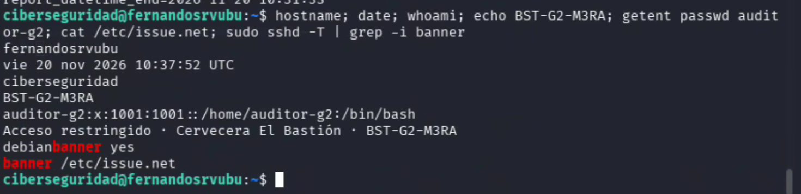

#### E-00b · Marcas del equipo en SRV-WIN

```
hostname; Get-Date; whoami; echo BST-G2-M3RA; Get-LocalUser auditor-g2 | Select Name,FullName; Get-ItemProperty "HKLM:\SOFTWARE\Microsoft\Windows\CurrentVersion\Policies\System" | Select legalnoticecaption,legalnoticetext
```

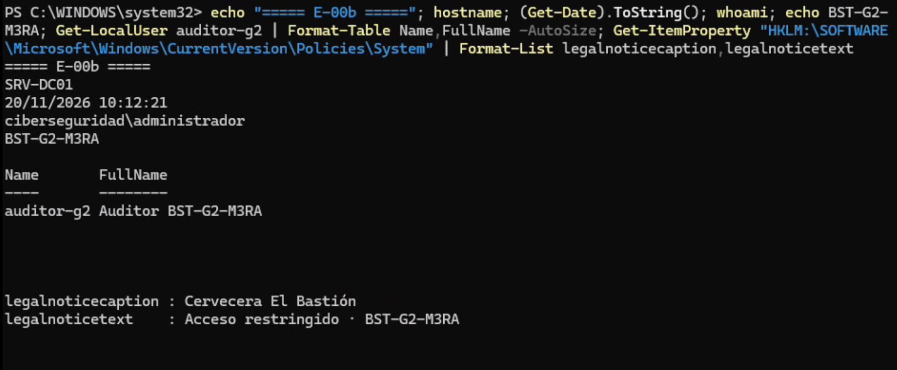

#### E-01 y E-02 · Puertos expuestos y cortafuegos de host, antes (obligatorios)

```
Bloque con separadores: echo "===== E-0X ====="; hostname; date; whoami; echo BST-G2-M3RA; <comando de cada evidencia>
```

*Captura original sin recortar. Arriba se ven los seis comandos lanzados; debajo, los resultados de E-01 y E-02.*

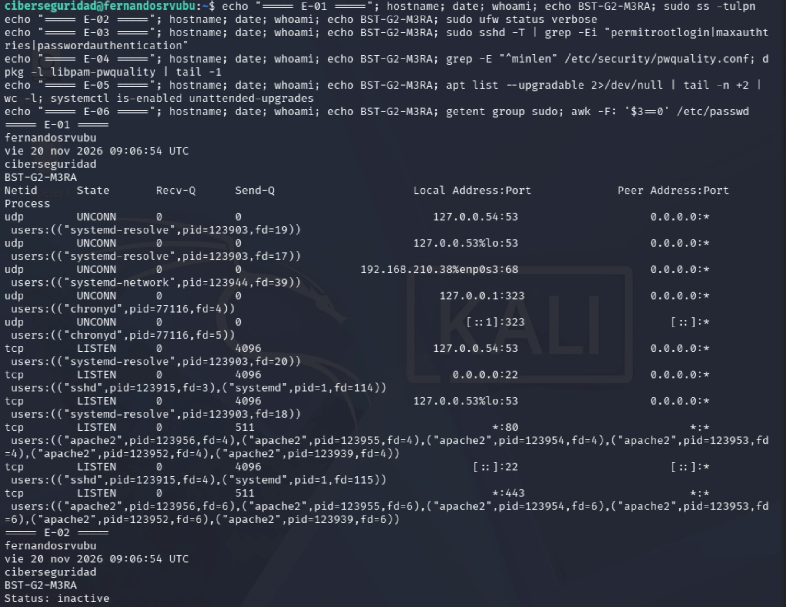

#### E-03 a E-06 · SSH, contraseñas, parches y cuentas con privilegios, antes

```
Continuación del mismo bloque (los comandos se ven en la captura anterior)
```

*Captura original sin recortar, tomada a continuación de la anterior en la misma sesión.*

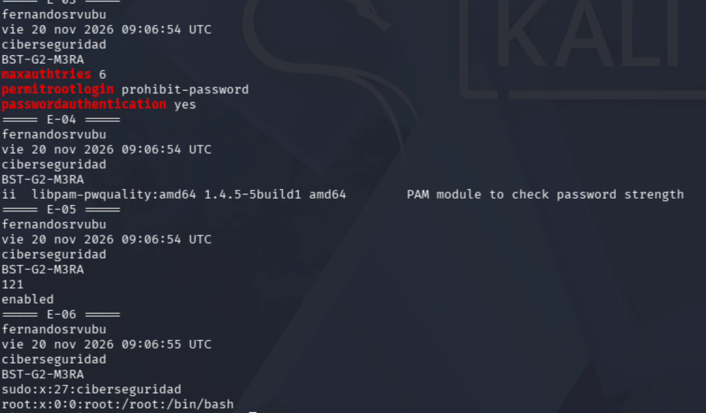

#### E-02b · Cortafuegos de host, después de IT-BST-01

```
hostname; date; whoami; echo BST-G2-M3RA; sudo ufw status verbose
```

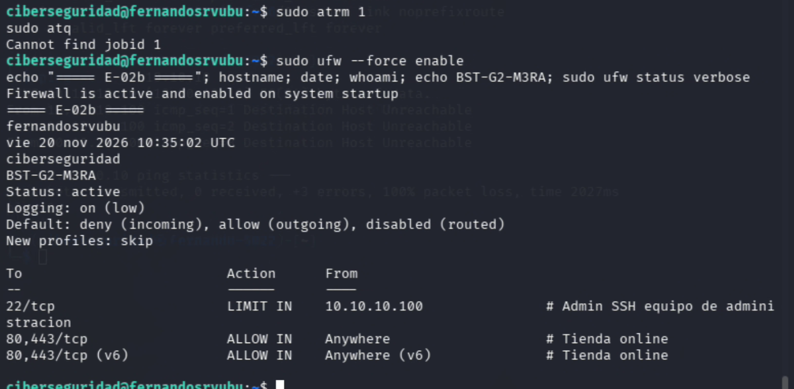

#### E-03b y E-04b · SSH y contraseñas, después

```
Aplicación de los cambios y verificación en el mismo bloque
```

*Captura original: arriba los comandos que aplican MaxAuthTries 4, PermitRootLogin no y minlen 16; debajo, la verificación.*

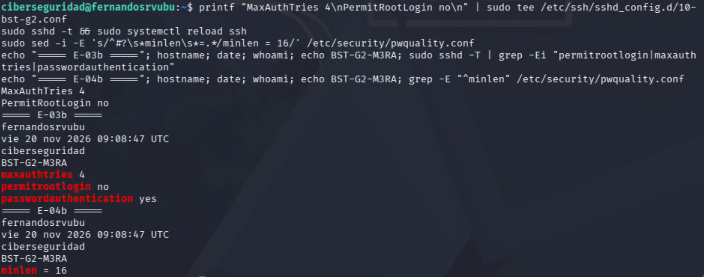

#### E-02c · Prueba de IT-BST-01: SSH denegado desde un equipo que no administra (Fermentador, W11_IoT)

```
hostname; Get-Date; whoami; echo BST-G2-M3RA; Test-NetConnection 10.10.10.10 -Port 22; Test-NetConnection 10.10.10.10 -Port 443
```

*El puerto 22 debe dar False y el 443 True: solo se cierra la administración, la web sigue funcionando.*

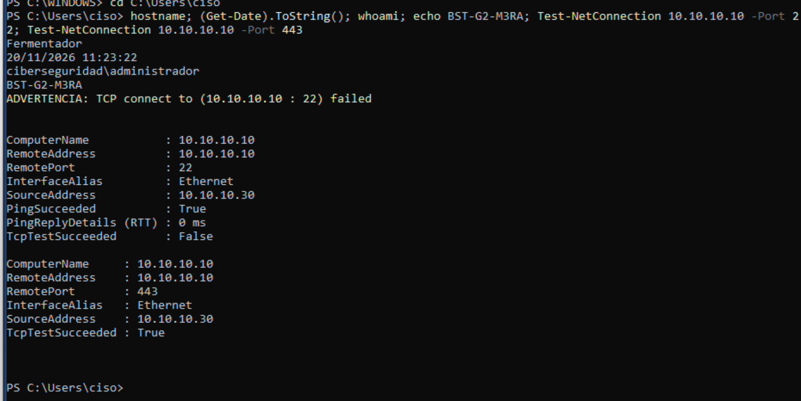

#### E-07 · Índice Lynis, antes

```
sudo lynis audit system --quick   (esperar a que termine; sin captura)
hostname; date; whoami; echo BST-G2-M3RA; sudo grep hardening_index /var/log/lynis-report.dat
```

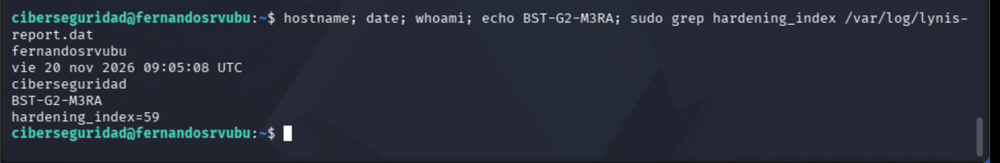

#### E-07b · Índice Lynis, después de las victorias rápidas (con ufw activo)

```
sudo lynis audit system --quick   (esperar a que termine; sin captura)
hostname; date; whoami; echo BST-G2-M3RA; sudo grep -E "hardening_index|report_datetime_end" /var/log/lynis-report.dat
```

*La hora de fin del informe (10:44:50 UTC) es posterior a la activación de ufw (E-02b, 10:35 UTC).*

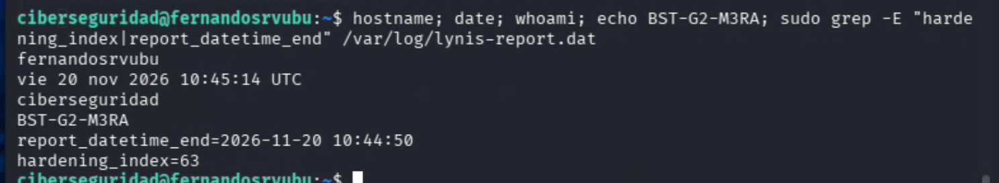

#### E-08 · Perfiles del cortafuegos de Windows (obligatorio)

```
hostname; Get-Date; whoami; echo BST-G2-M3RA; Get-NetFirewallProfile | Select Name,Enabled,DefaultInboundAction
```

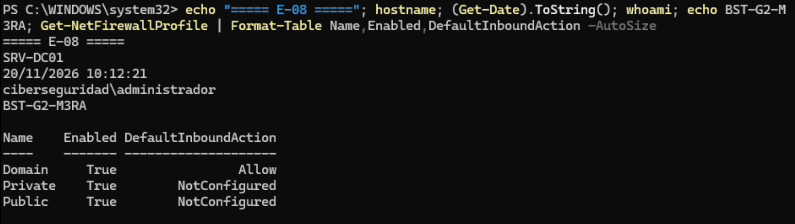

#### E-09 · Contraseñas y bloqueo, antes

```
hostname; Get-Date; whoami; echo BST-G2-M3RA; net accounts
```

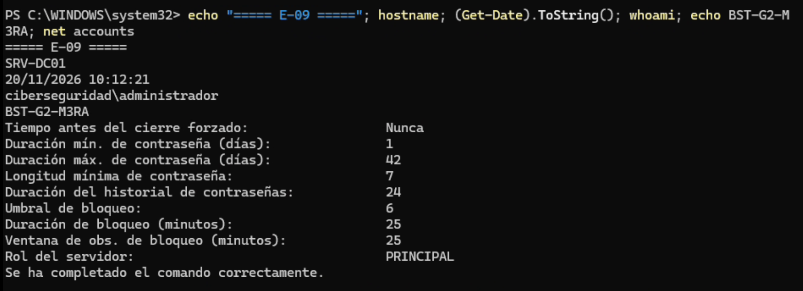

#### E-09b-1 · Contraseñas y bloqueo justo después de aplicar la línea base

```
hostname; Get-Date; whoami; echo BST-G2-M3RA; net accounts
```

*La línea base de OSConfig cambia el bloqueo a 3 intentos y 15 minutos.*

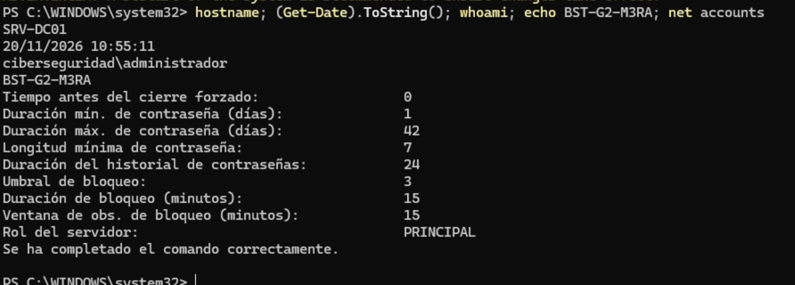

#### E-09b · Contraseñas y bloqueo, después (6 intentos · 25 min)

```
net accounts /lockoutthreshold:6 /lockoutwindow:25 /lockoutduration:25
hostname; Get-Date; whoami; echo BST-G2-M3RA; net accounts
```

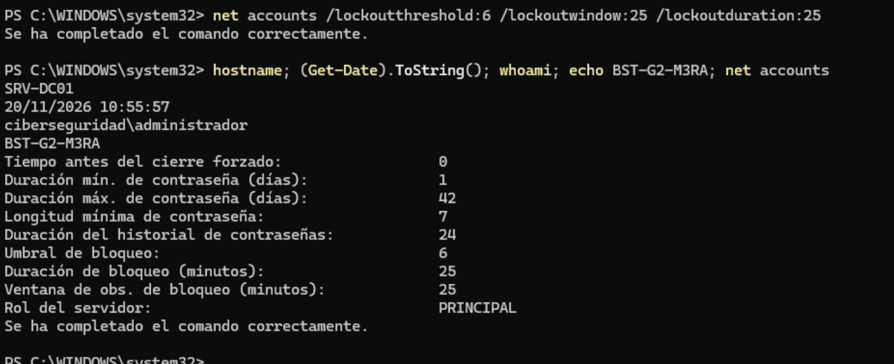

#### E-10 · Cuentas y grupos de administración

```
hostname; Get-Date; whoami; echo BST-G2-M3RA; Get-LocalUser | Format-Table Name,Enabled,PasswordLastSet; Get-ADGroupMember -Identity S-1-5-32-544 | Format-Table Name,objectClass; Get-ADGroupMember -Identity "$((Get-ADDomain).DomainSID)-512" | Format-Table Name,objectClass
```

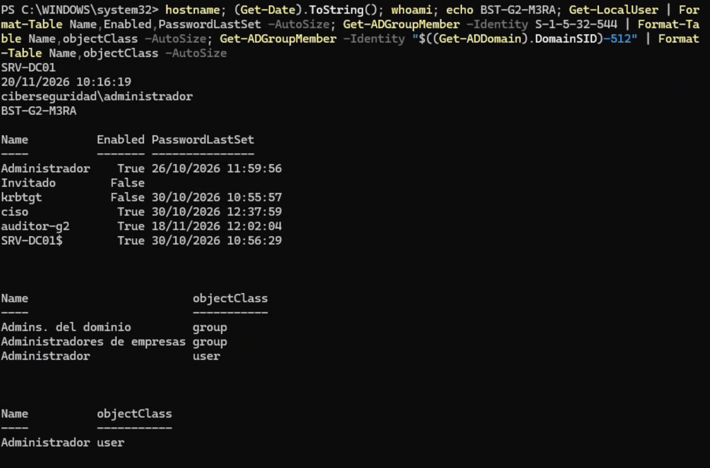

#### E-11 y E-12 · Auditoría de inicios de sesión y configuración de SMB

```
hostname; Get-Date; whoami; echo BST-G2-M3RA; auditpol /get /subcategory:"{0CCE9215-69AE-11D9-BED3-505054503030}"  ·  Get-SmbServerConfiguration | Format-List EnableSMB1Protocol,RequireSecuritySignature,EncryptData
```

*Captura original sin recortar con las dos evidencias seguidas.*

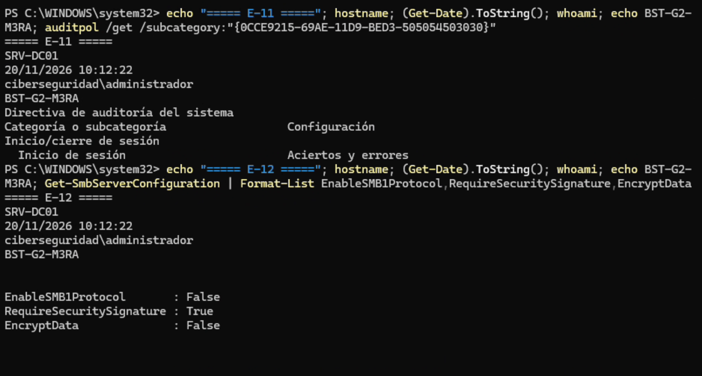

#### E-13 · Permisos de la carpeta de recetas

```
hostname; Get-Date; whoami; echo BST-G2-M3RA; Get-SmbShareAccess -Name Recetas; (Get-Acl C:\Datos\Recetas).Access | Select IdentityReference,FileSystemRights
```

*Carpeta creada en el laboratorio para reproducir el escenario del R5 (diapositiva 18): New-Item, New-SmbShare -FullAccess Todos e icacls con control total para Todos.*

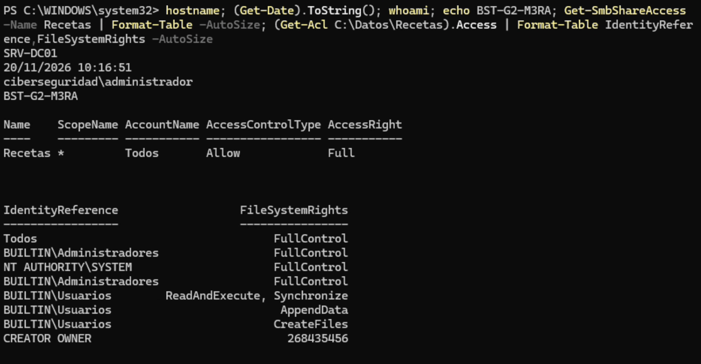

#### E-14 · Línea base OSConfig, antes

```
hostname; Get-Date; whoami; echo BST-G2-M3RA; $r = Get-OSConfigDesiredConfiguration -Scenario SecurityBaseline/WindowsServer/2025/DomainController; [math]::Round((($r | ? {$_.Compliance.Status -eq 'Compliant'}).Count / $r.Count) * 100)
```

*Medición tras restaurar la instantánea «antes OSConfig», sin la línea base aplicada.*

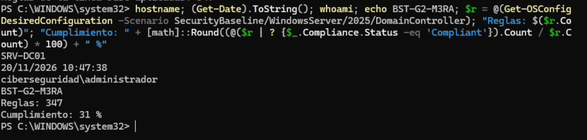

#### E-14b · Línea base OSConfig, después

```
hostname; Get-Date; whoami; echo BST-G2-M3RA; (mismo comando que E-14)
```

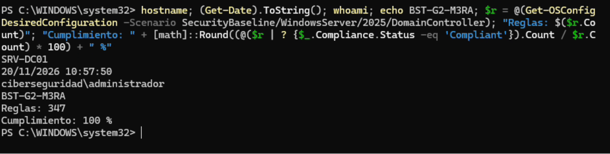

## Anexo B · Test del recién llegado (IT-BST-01)

> **Pendiente.** Una persona de otro equipo ejecutará la instrucción IT-BST-01 (apartado 4.6) en SRV-UBU sin nuestra ayuda. Aquí se anotarán quién la ejecutó, la fecha, el tiempo empleado, si terminó sin ayuda, las dudas que tuvo y qué cambiamos en la instrucción, con su captura (E-B1).

## Anexo C · Indicadores, dependencias y fichas completas

| ID | Indicador y meta | Depende de | Criterio circular |
|---|---|---|---|
| M01 | Restauraciones de prueba correctas: 12 de 12 al año | — | Sí: reutiliza un PC retirado (criterio obligatorio) |
| M02 | Prueba de segmentación superada: desde la wifi de clientes no se alcanza ninguna IP interna (anual y tras cada cambio) | Compra del cortafuegos y el switch | No |
| M03 | Cuentas compartidas con privilegios: 0 | — | No |
| M04 | Lynis: +10 puntos sobre E-07 · OSConfig ≥ 90 % · parches con más de 30 días: 0 | — | Sí: alarga la vida de los servidores actuales |
| M05 | Usuarios compartidos en el TPV: 0 · revisión del datáfono anotada cada día de apertura | M02 para la VLAN definitiva del TPV | No |
| M06 | Sensores con clave de fábrica: 0 | M02 para la VLAN | Sí: se actualizan en lugar de sustituirlos |
| M07 | Carpetas sensibles con «Todos»: 0 | M09 para revisar los accesos | No |
| M08 | Prueba de corte eléctrico trimestral superada | — | No |
| M09 | Alertas revisadas en menos de 24 h laborables | M02 y M04 | Sí: reutiliza un segundo PC retirado |
| M10 | Disponibilidad mensual de la tienda ≥ 99,5 % | Contrato con el proveedor | No |

### Fichas completas de M05 y M01

|  |  |
|---|---|
| Identificador y nombre | M05 · Bar seguro |
| Riesgos que trata | R8 (20, crítico); ayuda a R1 y R2 al cerrar un camino hacia la red interna |
| Activos | TPV del bar, datáfono, wifi de clientes, pantallas de la carta, datos de tarjetas |
| Situación actual (evidencia) | TPV y wifi en la red de la empresa; servicios de SRV-UBU visibles desde cualquier punto (E-01); un usuario del TPV para todos los camareros |
| Descripción | 1) El datáfono pasa a conectarse por 4G propio, sin tocar la red de la empresa, y debe estar certificado. 2) Cada camarero tiene su usuario en el TPV. 3) La wifi de clientes se separa en su propia red, solo con salida a Internet. 4) Al abrir el bar, el encargado revisa que el datáfono no tiene nada pegado ni manipulado y lo anota. 5) Formación de 30 minutos: qué hacer si el TPV va raro o un cliente avisa de un cargo extraño. |
| Tipo | Preventiva (con una parte de concienciación) |
| Responsable y plazo | Encargado del bar e informática · 30 días (usuarios, wifi, formación) y 60 días (datáfono 4G) |
| Coste y recursos | 1.100 €: diferencia de alquiler del datáfono 4G (360 €), configuración del TPV (300 €), formación (240 €) y escaneo externo si el banco lo pide (200 €). El importe del datáfono se confirmará con el banco. |
| Dependencias | M02 para la VLAN definitiva del TPV. Mientras tanto, la wifi de clientes se aísla en el punto de acceso actual, si lo permite; si no, se hace con M02. |
| Indicador y meta | Usuarios compartidos en el TPV: 0 · revisiones del datáfono anotadas: 100 % de los días de apertura |
| Relación con PCI DSS | Reduce el alcance: si el datáfono va por 4G y el TPV no ve datos de tarjeta, el TPV y la red de la empresa salen del entorno de tarjetas (apartado 4.2). |
| Riesgo residual esperado | R8 baja de 20 a 6 (medio) |

|  |  |
|---|---|
| Identificador y nombre | M01 · Copias 3-2-1 con un PC reutilizado |
| Riesgos que trata | R1 (20, crítico) |
| Activos | NAS de copias, SRV-UBU (tienda), SRV-WIN (ficheros y recetas) |
| Situación actual (evidencia) | Las copias están en un NAS de la red plana; un ransomware que cifre SRV-WIN las alcanza también. Nunca se ha probado una restauración. |
| Descripción | Tres copias en dos soportes y una fuera: 1) el NAS actual; 2) un PC de oficina retirado, con discos cifrados, que se enciende y conecta solo durante la ventana de copia nocturna; 3) una copia inmutable en la nube que no se puede borrar durante 30 días. El primer lunes de cada mes se restaura un archivo y una carpeta completa en el laboratorio. |
| Tipo | Preventiva y de recuperación |
| Responsable y plazo | Responsable de informática · 30 días |
| Coste y recursos | 1.200 €: almacenamiento inmutable en la nube (720 €/año), dos discos para el PC (300 €) y configuración (180 €) |
| Dependencias | Ninguna para empezar. M02 pondrá el PC de copias en la VLAN de gestión. |
| Indicador y meta | Restauraciones de prueba correctas: 12 de 12 al año |
| Criterio circular | Cumple el criterio obligatorio del enunciado: da una segunda vida a un PC que El Bastión ya tiene. |
| Riesgo residual esperado | R1 baja de 20 a 6 (medio) |

## Anexo D · Declaración de autoría y contribución

Declaramos que este plan es trabajo original del equipo BST-G2, que las evidencias se han obtenido en nuestro laboratorio con el código testigo del equipo y que conocemos todas las partes del documento.

| Miembro | Contribución principal | Firma |
|---|---|---|
| Luis Fernando Arrosquipa Mamani | Laboratorio y evidencias (entregable 2), instrucción IT-BST-01 y protocolo de incidencias (entregable 5) |  |
| Marcos Olmo García | Riesgo R8, plan de medidas (entregable 3) y marco de referencia (entregable 4) |  |

#### Uso de inteligencia artificial

Hemos usado Claude (Anthropic) como apoyo para estructurar el documento, redactar borradores, preparar los comandos del laboratorio y revisar la redacción. Las evidencias se obtuvieron en nuestro laboratorio y todas las decisiones y valoraciones las hemos revisado y comprobado nosotros.

**Fecha:** 20/11/2026
